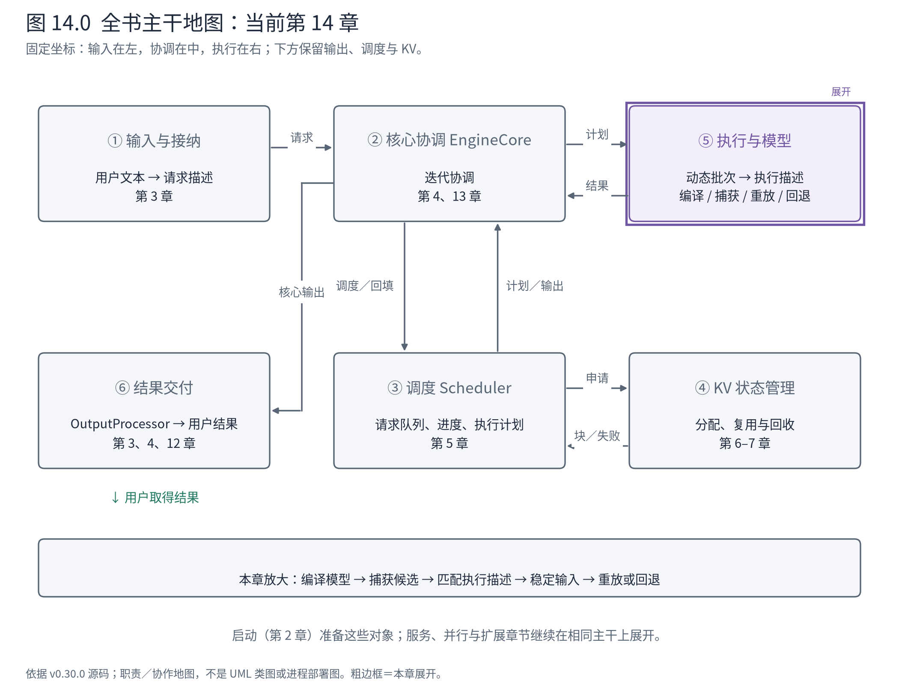
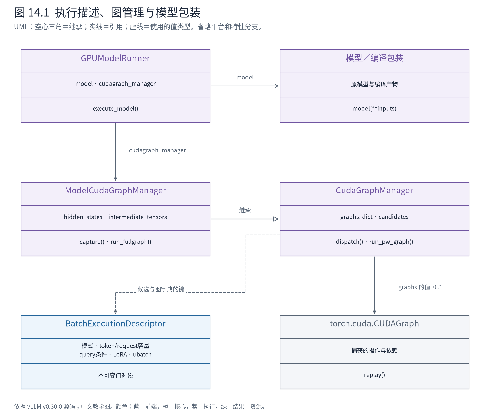
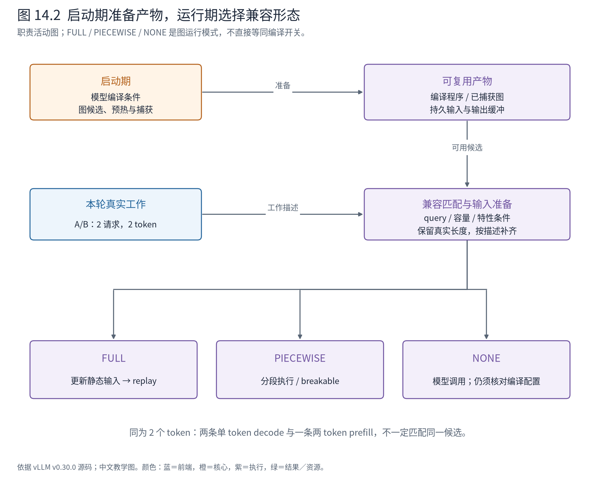

# 第 14 章 稳定执行形态：编译、图捕获与动态请求

第 13 章通过重叠工作减少等待，但 CPU 仍可能为每轮模型计算重复组织和发射许多操作。尤其在短 decode 中，实际张量计算很短，重复的框架与发射开销就更显眼。

本章打开两类相互配合的优化：编译把模型运算转换为更适合执行的计算程序；设备图捕获并重放一组操作，减少逐次发射的开销。我们关心它们如何接入 Runner，而不是把所有编译器内部算法再写成一册书。



**先在地图上定位。** 仍在⑤，Scheduler 交出的 token 计划不变，变化的是 Runner 如何将当轮输入交给模型执行。启动期准备的产物在运行期复用，因此本章同时回扣第 2 章的预热与就绪。

## 14.1 两种“图”解决不同问题

TorchDynamo 等编译前端捕获的是张量运算表示，后端可以对它做融合、变换并生成代码。CUDA Graph 捕获的是可重放的设备工作组织，重点是减少反复经过 CPU 发射操作的成本。两个机制都出现“图”字，但对象与生命周期不同。

一个模型可以经过编译后仍逐次执行，也可以在满足条件时将执行过程捕获为 CUDA Graph。vLLM 官方编译文章将优化逻辑与模型定义分开作为重要方向；图执行设计又试图减少捕获策略与编译策略之间不必要的绑定。这里引用的是设计背景，具体类名与运行分支仍以下文 v0.30.0 源码为准。[官方编译讲解](https://vllm.ai/blog/2025-08-20-torch-compile)、[官方图执行设计](https://docs.vllm.ai/en/v0.30.0/design/cuda_graphs/)

因此，配置或日志中的 `CUDAGraphMode.NONE` 只表示这轮没有使用 CUDA Graph，不能单凭它断言模型完全没有编译包装。本书基础 NPU 案例显式使用 eager 作为观察配置；这份记录没有测量图执行收益。

## 14.2 模型声明动态轴，编译层负责处理程序

第 10 章的 Qwen3Model 继承模型骨架，其中有编译支持声明：

<!-- book:ch14-compile:start -->
源码教学注释版，vllm v0.30.0：[原文件 L313–L323](https://github.com/vllm-project/vllm/blob/ced6857afa0ea7b2e3f0846a62e1394e90f15607/vllm/model_executor/models/qwen2.py#L313-L323)。仅新增 `# 【解读】`，其他内容保留原文。

```python
# 【解读】Qwen3复用的模型骨架声明可参与编译；装饰器支持不等于本次运行已启用。
@support_torch_compile(
    dynamic_arg_dims={
        # 【解读】input_ids的第0轴是随当轮工作量变化的token轴。
        "input_ids": {0: "b"},
        # positions is of shape (3, seq_len) if mrope is enabled for qwen2-vl,
        # otherwise (seq_len, ).
        # 【解读】positions按最后一轴声明动态；普通文本是一维，多轴位置有不同布局。
        "positions": {-1: "b"},
        # 【解读】PP中间张量与直接embedding输入也声明对应动态轴。
        "intermediate_tensors": {0: "b"},
        "inputs_embeds": {0: "b"},
    }
)
class Qwen2Model(nn.Module, EagleModelMixin):
```
<!-- book:ch14-compile:end -->

首轮 input_ids 形状 `[11]`，下一轮 `[2]`，变化发生在 token 轴。模型 hidden size、权重形状与大部分运算结构没有因此变化。动态轴声明让编译系统知道哪些输入尺寸应被当作变化条件；它不是放弃所有约束，更不是允许任意 dtype、设备或布局混用同一产物。

`support_torch_compile` 装饰器与包装层建立编译接入，VllmBackend 对得到的图做配置、分割与后端处理。源码允许由 Inductor 决定分区，也允许先按 splitting_ops 在 FX 图层分割。Attention 这类具有专门后端与状态依赖的操作，是理解边界的代表：不能为了把一张图做大，就忽略第 11 章的 KV 更新顺序和布局契约。

编译产物缓存也不是“模型名相同即可复用”。配置、相关代码和编译条件都可能改变生成程序。官方文档列出了这些缓存因素；阅读缓存目录时，应把它看作特定执行条件下的产物，而不是 checkpoint 的另一份副本。

本章采用如下源码导航树区分准备期与运行期：

```text
准备期
├─ 模型类的 support_torch_compile 声明
├─ 编译包装 → VllmBackend → 分区 / 后端编译 / 缓存
└─ ModelCudaGraphManager.capture
   ├─ 准备捕获形态与持久输入
   ├─ 预热适用路径
   └─ 保存已捕获图与输出存储

运行期：GPUModelRunner.execute_model
├─ graph manager.dispatch → BatchExecutionDescriptor
├─ 按描述准备 / 补齐输入与元数据
├─ FULL → run_fullgraph → replay
├─ PIECEWISE → run_pw_graph
└─ NONE → model(**model_inputs)
```

这是两段生命周期的源码概括，不是一个连续调用栈。最后的模型调用是否经过编译包装，还取决于有效配置与所选模型路径。

## 14.3 一个执行描述封装什么兼容条件

动态请求不能直接“塞进任意一张已经捕获的图”。本版 MRV2 用 BatchExecutionDescriptor 表达候选形态：

<!-- book:ch14-desc:start -->
源码教学注释版，vllm v0.30.0：[原文件 L63–L76](https://github.com/vllm-project/vllm/blob/ced6857afa0ea7b2e3f0846a62e1394e90f15607/vllm/v1/worker/gpu/cudagraph_utils.py#L63-L76)。仅新增 `# 【解读】`，其他内容保留原文。

```python
class BatchExecutionDescriptor:
    """Describes the shape of the batch and CG mode to run; this is used to make shape
    matches between the capture and runtime."""

    # 【解读】运行描述同时约束模式与补齐后的尺寸，不能只用batch size做键。
    cg_mode: CUDAGraphMode
    num_tokens: int
    # 【解读】某些路径不要求按请求数补齐，因此允许None。
    num_reqs: int | None  # None means no request padding is needed (PIECEWISE graphs)
    # 【解读】每请求一致的query长度、最大query长度用于区分执行兼容性。
    uniform_token_count: int | None = None
    # Upper bound on per-request query length. Varlen decode graphs leave
    # uniform_token_count unset, so this is what keeps a prefill batch out of one.
    max_query_len: int | None = None
    # 【解读】LoRA与微批次分割也进入匹配契约；形状相同不保证可互换。
    num_active_loras: int = 0
    # Number of microbatches the batch is split into (DBO). 1 means no splitting.
    num_ubatches: int = 1
```
<!-- book:ch14-desc:end -->

其中 num_tokens 可以是补齐后的工作量，num_reqs 可以表示需要的请求补齐规模。uniform_token_count 描述统一的每请求 query 数；max_query_len 限制可接受的 query 长度。LoRA 数量和微批次分割也进入兼容判断，因为它们可能改变执行组织。



**图 14.1 怎样读。** Runner 持有 ModelCudaGraphManager；后者继承通用 CudaGraphManager，并管理模型相关的隐藏状态输出。通用 Manager 持有按执行描述索引的图。描述是不可变值对象，用来表达匹配条件；它不是某条用户请求的生命周期对象。编译包装位于模型调用路径，不能把它画成 Scheduler 的父类。

这个区别让图管理可以单独演进：调度器仍决定实际工作，图管理器选择能够承接工作的一种执行形态。代价是两者之间需要输入补齐、有效长度和元数据解释保持一致。图中的“4 个 token 容量”不意味着系统生成了额外两份用户结果。

## 14.4 看见一次兼容判断，而不是猜测选中了什么

运行时分派先看是否捕获过、是否存在候选，再逐个核对兼容条件；没有匹配就返回 NONE：

<!-- book:ch14-dispatch:start -->
源码教学注释版，vllm v0.30.0：[原文件 L507–L527](https://github.com/vllm-project/vllm/blob/ced6857afa0ea7b2e3f0846a62e1394e90f15607/vllm/v1/worker/gpu/cudagraph_utils.py#L507-L527)。仅新增 `# 【解读】`，其他内容保留原文。

```python
        # 【解读】把实际LoRA数映射到预备的有效捕获档位。
        effective_loras = self._resolve_effective_loras(num_active_loras)
        key = (num_tokens, effective_loras)
        # 【解读】只有已经捕获且存在候选时，才逐个检查兼容描述。
        if self._graphs_captured and num_tokens > 0 and key in self._candidates:
            for desc in self._candidates[key]:
                if _is_compatible(
                    desc,
                    num_reqs,
                    num_tokens,
                    uniform_token_count,
                    effective_loras,
                    max_query_len,
                    num_ubatches,
                ):
                    # 【解读】返回匹配描述，后续输入准备按它的补齐要求执行。
                    return desc
        # 【解读】没有可用匹配时返回NONE与真实尺寸，不能勉强使用不兼容图。
        return BatchExecutionDescriptor(
            cg_mode=CUDAGraphMode.NONE,
            num_tokens=num_tokens,
            num_reqs=num_reqs,
            num_active_loras=effective_loras,
            num_ubatches=num_ubatches,
        )
```
<!-- book:ch14-dispatch:end -->

为了把判断变成可见实物，配套 CPU 实验从固定源码提取原始 dataclass 和纯 `_is_compatible` 函数，未改写逻辑。实验手工构造一个 FULL 候选：容纳 4 个 token、4 条请求，每请求 query 长度 1，最大 query 长度也是 1。

<!-- book:ch14-cases:start -->
CPU 执行固定源码纯兼容函数的结果；候选描述手工构造，没有捕获或重放设备图。来自[原始记录](evidence/metadata-contracts/trace.json)。

```json
{
  "graph": {
    "descriptor": {
      "cg_mode": "FULL",
      "num_tokens": 4,
      "num_reqs": 4,
      "uniform_token_count": 1,
      "max_query_len": 1,
      "num_active_loras": 0,
      "num_ubatches": 1
    },
    "cases": {
      "two_decode": {
        "input": {
          "num_reqs": 2,
          "num_tokens": 2,
          "uniform_token_count": 1,
          "num_active_loras": 0,
          "max_query_len": 1,
          "num_ubatches": 1
        },
        "compatible": true
      },
      "one_prefill_two_tokens": {
        "input": {
          "num_reqs": 1,
          "num_tokens": 2,
          "uniform_token_count": null,
          "num_active_loras": 0,
          "max_query_len": 2,
          "num_ubatches": 1
        },
        "compatible": false
      }
    }
  }
}
```
<!-- book:ch14-cases:end -->

A/B 都进入 decode 时，两条请求、两个 token 可以匹配这个候选；但如果同样两个 token 属于一条请求的 prefill，它就不能匹配。token 总数相同，query 组织不同。其余测试还确认：5 个 token 超过容量时失败，LoRA 条件不一致时也失败，详见同一原始记录。

这个实验只执行兼容函数，没有创建 CUDA Graph、没有走完整 Manager.dispatch，也没有证实实际环境预先捕获了这个候选。它说明的是本版兼容契约，不能把构造的候选写成运行日志。

再把情景放回 A/B 主线：首轮各 5、6 个 query，属于非统一的 prefill 形态；第二轮各一个 query，属于统一 decode。分派器可能为两轮选择不同模式，也可能因配置或能力而都退回 NONE。决定来自有效候选集合与本轮元数据，而不是仅仅来自“现在是第二轮”。

## 14.5 重放不接收新参数，输入为什么还能改变

普通 Python 前向调用会显式传 input_ids、positions 等参数。MRV2 的 FULL 路径调用 run_fullgraph 时只传描述，因为本轮输入已经写进图关联的缓冲区。

<!-- book:ch14-replay:start -->
源码教学注释版，vllm v0.30.0：[原文件 L529–L542](https://github.com/vllm-project/vllm/blob/ced6857afa0ea7b2e3f0846a62e1394e90f15607/vllm/v1/worker/gpu/cudagraph_utils.py#L529-L542)。仅新增 `# 【解读】`，其他内容保留原文。

```python
    def run_fullgraph(self, desc: BatchExecutionDescriptor):
        """Replay a captured FULL cudagraph."""
        # 【解读】FULL重放入口要求模式一致，且字典中实际存在该图。
        assert desc.cg_mode == CUDAGraphMode.FULL, (
            f"Expected FULL mode, got {desc.cg_mode}"
        )
        assert desc in self.graphs, f"No cudagraph for {desc}"
        # Sync offloader before replay - needed when transitioning from
        # eager/piecewise to full cudagraph (e.g., prefill → decode).
        # The previous eager iteration's start_prefetch may have queued
        # H2D copies on copy_stream that the graph's captured events
        # cannot see. Without this, replay could overwrite static buffers
        # while those copies are still in flight.
        # 【解读】先确保旧预取不再与静态缓冲冲突；省掉Python发射不等于省掉同步依赖。
        get_offloader().sync_prev_onload()
        # 【解读】重放已捕获图；输入内容必须已经写入捕获关联的缓冲区。
        self.graphs[desc].replay()
```
<!-- book:ch14-replay:end -->

重放读取的是捕获时关联的地址和执行依赖；每轮可以更新这些存储里的有效内容，但不能随意换成另一个新分配的张量后期待旧图自动读取新地址。第 9 章 InputBuffers 与第 13 章传输槽的生命周期，因而直接影响图执行正确性。

ModelCudaGraphManager 在重放后从保存的 hidden_states 或 PP 中间张量中取对应范围，继续交给 Runner。输出也有存储生命周期；不能让另一次重放覆盖尚未消费的结果。



**图 14.2 怎样读。** 启动期准备候选和捕获产物；运行期将真实工作映射到兼容描述，更新持久输入，再选择 FULL、PIECEWISE 或 NONE。沿 A/B 第二轮看，真实工作量是 2，即使某候选容量更大，模型输入和元数据也必须区分有效范围与补齐范围，结果交付只认真实请求。

上面源码还在 replay 前调用 offloader 的同步接口。原因是先前普通执行路径发起的预取可能仍在使用静态缓冲，捕获图内部的事件未必覆盖这份图外工作。减少重复发射不能删除数据依赖；这与第 11 章 KV 写入依赖的原则相同。

## 14.6 分段与回退保留了哪些边界

完整捕获对路径稳定性要求较高。某个后端或特性不支持时，可以在允许的条件下分段，让适合的区域复用图，其他操作仍按各自接口执行。本版本 MRV2 的分段入口还有两种实现选择：

<!-- book:ch14-pw:start -->
源码教学注释版，vllm v0.30.0：[原文件 L550–L555](https://github.com/vllm-project/vllm/blob/ced6857afa0ea7b2e3f0846a62e1394e90f15607/vllm/v1/worker/gpu/cudagraph_utils.py#L550-L555)。仅新增 `# 【解读】`，其他内容保留原文。

```python
    def run_pw_graph(self, model: nn.Module, model_inputs: dict[str, Any]) -> Any:
        # 【解读】默认piecewise路径通过模型调用进入已编译的分段图。
        if not self.use_breakable_cg:
            # Default: Use torch-compiled piecewise cudagraph.
            return model(**model_inputs)
        # 【解读】启用breakable路径时使用专门包装器，说明分段图不应一概等同torch.compile。
        assert self.breakable_cg_runner is not None
        return self.breakable_cg_runner(**model_inputs)
```
<!-- book:ch14-pw:end -->

默认调用进入编译后的 piecewise 路径，启用 breakable 配置则使用相应包装器。因此阅读旧设计文章时，不能把“分段图必须依赖同一种编译分割”当成永远不变的事实。本文以本版源码标出分支，具体平台支持在第 19 章核对。

收益与代价也必须一起看。图重用减少运行期组织开销，却需要启动期捕获、额外存储和候选管理；更细的形态覆盖可以少做补齐，也可能增加捕获数量和内存占用；动态请求、LoRA、投机和微批次越多，兼容条件越复杂。错误地扩大匹配范围会破坏正确性，过于保守则减少优化机会。

对于本机 Ascend，CUDA Graph 源码是上游设计阅读对象，NPU 对应图机制不能仅凭同名类或接口宣称完全等价。本章既有 NPU 记录只证明 eager 路径与张量边界，CPU 实验只证明匹配函数；没有给出未执行的图模式性能数字。

至此，单设备核心闭环的职责、状态与执行优化已经连起来。下一章回到左侧入口，把生成器、请求输出队列和取消接到在线服务，观察同一个核心怎样面对彼此独立的用户会话。

**源码停点：** [MRV2 图管理](https://github.com/vllm-project/vllm/blob/ced6857afa0ea7b2e3f0846a62e1394e90f15607/vllm/v1/worker/gpu/cudagraph_utils.py#L63-L210)先读描述和持有关系；[运行分支](https://github.com/vllm-project/vllm/blob/ced6857afa0ea7b2e3f0846a62e1394e90f15607/vllm/v1/worker/gpu/model_runner.py#L1900-L1948)对齐三种模式；[编译分区](https://github.com/vllm-project/vllm/blob/ced6857afa0ea7b2e3f0846a62e1394e90f15607/vllm/compilation/backends.py#L1166-L1192)看运算图如何进入分割。无需在本章穷尽所有 compiler pass。
