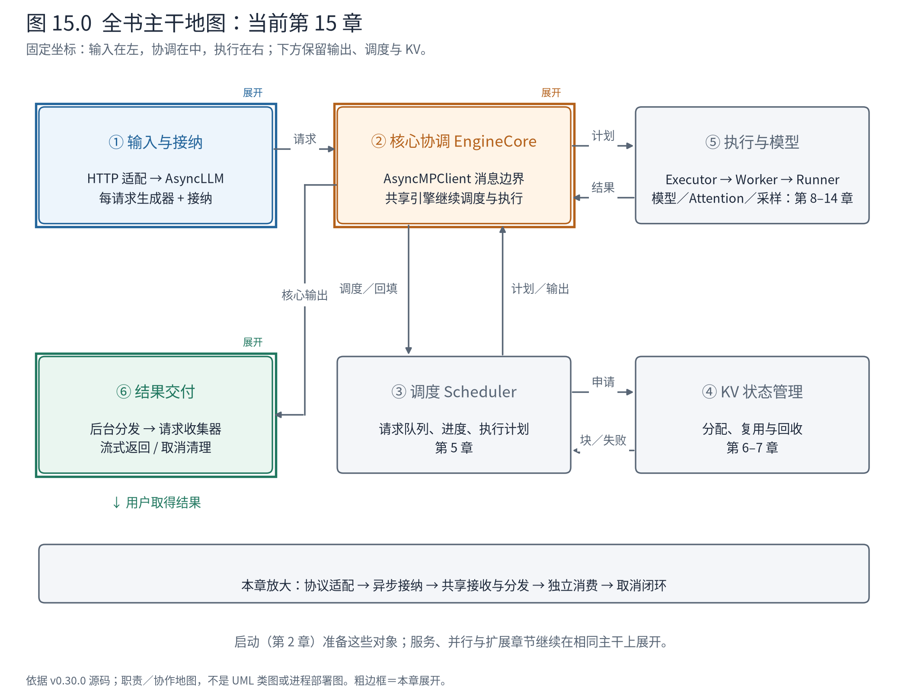
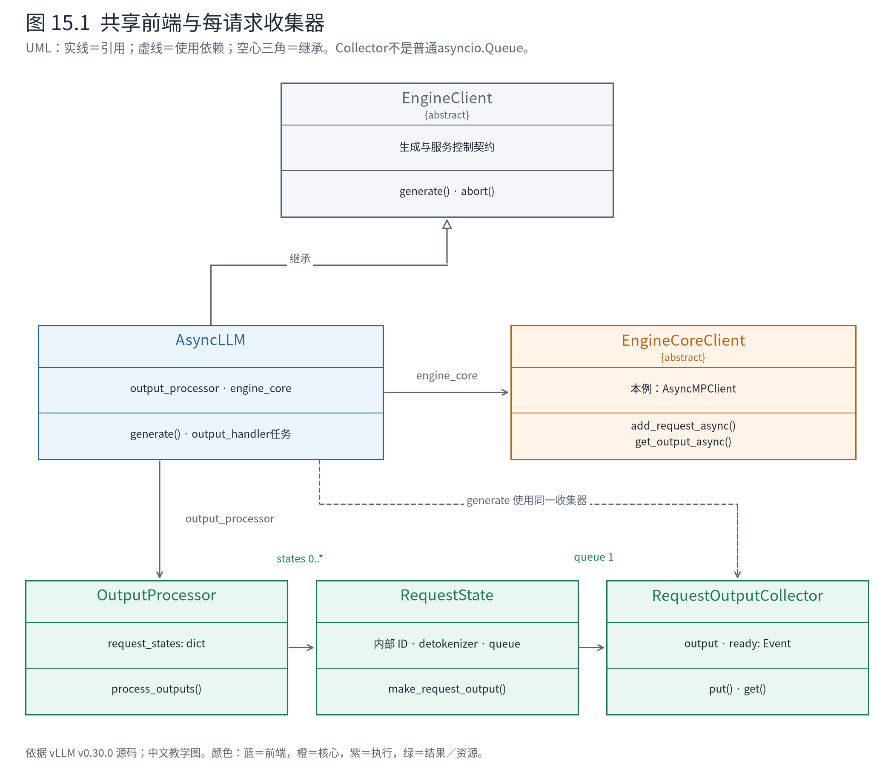
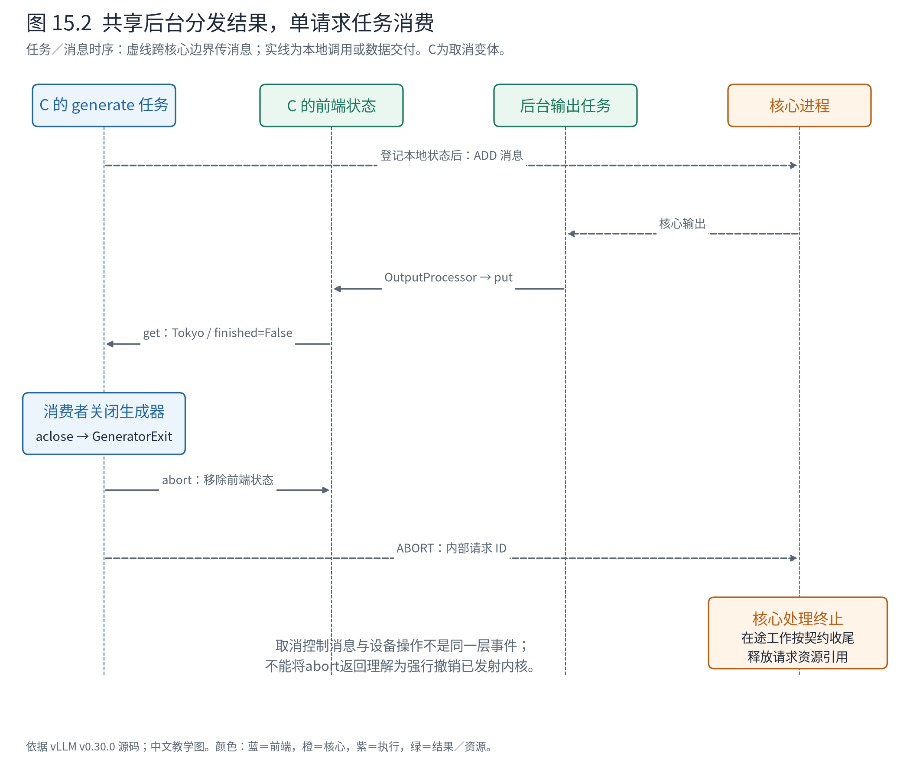

# 第 15 章 在线服务：把共享计算接到独立会话

前面的 A/B 由一个程序提交，程序负责接收结果。在线场景里，A 与 B 可能来自不同连接，用户希望边生成边看到文本，也可能在中途离开。系统不能让每条 HTTP 请求各自创建一套调度器和模型，更不能让一个用户的等待阻止其他请求被处理。

本章在已经理解的核心外围增加服务层：协议适配、异步请求任务、共享输出分发，以及贯穿前端和核心的取消。模型、调度与 KV 主干仍然复用前面的实现。



**先在地图上定位。** 重点回到①和⑥，②通过异步核心客户端连接它们。图中的进程消息不等于 Python 函数直接调用；本章会把每请求任务、后台输出任务与核心进程分开看。

## 15.1 HTTP 处理器不是生成引擎

以文本 Completion 接口为例，路由层接收请求并取得 OpenAIServingCompletion；服务对象处理模型选择、参数与输入，调用 engine_client.generate，取得异步结果生成器。若用户选择流式输出，服务层把结果转换为协议响应块，路由层用 StreamingResponse 发送 `text/event-stream`。

这里每一层都有具体边界。请求协议关心 model、prompt、stream 等外部字段；AsyncLLM 关心如何登记计算请求并交付 RequestOutput；EngineCore 关心调度、执行与资源。SSE 的 `data: ...` 包装发生在服务层，模型没有生成 HTTP 消息，Scheduler 也无需知道浏览器如何显示它。

源码导航可整理成三段：

```text
HTTP 接入任务
└─ completion.api_router.create_completion
   └─ OpenAIServingCompletion.create_completion
      ├─ 准备输入和采样参数
      ├─ engine_client.generate → AsyncLLM 生成器
      └─ 流式：completion_stream_generator → SSE 响应块

请求生成任务：AsyncLLM.generate
├─ add_request → 本地登记 + 核心客户端 ADD 消息
└─ 消费本请求 RequestOutputCollector → yield RequestOutput

共享后台任务：AsyncLLM.output_handler
├─ core_client.get_output_async ← 核心输出消息
└─ OutputProcessor.process_outputs → 各请求 Collector
```

这个表示特意将后台任务另起一段。HTTP 调用链中的 generate 不会同步调用后台 output_handler 来取下一 token；它们通过收集器协作。核心内部的 schedule→execute→update 仍沿前面章节的闭环运行。

## 15.2 一个 AsyncLLM，多个请求消费者



**图 15.1 怎样读。** AsyncLLM 实现 EngineClient 契约，并引用 OutputProcessor 与 EngineCoreClient。OutputProcessor 按内部 ID 保存输出侧 RequestState，每个在线状态引用相应 RequestOutputCollector。generate 使用同一个收集器等待结果。实线表示持有关系，虚线表示使用依赖，空心三角表示继承；它们不是进程边界。

AsyncLLM 把共享核心与独立消费者接在一起。它不为每条请求复制一个模型，后台输出处理也不为每条请求建立一个核心接收循环。共享接收者拿到一批核心结果后按 ID 分发；每请求生成器只等待自己的结果。

这种结构降低了重复接收与重复初始化成本，也清楚表达了会话之间的隔离。代价是需要维护可靠的身份映射，并把异常传播给所有受影响的消费者。后台任务若失败，不能只记录日志后留下永远等待的 generate；OutputProcessor 的 propagate_error 会向各收集器交付异常。

请求登记仍遵循第 3 章的顺序，但这里“第一次 await 在哪里”成为并发正确性的关键：

<!-- book:ch15-register:start -->
源码教学注释版，vllm v0.30.0：[原文件 L515–L524](https://github.com/vllm-project/vllm/blob/ced6857afa0ea7b2e3f0846a62e1394e90f15607/vllm/v1/engine/async_llm.py#L515-L524)。仅新增 `# 【解读】`，其他内容保留原文。

```python
        # 【解读】新请求先通过接纳检查，避免超过前端允许的资源约束。
        if parent_req is None and not self.output_processor.has_request(
            request.request_id
        ):
            self.check_admission(request_id=request.request_id)

        # Register locally before the first await so concurrent tasks see this request.
        # 【解读】在首次await之前建立输出侧状态，使并发任务能立即看见本地登记。
        self.output_processor.add_request(request, prompt, parent_req, index, queue)

        # Add the EngineCoreRequest to EngineCore (separate process).
        # 【解读】再异步发送核心请求；此await不代表等待整段生成完成。
        await self.engine_core.add_request_async(request)
```
<!-- book:ch15-register:end -->

本地登记先于可能让出控制权的异步发送。否则其他任务有机会在请求已经进入核心、但前端尚未建立输出状态时运行，破坏接纳与交付之间的配合。asyncio 的并发并不是任意语句之间抢占，明确 await 边界才能分析哪一段状态更新保持连续。

## 15.3 异步生成器等待什么

generate 登记请求后，并不循环调用 EngineCore.step。它消费收集器：

<!-- book:ch15-yield:start -->
源码教学注释版，vllm v0.30.0：[原文件 L700–L713](https://github.com/vllm-project/vllm/blob/ced6857afa0ea7b2e3f0846a62e1394e90f15607/vllm/v1/engine/async_llm.py#L700-L713)。仅新增 `# 【解读】`，其他内容保留原文。

```python
            # The output_handler task pushes items into the queue.
            # This task pulls from the queue and yields to caller.
            # 【解读】这个循环只消费该请求的结果，不亲自驱动模型前向。
            finished = False
            while not finished:
                # Note: drain queue without await if possible (avoids
                # task switching under load which helps performance).
                # 【解读】有现成结果就立即取，否则挂起当前协程等待；事件循环可处理其他请求。
                out = q.get_nowait() or await q.get()

                # Note: both OutputProcessor and EngineCore handle their
                # own request cleanup based on finished.
                assert isinstance(out, RequestOutput)
                # 【解读】以输出契约中的finished控制生成器结束，不能用文本非空代替。
                finished = out.finished
                if out is not STREAM_FINISHED:
                    # 【解读】交给调用者的仍是RequestOutput，HTTP协议适配在更外层。
                    yield out
```
<!-- book:ch15-yield:end -->

有结果时可以直接取出，没有结果时 await 只挂起当前协程，让事件循环处理其他连接、后台消息或已就绪的请求。用户若需要完整答案，外层可以把这些结果收集完再返回；用户若需要流式交付，外层可以逐块发送。

由此要分开三个问题：调用者是否等待全部生成完成，系统能否同时服务多条请求，返回内容是否分成多个块。这三者并非同一个开关。离线阻塞调用内部也可能有并发；在线非流式响应也可以使用 AsyncLLM；前端异步更不等于核心启用了第 13 章的异步调度。

本章实际 NPU 观测刻意保持核心同步调度，得到有效配置：

<!-- book:ch15-effective:start -->
真实运行字段投影，保留字段名与值，省略无关项。来自[原始记录](evidence/async-frontend/manifest.json)。

```json
{
  "effective": {
    "client": "vllm.v1.engine.core_client.AsyncMPClient",
    "async_scheduling": false,
    "use_v2_model_runner": true
  }
}
```
<!-- book:ch15-effective:end -->

客户端是 AsyncMPClient，核心 async_scheduling 为 false。A-online 与 B-online 通过两个协程并发消费，仍得到与基础案例一致的 token。A 的真实增量块为：

<!-- book:ch15-delta:start -->
真实运行字段投影，保留字段名与值，省略无关项。来自[原始记录](evidence/async-frontend/projection.json)。

```json
{
  "deltas": {
    "A-online": [
      {
        "seq": 1,
        "text": " Paris",
        "token_ids": [
          12095,
          13
        ],
        "finished": false,
        "finish_reason": null
      },
      {
        "seq": 2,
        "text": ".",
        "token_ids": [
          13
        ],
        "finished": true,
        "finish_reason": "length"
      }
    ]
  }
}
```
<!-- book:ch15-delta:end -->

第一块 ` Paris`，第二块句号，最后 finished 为 true。拼接得到第 12 章相同的 ` Paris.`。本实验直接运行 AsyncLLM，没有启动 HTTP 服务，所以这里验证的是引擎异步前端与 NPU 计算，不是网络传输、浏览器或反向代理行为。

## 15.4 一个流式块不必等于一个引擎迭代

类名 RequestOutputCollector 很容易被读成一个普通队列。实际上它只保存当前待消费结果，并可在生产者领先时合并输出：

<!-- book:ch15-merge:start -->
源码教学注释版，vllm v0.30.0：[原文件 L68–L78](https://github.com/vllm-project/vllm/blob/ced6857afa0ea7b2e3f0846a62e1394e90f15607/vllm/v1/engine/output_processor.py#L68-L78)。仅新增 `# 【解读】`，其他内容保留原文。

```python
    def put(self, output: RequestOutput | PoolingRequestOutput | Exception) -> None:
        """Non-blocking put operation."""
        # 【解读】空槽或异常直接设置结果并唤醒消费者。
        if self.output is None or isinstance(output, Exception):
            self.output = output
            self.ready.set()
        # 【解读】如果已有未消费结果，不再无条件堆一条队列节点。
        elif isinstance(self.output, RequestOutput) and isinstance(
            output, RequestOutput
        ):
            # This ensures that request outputs with different request indexes
            # (if n > 1) do not override each other.
            # 【解读】通过RequestOutput.add按候选索引合并；DELTA累加内容，累计模式保留相应最新结果。
            self.output.add(output, aggregate=self.aggregate)
```
<!-- book:ch15-merge:end -->

DELTA 模式下，后来的同候选增量追加到已有结果；累计模式使用相应最新内容。n>1 时还要按候选 index 处理，不能拿一个候选覆盖另一个。合并没有把 A 与 B 混在一起，它发生在单请求收集器内部。

为了看清行为，CPU 实验将上节记录的 A 两个真实增量连续 put 到上游收集器，在两次 put 之间不取结果，然后只 get 一次：

<!-- book:ch15-merge-data:start -->
CPU 收集器实验：重放已保存的真实 A 输出块，连续 put 后才 get；不是网络背压实测。来自[原始记录](evidence/async-frontend/projection.json)。

```json
{
  "collector_cpu": {
    "kind": "replay recorded deltas through actual CPU RequestOutputCollector, without consumer reads between puts",
    "put_count": 2,
    "get_count": 1,
    "text": " Paris.",
    "token_ids": [
      12095,
      13
    ],
    "finished": true
  }
}
```
<!-- book:ch15-merge-data:end -->

这一次读取包含两个 token 和完整文本。它不是新增模型计算，也不是丢掉中间 token；只是改变交付块的边界。因此不能用客户端收到的块数推算 Scheduler 的执行轮数，也不能将流式块的间隔直接当成纯设备单步耗时。

合并能减少落后消费者的待处理对象数量，却不等于系统已经具备完整的网络背压策略。文本和 token 数据仍需保存；接纳限制、连接管理和服务容量还各有职责。本章不从一个收集器方法推导它能自动控制所有客户端资源。

## 15.5 用户离开后，取消必须到达核心

假设 C 开始生成 Tokyo 后，用户关闭会话。仅停止读取结果会留下计算资源：核心仍可能继续排定 token，KV 引用也仍由活跃请求持有。取消因此必须改变计算生命周期。

generate 对取消和生成器关闭的处理是：

<!-- book:ch15-cancel:start -->
源码教学注释版，vllm v0.30.0：[原文件 L715–L723](https://github.com/vllm-project/vllm/blob/ced6857afa0ea7b2e3f0846a62e1394e90f15607/vllm/v1/engine/async_llm.py#L715-L723)。仅新增 `# 【解读】`，其他内容保留原文。

```python
        # If the request is disconnected by the client, generate()
        # is cancelled or the generator is garbage collected. So,
        # we abort the request if we end up here.
        # 【解读】协程取消或生成器关闭都要进入请求清理；正常长度结束不经这个异常分支。
        except (asyncio.CancelledError, GeneratorExit):
            if q is not None:
                # 【解读】使用收集器持有的内部请求ID，避免把用户标识误当核心身份。
                await self.abort(q.request_id, internal=True)
            if self.log_requests:
                logger.info("Request %s aborted.", request_id)
            # 【解读】清理后继续传播取消语义，不把它变成一次成功完成的文本响应。
            raise
```
<!-- book:ch15-cancel:end -->

它用收集器持有的内部 ID 调用 abort。abort 先处理前端映射与状态，再把实际内部 ID 发送到核心：

<!-- book:ch15-abort:start -->
源码教学注释版，vllm v0.30.0：[原文件 L848–L857](https://github.com/vllm-project/vllm/blob/ced6857afa0ea7b2e3f0846a62e1394e90f15607/vllm/v1/engine/async_llm.py#L848-L857)。仅新增 `# 【解读】`，其他内容保留原文。

```python
    async def abort(
        self, request_id: str | Iterable[str], internal: bool = False
    ) -> None:
        """Abort RequestId in OutputProcessor and EngineCore."""

        # 【解读】统一单个ID和ID集合的输入形式。
        request_ids = (
            (request_id,) if isinstance(request_id, str) else as_list(request_id)
        )
        # 【解读】前端移除输出状态并解析实际内部ID，可能涉及一个用户ID下的多个请求。
        all_request_ids = self.output_processor.abort_requests(request_ids, internal)
        # 【解读】向核心发送终止消息，使计算与资源生命周期也结束。
        await self.engine_core.abort_requests_async(all_request_ids)
```
<!-- book:ch15-abort:end -->

为什么需要 internal 标志？一个用户标识可能关联多个内部请求或候选；第 3 章区分外部与内部 ID 的设计，在取消路径同样不能省略。已经关闭输出状态之后，晚到结果也不能重新建立一个用户会话。



**图 15.2 怎样读。** 先沿正常返回看：核心消息由后台任务读取，再进入 C 的收集器，最后唤醒 C 的生成器。接着沿取消看：生成器关闭触发 abort，前端移除状态并向核心发送消息。核心是否还有在途工作，属于另一个完成时点；不能把 abort 方法返回瞬间当成设备上所有操作都被撤销。

真实 NPU 变体将 C 的长度上限设为 32，在收到首个未结束结果后显式 `aclose()`。记录如下：

<!-- book:ch15-cancel-data:start -->
真实运行字段投影，保留字段名与值，省略无关项。来自[原始记录](evidence/async-frontend/result.json)。

```json
{
  "cancel_first": {
    "request_id": "C-cancel",
    "outputs": [
      {
        "type": "vllm.outputs.CompletionOutput",
        "index": 0,
        "text": " Tokyo",
        "token_ids": [
          26194
        ],
        "cumulative_logprob": null,
        "logprobs": null,
        "routed_experts": null,
        "finish_reason": null,
        "stop_reason": null,
        "lora_request": null,
        "sampling_mask": null,
        "spec_decode_metrics": null
      }
    ],
    "finished": false
  },
  "aborts": [
    {
      "seq": 7,
      "event": "abort.call",
      "pid": 2236083,
      "monotonic_ns": 538141222924360,
      "request_id": "C-cancel-92ba6f2a",
      "internal": true,
      "unfinished_before": 1
    },
    {
      "seq": 8,
      "event": "abort.return",
      "pid": 2236083,
      "monotonic_ns": 538141223112890,
      "unfinished_after": 0
    }
  ],
  "idle": {
    "seq": 9,
    "event": "core.wait_idle_returned",
    "pid": 2236083,
    "monotonic_ns": 538141295178830,
    "frontend_unfinished": 0
  }
}
```
<!-- book:ch15-cancel-data:end -->

首块是 token 26194 对应的 ` Tokyo`，finished=false；关闭触发内部 ID `C-cancel-92ba6f2a` 的 abort。前端未完成请求数从 1 变 0，随后等待核心进入空闲的调用返回。这验证了生成器关闭、前端取消与核心消息这一条路径；没有直接观测每一个 KV 块的回收时间。

HTTP 断开则由外层机制触发相应取消。源码中 with_cancellation 在路由处理期间监听 disconnect；若处理器返回 StreamingResponse，监听职责交给响应对象。框架再将取消传播到生成器，进入上面的清理路径。本章没有做真实 socket 断开实验，因此不会把生成器 aclose 记录描述成 HTTP 端到端实测。

## 15.6 共享计算与独立会话之间的稳定契约

在线服务增加了协议、等待和取消，但核心仍只处理带身份的请求与结果。这个边界让同一核心可被不同服务协议复用，也让输出处理可以支持累计或增量交付。相应代价是状态分布在前端、核心与执行侧，错误和取消都必须沿边界传播，不能依靠某个对象被 Python 回收就自动完成全系统清理。

对读者而言，最有用的定位方式是先问故障发生在哪一种等待：请求尚未接纳，核心尚未产出，输出尚未分发，还是协议层尚未发送。它们都可能表现成“没有新文本”，源码入口却不同。第 27 章会把这条思路扩成系统排查地图。

下一章从共享会话转向共享模型：如果一个模型需要多个设备协作，同一份计划如何进入多个 Worker，层内切分与层间分段又分别在什么接口上出现？

**源码停点：** [Completion 路由](https://github.com/vllm-project/vllm/blob/ced6857afa0ea7b2e3f0846a62e1394e90f15607/vllm/entrypoints/openai/completion/api_router.py#L45-L72)读到 StreamingResponse；[服务适配](https://github.com/vllm-project/vllm/blob/ced6857afa0ea7b2e3f0846a62e1394e90f15607/vllm/entrypoints/openai/completion/serving.py#L177-L234)读到 engine_client；[共享输出任务](https://github.com/vllm-project/vllm/blob/ced6857afa0ea7b2e3f0846a62e1394e90f15607/vllm/v1/engine/async_llm.py#L764-L846)跟按请求分发；[断开监听交接](https://github.com/vllm-project/vllm/blob/ced6857afa0ea7b2e3f0846a62e1394e90f15607/vllm/entrypoints/serve/utils/api_utils.py#L51-L94)辨别框架与引擎各自的责任。
