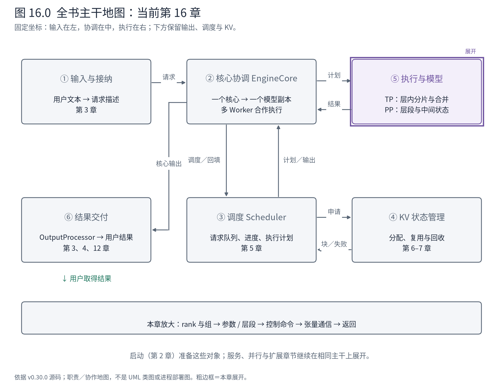
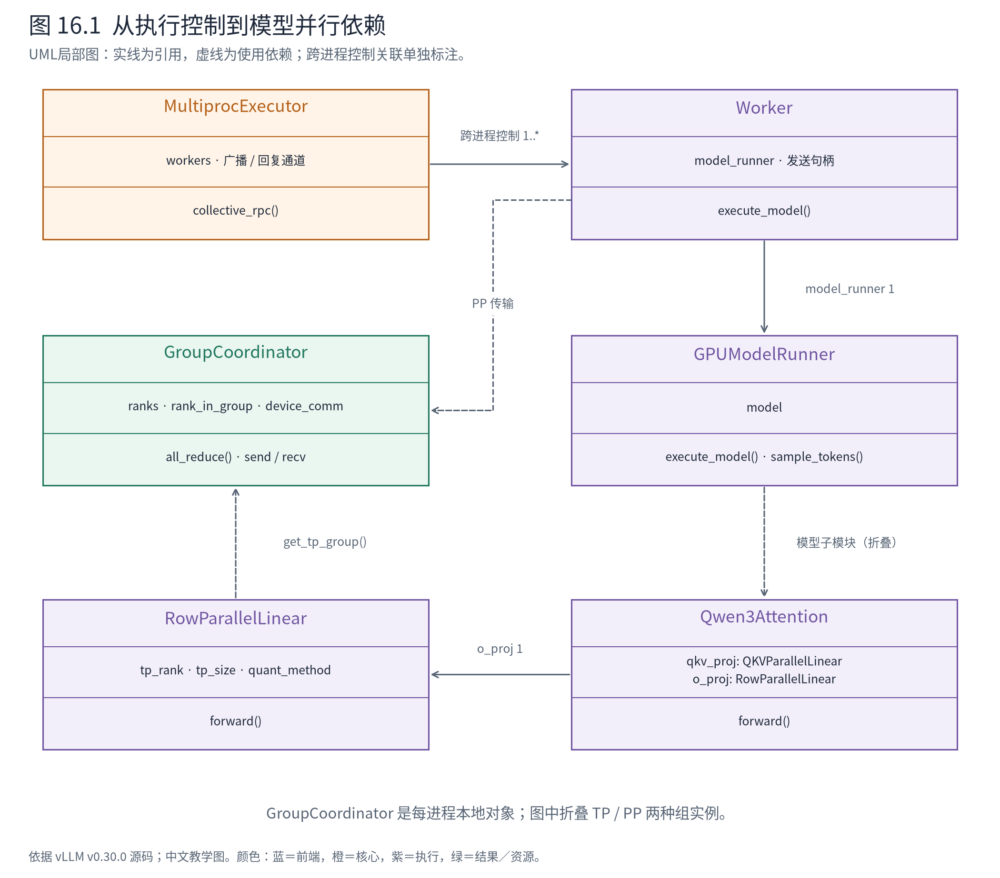
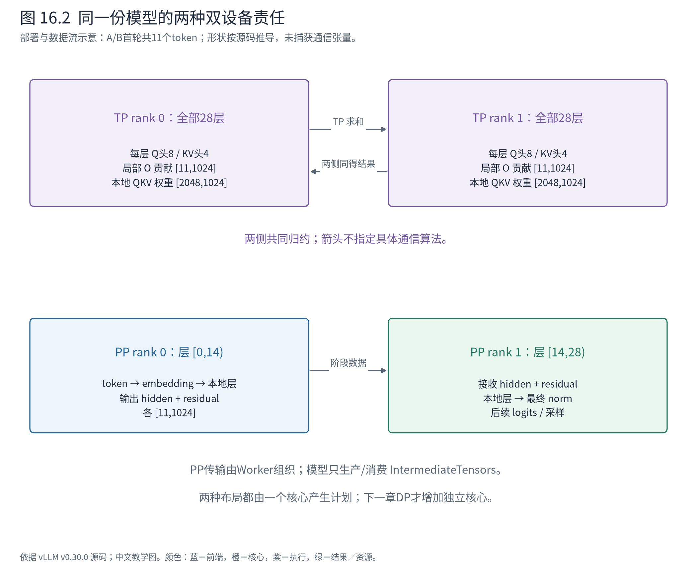

# 第 16 章 一份模型如何跨设备执行：TP、PP 与通信契约

第 15 章允许多个用户独立提交请求，但每次真正执行时，模型仍由同一组执行资源完成。现在把 A/B 的模型放到两张设备上：是让 A 去设备 0、B 去设备 1，还是让两张设备共同计算 A 和 B？这两件事改变的架构边界不同。

本章先处理后者：一份模型副本由多个 Worker 合作执行。张量并行（Tensor Parallelism，TP）把层内计算分给多张设备；流水线并行（Pipeline Parallelism，PP）把模型层分为前后阶段。请求仍从一个核心取得计划，多个 rank 必须完成同一次模型计算。下一章才讨论多个核心接收不同请求的 DP。



**先在地图上定位。** ⑤从一个执行上下文展开为多个 Worker；②仍交出统一计划。④管理请求所需的状态空间，但设备上的 KV 随模型层与 KV 头分布，不能把每张设备都画成存有完整模型与完整 KV 的独立服务。

## 16.1 rank 是位置，进程组是协作范围

rank 是某个通信范围内参与者的编号。全局 rank、TP 组内 rank、PP 组内 rank 可以不同。进程组规定“这一次集合通信到底包括谁”；没有这层范围，四个进程就无法区分是两两相加，还是四个一起相加。

先看一个源码构造的布局例，**不是四卡实测**：TP=2、PP=2，关闭其他并行维度。上游组构造按 PP、TP 的顺序安排 rank，得到：

| 阶段 | TP 组 | 模型责任 |
|---|---|---|
| PP 阶段 0 | `[0, 1]` | 前半层，每层由两个 TP rank 合算 |
| PP 阶段 1 | `[2, 3]` | 后半层，每层由两个 TP rank 合算 |

对应 PP 组为 `[0, 2]` 与 `[1, 3]`，连接相同 TP 位置的前后阶段。`get_tp_group()` 与 `get_pp_group()` 返回的是当前进程中的 GroupCoordinator 对象；每个进程各有自己的 Python 对象与通信句柄，没有一份跨进程共享的 Python 对象图。

GroupCoordinator 封装组成员、组内位置、设备通信实现及相关操作。模型并行层通过组接口请求 all-reduce 等操作，而不直接决定所有设备拓扑。这里的 all-reduce 是组内各成员贡献同形状张量，按指定规约合成结果并让各成员取得它；本章行并行线性层使用求和。



**图 16.1 怎样读。** 上层执行器管理 Worker 进程的控制通道，Worker 持有 Runner，Runner 持有本地模型。模型中的并行层依赖 TP 组，Worker 的阶段传输依赖 PP 组。虚线表示通过组访问函数使用通信能力，不表示每层都拥有一个独立进程组。这里只展开关键依赖，Qwen3Attention 里还有归一化、旋转位置编码等已讲过的成员。

这份分工把“怎么调动进程”与“一个数学运算怎样跨设备完成”分开。更换执行器不应改变矩阵分片的数学含义；更换设备通信实现也不应要求 Scheduler 重写 token 预算。不过，所有成员的配置、调用顺序与张量契约必须一致，否则局部看似正确的代码也可能等待永远不会到来的通信伙伴。

## 16.2 TP 切的是层内责任，不是把请求分成两份

回到第 10 章的 Qwen3-0.6B：hidden size 为 1024，16 个 Q 头、8 个 KV 头，每头 128。未分片的 Q/K/V 投影宽度分别为 2048、1024、1024。

TP=2 时，每个 rank 计算 8 个 Q 头和 4 个 KV 头，本地融合 QKV 权重变为 `[2048, 1024]`。两个 rank 都看到本轮 A/B 的 token 轴，但各自负责不同头的投影与 Attention。不能把 rank 0 解释为只处理 A，rank 1 解释为只处理 B。

QKVParallelLinear 的构造把这种责任变成参数分区约束：

<!-- book:ch16-heads:start -->
源码教学注释版，vllm v0.30.0：[原文件 L1047–L1054](https://github.com/vllm-project/vllm/blob/ced6857afa0ea7b2e3f0846a62e1394e90f15607/vllm/model_executor/layers/linear.py#L1047-L1054)。仅新增 `# 【解读】`，其他内容保留原文。

```python
        # 【解读】取得本层参与的TP规模；禁用TP时按单份处理。
        tp_size = get_tensor_model_parallel_world_size() if not disable_tp else 1
        # 【解读】Q头按TP划分，divide会要求合法整除。
        self.num_heads = divide(self.total_num_heads, tp_size)
        # 【解读】KV头少于或等于TP规模时，每rank至少保留一个KV头。
        if tp_size >= self.total_num_kv_heads:
            self.num_kv_heads = 1
            # 【解读】记录复制次数；不能把KV头无限切成分数头。
            self.num_kv_head_replicas = divide(tp_size, self.total_num_kv_heads)
        else:
            # 【解读】否则按TP切KV头，本例8/2=4。
            self.num_kv_heads = divide(self.total_num_kv_heads, tp_size)
            self.num_kv_head_replicas = 1
```
<!-- book:ch16-heads:end -->

这里还有一个不能被“平均切开”掩盖的分支：当 TP 数达到或超过总 KV 头数时，局部 KV 头数固定为 1，并记录复制次数。KV 头太少时不能把一个头无限切成分数头；合法配置中某些 rank 会复制 KV 头。所需整除条件由 `divide` 等检查约束，所以 TP 不是任意整数开关。

对于当前 TP=2 的 A/B 首轮，可以按源码推导以下形状。**中间张量未在这次双卡实验中截取；表中除权重外是计算契约推导。**

| 阶段 | 每个 rank 输入 | 每个 rank 输出 |
|---|---|---|
| 本地 QKV 投影 | hidden `[11,1024]` | 融合 QKV `[11,2048]` |
| 拆分 Q/K/V | `[11,2048]` | Q `[11,8,128]`；K/V 各 `[11,4,128]` |
| 本地 Attention | Q 与本地 KV 状态 | `[11,8,128]`，展平为 `[11,1024]` |
| O 投影局部乘法 | `[11,1024]`，权重 `[1024,1024]` | 局部贡献 `[11,1024]` |
| TP 求和 | 两份同形状局部贡献 | 每个 rank 得到完整 hidden `[11,1024]` |

注意最后两行的输入输出形状相同，但值的含义不同：求和前是本 rank 对输出的贡献，求和后才是跨头合成的结果。仅打印 shape 不足以理解张量的语义。

## 16.3 为什么 O 投影要通信，而不是直接返回本地结果

第 10 章的 Qwen3Attention 使用 RowParallelLinear 完成输出投影。输入已经按头划分，因此各 rank 可以各自做局部矩阵乘法；但每个局部结果只包含部分输入通道的贡献，需要求和才能恢复完整输出。

<!-- book:ch16-row:start -->
源码教学注释版，vllm v0.30.0：[原文件 L1761–L1783](https://github.com/vllm-project/vllm/blob/ced6857afa0ea7b2e3f0846a62e1394e90f15607/vllm/model_executor/layers/linear.py#L1761-L1783)。仅新增 `# 【解读】`，其他内容保留原文。

```python
        # 【解读】调用者已给局部输入时直接使用；否则在这里切最后一维。
        if self.input_is_parallel:
            input_parallel = input_
        else:
            split_input = split_tensor_along_last_dim(
                input_, num_partitions=self.tp_size
            )
            # 【解读】按本rank选择局部输入，保证连续存储。
            input_parallel = split_input[self.tp_rank].contiguous()

        # Matrix multiply.
        # Only fuse bias add into GEMM for rank 0 (this ensures that
        # bias will not get added more than once in TP>1 case)
        # 【解读】偏置至多加一次，避免后续求和把偏置重复计算。
        bias_ = None if (self.tp_rank > 0 or self.skip_bias_add) else self.bias
        # 【解读】调用本层配置的计算方法，得到局部输出贡献。
        output_parallel = self.quant_method.apply(self, input_parallel, bias_)

        # 【解读】需要合并且TP大于1时求和；相同形状的局部贡献变为完整结果。
        if self.reduce_results and self.tp_size > 1:
            output = tensor_model_parallel_all_reduce(output_parallel)
        else:
            output = output_parallel

        # 【解读】返回值是否附偏置由层契约控制，不能假设永远只有一个张量。
        if not self.return_bias:
            return output
        output_bias = self.bias if self.skip_bias_add else None
        return output, output_bias
```
<!-- book:ch16-row:end -->

`input_is_parallel` 决定收到的输入是否已经切片；不能重复切。`quant_method.apply` 封装局部计算的实现，后续量化章节会打开这个接口。`reduce_results` 决定这一层是否在这里合并结果，因而读 RowParallelLinear 时必须同时看构造参数，而不能把每个调用都视作相同通信行为。

源码还特意让偏置只在 rank 0 的乘法中加入。否则两个 rank 都加偏置再求和，就会把同一个偏置算两次。这是设计契约直接保护数学正确性的例子，而不是“通信优化”的附带细节。本例 Qwen3 Attention 的输出投影没有偏置，但类实现仍需支持带偏置模型。

对于二维权重，PyTorch 存储通常以 `[输出通道, 输入通道]` 表达；“列并行/行并行”的命名来自数学乘法中的分区约定。看源码时应以实际输入、权重形状和归约位置核对，不能只按类名猜测存储轴。

本章配套双卡记录将给出每个 Worker 的本地权重形状与最终输出。它能验证分片装配和生成结果，不能用来宣称捕获了每次 all-reduce 的内部张量或测得通信收益。

## 16.4 PP 让模型返回一份“尚未完成的前向状态”

TP 每层都有合作。PP 则改变本地模型拥有的层段。Qwen3-0.6B 有 28 层，默认均分的 PP=2 布局让第一个阶段拥有 `[0,14)`，第二个阶段拥有 `[14,28)`。

这不是让第二个阶段把自己的第一层重新命名为 layer 0。权重加载仍需要全局层名，模型还需要识别哪些参数根本不属于本地。`make_layers` 为不属于本 rank 的位置放置 PPMissingLayer：

<!-- book:ch16-layers:start -->
源码教学注释版，vllm v0.30.0：[原文件 L875–L887](https://github.com/vllm-project/vllm/blob/ced6857afa0ea7b2e3f0846a62e1394e90f15607/vllm/model_executor/models/utils.py#L875-L887)。仅新增 `# 【解读】`，其他内容保留原文。

```python
    # 【解读】根据当前PP位置求本地层段，end为开区间上界。
    start_layer, end_layer = get_pp_indices(
        num_hidden_layers, get_pp_group().rank_in_group, get_pp_group().world_size
    )

    # 【解读】ModuleList仍保留全局层下标。
    modules = torch.nn.ModuleList(
        # 【解读】前面不属于本rank的层放占位。
        [PPMissingLayer() for _ in range(start_layer)]
        + get_offloader().wrap_modules(
            # 【解读】只有本地层段真正调用层工厂；前缀保持全局编号。
            layer_fn(prefix=f"{prefix}.{idx}") for idx in range(start_layer, end_layer)
        )
        # 【解读】尾部不属于本rank的层同样占位。
        + [PPMissingLayer() for _ in range(end_layer, num_hidden_layers)]
    )

    # 【解读】调用者同时取得边界和模块表，前向只遍历本地范围。
    return start_layer, end_layer, modules
```
<!-- book:ch16-layers:end -->

所以 ModuleList 的长度可以仍然是 28，但并不表示本进程加载了 28 个真实 DecoderLayer。占位层保存索引与命名结构，`start_layer/end_layer` 决定实际前向遍历范围。加载器也会据 PP 缺失层跳过不属于本地的权重。

Qwen3Model 继承的骨架在入口处区分首段和后续段：

<!-- book:ch16-pp-input:start -->
源码教学注释版，vllm v0.30.0：[原文件 L408–L417](https://github.com/vllm-project/vllm/blob/ced6857afa0ea7b2e3f0846a62e1394e90f15607/vllm/model_executor/models/qwen2.py#L408-L417)。仅新增 `# 【解读】`，其他内容保留原文。

```python
        # 【解读】PP首段负责把用户输入变为hidden states。
        if get_pp_group().is_first_rank:
            # 【解读】已有embedding输入时无需再次查词表。
            if inputs_embeds is not None:
                hidden_states = inputs_embeds
            else:
                hidden_states = self.embed_input_ids(input_ids)
            # 【解读】首段尚无分离的残差状态。
            residual = None
        else:
            # 【解读】后续阶段必须收到前段状态，缺失就是契约错误。
            assert intermediate_tensors is not None
            # 【解读】取主分支与残差；它们共同构成后续层的输入。
            hidden_states = intermediate_tensors["hidden_states"]
            residual = intermediate_tensors["residual"]
```
<!-- book:ch16-pp-input:end -->

首段从 token 或已有 embedding 开始，后续段从 IntermediateTensors 取状态。模型只知道这份数据已经到达，不在 forward 里创建网络连接。完成本地层段后，非末段返回 hidden_states 与 residual；末段执行最终 norm，再进入 logits 与采样。

residual 为什么必须传？第 10 章已经看到模型把主分支与残差分别沿层传递，以便融合加法和归一化。如果只发送 hidden_states，下一阶段会失去正确恢复后续层输入所需的另一部分状态。IntermediateTensors 封装的是跨阶段前向契约，不只是一个为了“装张量”而随意创建的字典。辅助 hidden states 也可能加入其中，但 A/B 的普通生成不需要展开这条支路。

## 16.5 控制命令与设备张量走两条协作路径

把第 8 章折叠的多进程分发打开，先看执行器如何发命令：

<!-- book:ch16-rpc:start -->
源码教学注释版，vllm v0.30.0：[原文件 L416–L424](https://github.com/vllm-project/vllm/blob/ced6857afa0ea7b2e3f0846a62e1394e90f15607/vllm/v1/executor/multiproc_executor.py#L416-L424)。仅新增 `# 【解读】`，其他内容保留原文。

```python
        # 【解读】普通执行使用方法名；本地探针也可使用可序列化函数。
        if isinstance(method, str):
            send_method = method
        else:
            send_method = cloudpickle.dumps(method, protocol=pickle.HIGHEST_PROTOCOL)
        # 【解读】广播的是控制命令、参数与回复选择，不是模型层中的all-reduce。
        self.rpc_broadcast_mq.enqueue((send_method, args, kwargs, output_rank))

        # 【解读】默认收集各rank回复；指定output_rank时只等该通道。
        response_mqs: Sequence[MessageQueue] = self.response_mqs
        if output_rank is not None:
            response_mqs = (response_mqs[output_rank],)
```
<!-- book:ch16-rpc:end -->

消息带方法、参数与输出 rank；所有参与执行的 Worker 需要接到正确的本轮任务。`output_rank` 控制谁向执行器回复，并不等于只有这个 rank 参与计算。某些 connector 需要汇总多个 Worker 的结果，执行器还支持聚合路径。

设备上的 PP 中间张量则由 Worker 通过 PP 组发送：

<!-- book:ch16-send:start -->
源码教学注释版，vllm v0.30.0：[原文件 L1231–L1239](https://github.com/vllm-project/vllm/blob/ced6857afa0ea7b2e3f0846a62e1394e90f15607/vllm/v1/worker/gpu_worker.py#L1231-L1239)。仅新增 `# 【解读】`，其他内容保留原文。

```python
        # Non-blocking send of the intermediate tensors. The metadata handle
        # is reaped lazily by the GroupCoordinator; the device handles are
        # waited at the top of the next step.
        # 【解读】上游Worker通过PP组发送模型返回的中间张量。
        handles = get_pp_group().isend_tensor_dict(
            output.tensors,
            # 【解读】TP组信息供传输实现选择配合方式，不能推断一份张量总是完整重复发送。
            all_gather_group=get_tp_group(),
            all_gather_tensors=all_gather_tensors,
        )
        # 【解读】保存设备发送句柄，下一轮复用存储前等待；发送返回不等于数据不再在途。
        self._pp_send_work = handles[1:]
```
<!-- book:ch16-send:end -->

上游 Worker 在下一轮前等待前一次设备发送句柄，避免本轮前向覆盖仍被传输使用的存储。第 13、14 章的缓冲生命周期约束在这里再次出现：函数返回并不自动证明数据已经无人使用。

可以用两段源码调用树分别导航，**它们不是跨进程的活动调用栈**：

```text
核心进程：EngineCore
└─ MultiprocExecutor.execute_model
   └─ collective_rpc → 广播执行命令及 SchedulerOutput
                     ··· 控制消息到各 Worker ···

每个 Worker 进程：Worker.execute_model
├─ 若非 PP 首段：PP 组接收中间张量
├─ Runner.execute_model
│  └─ 本地 Qwen3Model.forward
│     └─ 本地层段
│        ├─ QKVParallelLinear：本地头
│        └─ RowParallelLinear：局部乘法 → TP 组求和
└─ 若非 PP 末段：PP 组发送 IntermediateTensors
   末段：后续采样路径 → 执行器选定的输出通道
```

图 16.2 把这两种并行分别放到两设备布局中，避免第一次阅读就同时叠加所有维度。



**图 16.2 怎样读。** 上半图两设备处于同一层，横向通信合成局部贡献；下半图两设备处于前后层段，箭头传递中间状态。两图都由同一份调度计划组织 A/B。图中 PP 的 `[11,1024]` 是首轮普通前向的形状推导，未将它伪装成抓取到的传输包。此图省略组内传输优化、采样 token 回传和微批次重叠，它们不改变“层内分工与层间分工”的区分。

## 16.6 从双卡现场核对责任，而不是只看参数名

本章使用相同固定模型和 A/B 文本，分别配置 TP=2 或 PP=2；上游模型的 TP/PP 组织在 Ascend 运行分支中落地。记录也能看见 AscendVocabParallelEmbedding、AscendParallelLMHead 等平台替换，不能将运行类一律写成上游原类。实验读取每个 rank 的模型元数据，并核对最终 token。为让本地探针函数传到 Worker，脚本仅在这次离线进程中开启可调用对象序列化；没有启动 HTTP 服务。

<!-- book:ch16-tp-data:start -->
真实运行字段投影，保留字段名与值，省略无关项。来自[原始记录](evidence/tp2-final/result.json)。

```json
{
  "ranks": [
    {
      "pid": 2257125,
      "tp": {
        "rank": 0,
        "ranks": [
          0,
          1
        ],
        "size": 2
      },
      "pp": {
        "rank": 0,
        "ranks": [
          0
        ],
        "size": 1
      },
      "layer_range": [
        0,
        28
      ],
      "layer_class": "Qwen3DecoderLayer",
      "model_class": "Qwen3ForCausalLM",
      "qkv_weight": [
        2048,
        1024
      ],
      "o_weight": [
        1024,
        1024
      ],
      "num_heads": 8,
      "num_kv_heads": 4,
      "embedding_class": "AscendVocabParallelEmbedding",
      "lm_head_class": "AscendParallelLMHead"
    },
    {
      "pid": 2257126,
      "tp": {
        "rank": 1,
        "ranks": [
          0,
          1
        ],
        "size": 2
      },
      "pp": {
        "rank": 0,
        "ranks": [
          1
        ],
        "size": 1
      },
      "layer_range": [
        0,
        28
      ],
      "layer_class": "Qwen3DecoderLayer",
      "model_class": "Qwen3ForCausalLM",
      "qkv_weight": [
        2048,
        1024
      ],
      "o_weight": [
        1024,
        1024
      ],
      "num_heads": 8,
      "num_kv_heads": 4,
      "embedding_class": "AscendVocabParallelEmbedding",
      "lm_head_class": "AscendParallelLMHead"
    }
  ]
}
```
<!-- book:ch16-tp-data:end -->

<!-- book:ch16-pp-data:start -->
真实运行字段投影，保留字段名与值，省略无关项。来自[原始记录](evidence/pp2/result.json)。

```json
{
  "ranks": [
    {
      "pid": 2262008,
      "tp": {
        "rank": 0,
        "ranks": [
          0
        ],
        "size": 1
      },
      "pp": {
        "rank": 0,
        "ranks": [
          0,
          1
        ],
        "size": 2
      },
      "layer_range": [
        0,
        14
      ],
      "layer_class": "Qwen3DecoderLayer",
      "model_class": "Qwen3ForCausalLM",
      "qkv_weight": [
        4096,
        1024
      ],
      "o_weight": [
        1024,
        2048
      ],
      "num_heads": 16,
      "num_kv_heads": 8,
      "embedding_class": "AscendVocabParallelEmbedding",
      "lm_head_class": "PPMissingLayer"
    },
    {
      "pid": 2262009,
      "tp": {
        "rank": 0,
        "ranks": [
          1
        ],
        "size": 1
      },
      "pp": {
        "rank": 1,
        "ranks": [
          0,
          1
        ],
        "size": 2
      },
      "layer_range": [
        14,
        28
      ],
      "layer_class": "Qwen3DecoderLayer",
      "model_class": "Qwen3ForCausalLM",
      "qkv_weight": [
        4096,
        1024
      ],
      "o_weight": [
        1024,
        2048
      ],
      "num_heads": 16,
      "num_kv_heads": 8,
      "embedding_class": "PPMissingLayer",
      "lm_head_class": "AscendParallelLMHead"
    }
  ]
}
```
<!-- book:ch16-pp-data:end -->

读取 TP 记录时先看 `tp.ranks` 与 `pp.ranks`，再看权重：同一 TP 组的两个进程都拥有全部层段，却各有较小的 QKV 与 O 权重。读取 PP 记录则反过来：TP 组各只有自己，QKV 没有按 TP 缩小，但 `layer_range` 分为前后两段。不要只看“共启动两个 Worker”就判断它们做了哪一种并行。

两种布局的 A/B 最终输出均与基础案例相同，实验断言已通过；完整输出保留在记录中。关机阶段出现了超时后强制清理及共享内存清理警告，完整日志已保留；本章不将生成成功写成无警告关机。这个小例只检查当前模型、配置和短序列，不意味着所有并行设置都逐 bit 等价，也没有证明小模型用两卡会更快。多卡可以降低每卡模型负担，同时增加通信、同步、启动和故障传播成本。TP 的频繁层内通信与 PP 的阶段依赖，构成不同的性能约束。

本章应留下的判断是：**多个 Worker 可以共同实现一个模型执行契约，rank 决定本地责任，进程组决定合作范围。** Scheduler 不需要理解每一次矩阵求和，却必须把一致的工作交给整组执行资源。下一章再向外扩大边界：如果有多个完整执行副本，谁来决定 A/B 分别进入哪个核心，结果又怎样返回原来的用户？

**源码停点：** [并行组构造](https://github.com/vllm-project/vllm/blob/ced6857afa0ea7b2e3f0846a62e1394e90f15607/vllm/distributed/parallel_state.py#L2044-L2076)读 rank 布局即可先停；[Qwen2 前向骨架](https://github.com/vllm-project/vllm/blob/ced6857afa0ea7b2e3f0846a62e1394e90f15607/vllm/model_executor/models/qwen2.py#L401-L444)用于追 Qwen3 的 PP 契约；[官方并行部署说明](https://docs.vllm.ai/en/v0.30.0/serving/parallelism_scaling/)补充单副本的 TP/PP 配置边界。NCCL 与 HCCL 的底层算法不在本章展开。
