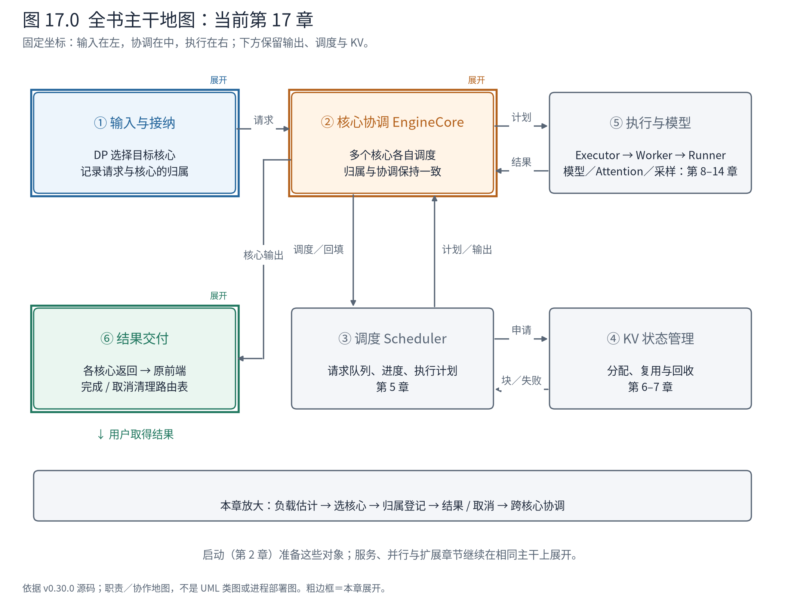
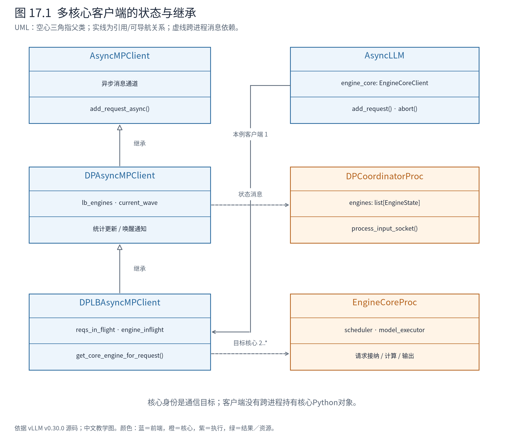
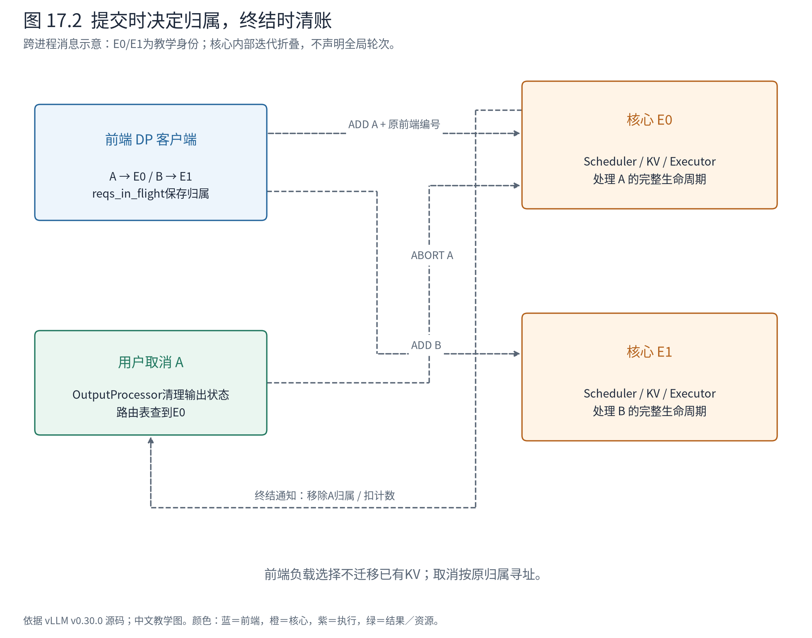

# 第 17 章 多个核心的路由与协调：DP 不只是复制模型

第 16 章中，多个 Worker 为同一份调度计划合作。现在有两个完整模型副本 E0、E1，各有自己的 EngineCore、Scheduler 和 KV 状态。A 可以进入 E0，B 可以进入 E1，各核心独立组成计算批次。数据并行（Data Parallelism，DP）在这里首先是服务容量的组织方式。

但是复制执行资源后，前端还缺三个能力：为新请求选择目标，记住请求属于哪个目标，让结果和取消回到正确的地方。如果模型的专家层又跨副本合作，还要协调这些核心何时共同计算。



**先在地图上定位。** ①到②之间增加目标选择；②展开为多个核心，每个内部仍保留③④⑤。⑥接收不同核心的输出，再按原来的请求身份交付用户。请求路由不取代核心内部的 token 调度，两者作用在不同尺度。

## 17.1 先区分三种“负载均衡”

外部路由器可以在多个服务端点之间选择；vLLM 前端可以在自己连接的 DP 核心之间选择；每个 Scheduler 再决定已进入核心的请求本轮算多少 token。这三层选择的输入、状态和动作都不同。

| 位置 | 选择对象 | 掌握的信息 | 作出的动作 |
|---|---|---|---|
| 服务外部路由 | 服务端点 | 外部采集的负载与服务策略 | 将 HTTP 请求发到一个端点 |
| DP 客户端 | EngineCore | 核心负载快照、本地在途请求等 | 将核心请求发给目标引擎 |
| Scheduler | 核心内请求 | token 进度、预算与本地 KV | 形成一轮 SchedulerOutput |

本章主要读第二层。官方部署说明还区分内部、混合、外部均衡：混合模式先在外部选择节点，再由节点前端选择本地核心。它改变路由范围，不要求每个核心内部换一套调度逻辑。[官方 DP 部署说明](https://docs.vllm.ai/en/v0.30.0/serving/data_parallel_deployment/)

对于稠密模型，每个核心的 KV 是自己请求的状态，A 在 E0 已经算出的 KV 不会因为 E1 更空闲，就自动出现在 E1。当前负载选择发生在请求进入时；“每个 token 都找最空闲设备”会破坏现有状态归属，除非另外实现迁移协议。第 26 章才打开跨边界状态传输。

## 17.2 客户端封装的是目标集合与请求归属

第 15 章的 AsyncMPClient 面向异步核心消息。本章的 DPAsyncMPClient 增加 DP 状态通知与协调；DPLBAsyncMPClient 再增加多核心选择。继承关系表达逐层增加的客户端能力，而不是让一个 Scheduler 继承另一个 Scheduler 来调度集群。



**图 17.1 怎样读。** 空心三角沿 DPLBAsyncMPClient → DPAsyncMPClient → AsyncMPClient 指向父类。前端持有一个客户端，客户端用引擎身份联系多个核心。协调器通过消息发布负载和运行状态，不是客户端的父类，也不逐条替 Scheduler 做 token 决策。

DPLBAsyncMPClient 中三份状态尤其值得放在一起读：

- `lb_engines`：按引擎顺序保存 `[waiting, running, kv_cache_usage]`。这是异步获得的全局快照，可能滞后。
- `reqs_in_flight`：本客户端已提交请求的内部 ID → 引擎身份。它回答取消应发给谁。
- `engine_inflight`：本客户端在各引擎上尚未结束的请求数。它可以立即反映本客户端刚刚提交的工作。

三者没有互相替代。快照能看到其他前端带来的压力，但不够新；本地计数足够及时，却看不到其他前端的全部工作；归属表记录身份关系，不能仅凭计数恢复。这是分布式状态设计里常见的取舍：分别维护不同准确性与时效性的视图，让决策明确承认它们的边界。

## 17.3 一次选择怎样使用旧快照和新事实

对普通生成请求，客户端先检查是否显式指定 DP rank；pooling 的特定局部性要求也可能确定目标。没有这些约束时，才扫描引擎并比较分数。

<!-- book:ch17-score:start -->
源码教学注释版，vllm v0.30.0：[原文件 L1570–L1582](https://github.com/vllm-project/vllm/blob/ced6857afa0ea7b2e3f0846a62e1394e90f15607/vllm/v1/engine/core_client.py#L1570-L1582)。仅新增 `# 【解读】`，其他内容保留原文。

```python
                # 【解读】本客户端知道自己交给该引擎的在途数，不必等待下一次远端统计。
                inflight = self.engine_inflight[self.core_engines[idx]]
                # 【解读】取远端队列总量与本地在途估计的较大值，防止旧快照抹掉刚提交的工作。
                score: float = max(self.client_count * inflight, waiting + running)
                # 【解读】只有存在等待请求时才增加KV压力惩罚。
                if waiting:
                    # Waiting requests are penalized in proportion to KV cache
                    # pressure: a queue on a KV-bound engine drains slowly, so
                    # new requests should strongly prefer other engines. With
                    # low KV usage the queue is transient (e.g. mid-burst) and
                    # the penalty stays off, preserving exact round-robin.
                    # Ramps from 0 at <=50% usage to 3x waiting at 100%.
                    # 【解读】KV占用高于50%才增加这一项；它是负载启发式，不是精确耗时预测。
                    score += waiting * 6.0 * max(0.0, kv_cache_usage - 0.5)
                # 【解读】严格小于才更新，平分时由扫描顺序决定。
                if score < min_score:
                    min_score = score
                    eng_index = idx
```
<!-- book:ch17-score:end -->

第一项取两个估计的较大值：远端的 waiting+running，以及本客户端在途数乘客户端数量。后者不是真实集群总数，而是防止局部突发完全被旧快照忽略的一项估计下界。随后，如果有等待请求且 KV 占用超过 50%，增加等待惩罚。它把“队列可能受 KV 容量约束而难以排空”反映在路由中。

这不是准确预测每条请求还要运行几毫秒。两个请求的 prompt 长度和输出长度可以相差很大，单纯请求数无法完全表达工作量；KV 占用也不是前缀内容相同与否的判定。源码没有在这里读取 A 的前缀哈希并寻找最匹配的核心。因此，应区分**资源压力感知**与**前缀内容感知**。

同版本官方部署文档的一段文字仍把引入 KV 信息说作未来可能方向；固定源码已经在评分中使用 KV 占用率。本书采用上述源码事实，不把文档概括直接当成实现。这个差异也说明：阅读架构文档后，仍需在负责决策的方法里核对真正的输入。

选定后先更新本地等待估计，并旋转下一次同分比较的起点，再保存归属：

<!-- book:ch17-owner:start -->
源码教学注释版，vllm v0.30.0：[原文件 L1591–L1597](https://github.com/vllm-project/vllm/blob/ced6857afa0ea7b2e3f0846a62e1394e90f15607/vllm/v1/engine/core_client.py#L1591-L1597)。仅新增 `# 【解读】`，其他内容保留原文。

```python
            # 【解读】未显式指定目标的负载选择结束后旋转扫描起点，减少固定同分偏向。
            self.eng_start_index = (self.eng_start_index + 1) % num_engines

        # 【解读】把下标转换为真实引擎通信身份。
        chosen_engine = self.core_engines[eng_index]
        # Record which engine is chosen for this request, to handle aborts.
        # 【解读】保存请求归属，后续取消必须发回这个核心。
        self.reqs_in_flight[request.request_id] = chosen_engine
        # 【解读】立即增加本客户端的精确在途计数。
        self.engine_inflight[chosen_engine] += 1
        return chosen_engine
```
<!-- book:ch17-owner:end -->

旋转起点解决的是同分偏向，而不是无条件轮询。某个核心明显更忙时，仍会输掉分数比较。`reqs_in_flight` 和 `engine_inflight` 在此写入，之后无论是否收到新的快照，刚提交的请求都不会凭空从本地账本中消失。

## 17.4 让 A/B/C 经过真实选择方法

配套实验直接调用固定版本的 `get_core_engine_for_request`，手工构造两个引擎状态。E0、E1 是教学身份，方法本身来自真实类；没有创建 DP 引擎、没有发网络消息。我们故意让 A/B 提交后收到一份过时的“全空”快照，再提交 C。

<!-- book:ch17-burst:start -->
CPU真实路由方法的构造状态实验：E0/E1是教学引擎身份，网络发送替换为记录器；没有运行DP模型。来自[原始记录](evidence/dp-contract/trace.json)。

```json
{
  "burst": [
    {
      "request": "A",
      "chosen": "E0",
      "after": {
        "counts": [
          [
            1,
            0,
            0.0
          ],
          [
            0,
            0,
            0.0
          ]
        ],
        "inflight": {
          "E0": 1
        },
        "owners": {
          "A": "E0"
        },
        "scan_start": 1
      }
    },
    {
      "request": "B",
      "chosen": "E1",
      "after": {
        "counts": [
          [
            1,
            0,
            0.0
          ],
          [
            1,
            0,
            0.0
          ]
        ],
        "inflight": {
          "E0": 1,
          "E1": 1
        },
        "owners": {
          "A": "E0",
          "B": "E1"
        },
        "scan_start": 0
      }
    },
    {
      "request": "C",
      "chosen": "E0",
      "after": {
        "counts": [
          [
            1,
            0,
            0.0
          ],
          [
            0,
            0,
            0.0
          ]
        ],
        "inflight": {
          "E0": 2,
          "E1": 1
        },
        "owners": {
          "A": "E0",
          "B": "E1",
          "C": "E0"
        },
        "scan_start": 1
      }
    }
  ]
}
```
<!-- book:ch17-burst:end -->

A 进入 E0，B 进入 E1。当远端快照被置回零时，两个核心在本客户端中的在途计数仍各为 1。C 的决策仍能看到已经提交的工作；最终归属为 A/C → E0、B → E1。`counts` 是可更新的本地负载视图，不应把实验里更新的 waiting 值称为核心队列的实测长度。

再保持两核心各等待一条请求，但将 KV 占用分别设为 0.95 与 0.1。基础分都为 1，E0 的额外惩罚是 $1\times6\times(0.95-0.5)=2.7$，因此总分 3.7；E1 仍为 1。这个计算只是把源码常数代入构造状态，不是测量耗时。

<!-- book:ch17-pressure:start -->
CPU真实路由方法的构造状态实验：E0/E1是教学引擎身份，网络发送替换为记录器；没有运行DP模型。来自[原始记录](evidence/dp-contract/trace.json)。

```json
{
  "pressure": {
    "request": "C-pressure",
    "chosen": "E1",
    "after": {
      "counts": [
        [
          1,
          0,
          0.95
        ],
        [
          2,
          0,
          0.1
        ]
      ],
      "inflight": {
        "E1": 1
      },
      "owners": {
        "C-pressure": "E1"
      },
      "scan_start": 1
    }
  },
  "explicit_rank": {
    "request": "C-forced",
    "chosen": "E0",
    "after": {
      "counts": [
        [
          1,
          0,
          0.95
        ],
        [
          2,
          0,
          0.1
        ]
      ],
      "inflight": {
        "E1": 1,
        "E0": 1
      },
      "owners": {
        "C-pressure": "E1",
        "C-forced": "E0"
      },
      "scan_start": 1
    }
  }
}
```
<!-- book:ch17-pressure:end -->

C-pressure 因此进入 E1；接下来显式指定 rank 0 的 C-forced 进入 E0。后者说明显式目标是请求契约，负载均衡不能擅自把它改成更低分的核心。真实服务中若显式目标无效，应在相应校验边界处理，而不是把这个小例扩大为任意 rank 都合法。

## 17.5 请求归属怎样跨越结果与取消

选择并非方法返回就结束。ADD 消息还携带 `client_index`，使核心输出能够归还原前端；涉及协调的路径还带 `current_wave`：

<!-- book:ch17-send:start -->
源码教学注释版，vllm v0.30.0：[原文件 L1486–L1501](https://github.com/vllm-project/vllm/blob/ced6857afa0ea7b2e3f0846a62e1394e90f15607/vllm/v1/engine/core_client.py#L1486-L1501)。仅新增 `# 【解读】`，其他内容保留原文。

```python
    async def add_request_async(self, request: EngineCoreRequest) -> None:
        # 【解读】先确保统计更新任务存在。
        self._ensure_stats_update_task()

        # 【解读】消息同时带当前wave与原前端编号。
        request.current_wave = self.current_wave
        request.client_index = self.client_index

        # 【解读】选择并登记目标，再把ADD发给该核心。
        chosen_engine = self.get_core_engine_for_request(request)
        to_await = self._send_input(EngineCoreRequestType.ADD, request, chosen_engine)
        # 【解读】跨核心计算处于暂停时，额外通知协调器唤醒伙伴。
        if not self.engines_running:
            # Notify coordinator that we're sending a request
            req_msg = msgspec.msgpack.encode(("FIRST_REQ", chosen_engine))
            await self.first_req_send_socket.send(req_msg)

        # 【解读】等待本次发送操作完成，不等待整段生成。
        await to_await

        # 【解读】确保输出接收任务运行，结果还要回到原前端。
        self._ensure_output_queue_task()
```
<!-- book:ch17-send:end -->

这里有两个不同的关联维度：引擎身份指向计算归属，client_index 指向输出接收方。请求内部 ID 再将输出与前端 RequestState 对齐。不能用“有一个 request_id”概括掉这些不同方向的寻址需求。

源码导航可按两段消息路径阅读：

```text
前端接纳
AsyncLLM.add_request
└─ DPAsyncMPClient.add_request_async
   ├─ DPLBAsyncMPClient.get_core_engine_for_request
   │  ├─ 按约束 / 评分选择目标
   │  └─ 写入请求归属与本地在途计数
   ├─ ADD(request, client_index, current_wave) → 选中的核心
   └─ 必要时 FIRST_REQ → 协调器

结果接收（另一个任务）
核心输出消息 → 客户端接收
├─ process_engine_outputs：处理终结归属
└─ 前端OutputProcessor → RequestOutputCollector → 用户生成器
```

这是源码整理的路径；ADD 与结果接收之间存在消息和任务边界，不是一条持续挂着的 Python 栈。请求结束时，路由账本按核心的 finished_requests 清理：

<!-- book:ch17-finish:start -->
源码教学注释版，vllm v0.30.0：[原文件 L1614–L1617](https://github.com/vllm-project/vllm/blob/ced6857afa0ea7b2e3f0846a62e1394e90f15607/vllm/v1/engine/core_client.py#L1614-L1617)。仅新增 `# 【解读】`，其他内容保留原文。

```python
        # 【解读】核心通知请求终结后，再移除路由状态。
        if outputs.finished_requests and self.reqs_in_flight:
            for req_id in outputs.finished_requests:
                # 【解读】pop带默认值，重复终结不会再次扣减计数。
                if (engine := self.reqs_in_flight.pop(req_id, None)) is not None:
                    # 【解读】只有确实移除归属记录时才减本客户端计数。
                    self.engine_inflight[engine] -= 1
```
<!-- book:ch17-finish:end -->

`pop(..., None)` 让重复或已清理通知不会再次扣减本地计数。取消也需要同一份归属；对批量取消，客户端先分组：

<!-- book:ch17-cancel:start -->
源码教学注释版，vllm v0.30.0：[原文件 L1675–L1685](https://github.com/vllm-project/vllm/blob/ced6857afa0ea7b2e3f0846a62e1394e90f15607/vllm/v1/engine/core_client.py#L1675-L1685)。仅新增 `# 【解读】`，其他内容保留原文。

```python
        # 【解读】批量取消先按既有目标分组。
        by_engine = defaultdict[EngineIdentity, list[str]](list)
        for req_id in request_ids:
            # 【解读】只处理仍有归属记录的请求，不为取消重新做负载选择。
            if engine := self.reqs_in_flight.get(req_id):
                by_engine[engine].append(req_id)
        # 【解读】每组向自己的核心发送一次ABORT消息。
        for engine, req_ids in by_engine.items():
            await self._abort_requests(req_ids, engine)

    async def _abort_requests(
        self, request_ids: list[str], engine: EngineIdentity
    ) -> None:
        # 【解读】这里是消息提交；核心处理与资源清理仍有后续生命周期。
        await self._send_input(EngineCoreRequestType.ABORT, request_ids, engine)
```
<!-- book:ch17-cancel:end -->

沿前面的构造状态取消 A/B/C，真实方法交给发送记录器的消息如下：

<!-- book:ch17-aborts:start -->
CPU真实路由方法的构造状态实验：E0/E1是教学引擎身份，网络发送替换为记录器；没有运行DP模型。来自[原始记录](evidence/dp-contract/trace.json)。

```json
{
  "cancel_messages": [
    {
      "kind": "ABORT",
      "ids": [
        "A",
        "C"
      ],
      "engine": "E0"
    },
    {
      "kind": "ABORT",
      "ids": [
        "B"
      ],
      "engine": "E1"
    }
  ]
}
```
<!-- book:ch17-aborts:end -->

A/C 一起发给 E0，B 发给 E1。这里没有再次调用负载选择，也没有把每个 ID 广播给所有核心。前端输出状态的取消在第 15 章已讲过，本章补齐的是核心目标的确定。发送 ABORT 不在这里立即删除全部路由计数；终结通知负责后续清账。



**图 17.2 怎样读。** A/B 分别进入不同核心，各自内部仍是熟悉的 schedule-execute-update。取消 A 沿原归属回 E0；E1 不承担 A 的状态。两条核心时间线可以交错推进，本图不声明它们有一个统一的全局调度轮次。

## 17.6 为什么 MoE 的 DP 核心不能任意独立停下

对于本书稠密 Qwen3 案例，核心之间的模型计算相互独立。上游启动分支对此有明确区分：

<!-- book:ch17-dense:start -->
源码教学注释版，vllm v0.30.0：[原文件 L1318–L1328](https://github.com/vllm-project/vllm/blob/ced6857afa0ea7b2e3f0846a62e1394e90f15607/vllm/v1/engine/core.py#L1318-L1328)。仅新增 `# 【解读】`，其他内容保留原文。

```python
            # 【解读】保留服务侧DP身份。
            parallel_config.data_parallel_index = dp_rank
            # 【解读】只有DP且模型是MoE，才使用需要跨核心计算协调的实现。
            if data_parallel and vllm_config.model_config.is_moe:
                # Set data parallel rank for this engine process.
                parallel_config.data_parallel_rank = dp_rank
                engine_core = DPEngineCoreProc(*args, **kwargs)
            else:
                # 【解读】稠密DP内部计算相互独立，重新配置为各自的模型执行副本。
                # Non-MoE DP ranks are completely independent, so treat like DP=1.
                # Note that parallel_config.data_parallel_index will still reflect
                # the original DP rank.
                parallel_config.reconfigure_for_independent_dp_rank()
                # 【解读】保留engine_index供消息路由识别，不丢失外层服务身份。
                engine_core = EngineCoreProc(*args, engine_index=dp_rank, **kwargs)
```
<!-- book:ch17-dense:end -->

只有 DP 与 MoE 同时成立时，才使用 DPEngineCoreProc。稠密 DP 保留服务侧编号，但将内部模型执行配置整理为独立副本。这条分支防止我们从类名“DP Engine”反推所有 DP 都采用同一种循环。

MoE 的情况不同。Attention 可以处理本核心的请求，但专家计算可能需要其他 DP rank 的设备共同参与。如果 E0 正在进入专家集合通信，E1 因自己没请求就停止执行，E0 可能等不到伙伴。

DPCoordinator 因此还传递全局运行状态与请求波次（wave）。wave 标识一段共同运行到共同空闲的区间，不是 token 序号，也不是每请求的迭代号。新请求到来时，必要的伙伴被唤醒；本地没有可运行请求但全局仍在工作时，DPEngineCoreProc 可以执行 dummy batch，参加必要的通信。周期性全局未完成状态判断允许大家共同暂停。

dummy batch 没有创造额外的用户输出，它承担的是分布式执行协议的参与责任。也不能把 CPU 路由实验当成对此机制的运行验证：它没有启动这些核心，更没有执行专家通信。这里的依据是 DPEngineCoreProc 循环与协调器源码。

多个核心扩大了接入和调度容量，也引入统计滞后、目标归属、取消寻址以及条件性的跨核心协调。读者应把“路由请求”和“维持集体计算协议”分开理解。下一章就在这条条件分支上继续：一条 token 的专家选择，怎样变成跨设备分发、局部计算和返回合并？

**源码停点：** [客户端层次与路由](https://github.com/vllm-project/vllm/blob/ced6857afa0ea7b2e3f0846a62e1394e90f15607/vllm/v1/engine/core_client.py#L1507-L1597)先读三份状态，再读评分；[MoE 核心循环](https://github.com/vllm-project/vllm/blob/ced6857afa0ea7b2e3f0846a62e1394e90f15607/vllm/v1/engine/core.py#L2204-L2246)看 dummy 与全局空闲判断；[协调器契约](https://github.com/vllm-project/vllm/blob/ced6857afa0ea7b2e3f0846a62e1394e90f15607/vllm/v1/engine/coordinator.py#L23-L58)理解 wave 后即可先停，不必同时钻入弹性扩缩容。
