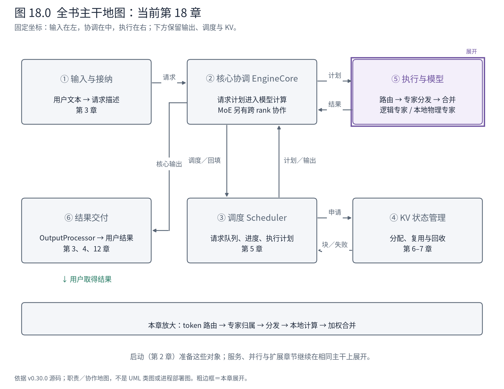
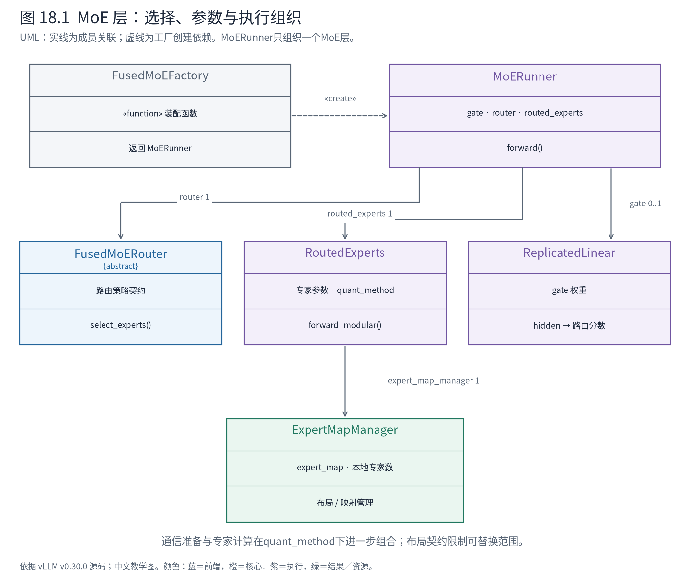
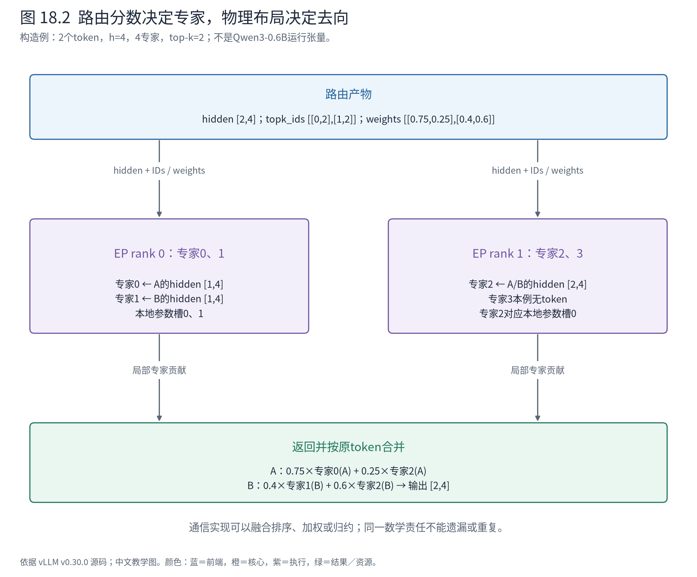

# 第 18 章 专家路由、分发与合并：MoE 的三个责任边界

第 17 章留下一个问题：为什么某个核心没有用户请求，也可能需要参加一次模型计算？原因来自 MoE 层。一个核心持有的 token，可能选择了另一个设备上的专家；请求归属与专家参数归属不再重合。

本章把模型分支明确切换到上游 Qwen3Moe 实现。前面的 Qwen3-0.6B 是稠密模型，不能给它加一个 EP 参数就凭空得到专家层。A/B 仍代表两条请求，但本章的小张量是解释专家协作的构造例，不是前面模型的隐藏状态记录。真实执行证据限于 CPU 专家布局函数；设备通信与专家内核按固定源码走读。



**先在地图上定位。** ⑤内部的 MLP 被专家选择与计算替换；②③仍管理请求与计划。跨 rank 专家协作要求第 17 章的条件性同步，但专家路由不是 Scheduler 在选择下一个请求，也不是 DP 客户端在选择核心。

## 18.1 一条 token 有两种归属

请求 A 的状态属于某个核心，A 的 KV 也沿本核心的 Attention 执行组织保留。进入专家层时，A 当前 token 的 hidden 可以发给多个专家。它们完成局部变换后，结果必须按原 token 合并，回到后续模型层。

先用 4 个逻辑专家、top-k=2、两个 EP rank 建立图景。连续放置时，rank 0 持专家 0、1；rank 1 持专家 2、3。设两个 token 的路由结果如下，权重已对所选专家归一化：

| token | 选中专家 ID | 权重 | 需要的专家位置 |
|---|---|---|---|
| A 当前 token | `[0,2]` | `[0.75,0.25]` | rank 0 的专家 0；rank 1 的专家 2 |
| B 当前 token | `[1,2]` | `[0.4,0.6]` | rank 0 的专家 1；rank 1 的专家 2 |

这是一个明确构造的路由结果，不声称由某组真实模型权重产生。它已经显示三件事：一个 token 可以去多个专家；同一专家可以接到不同来源的 token；专家负载由选择分布决定，而不由各核心的请求数直接决定。

输入 hidden 为 `[2,h]`，路由 logits 为 `[2,4]`，topk_ids 与 topk_weights 都为 `[2,2]`。把 hidden size 临时取为 4，只为让纸面例子足够小。最终专家合并仍返回 `[2,4]`，保持模型残差通路的接口形状。

## 18.2 模型层组装协作者，Runner 组织一次 MoE 工作

打开 Qwen3MoeSparseMoeBlock，会看到 gate、可选共享专家和 `self.experts`。gate 是把 hidden 变为各专家分数的复制线性层；共享专家若存在，可以在路由专家之外贡献结果。本章小例关闭共享专家，先理解选择的专家。

一个容易误读的地方是 `FusedMoEFactory`。它是装配函数，本版默认返回 MoERunner。名字里有 Factory，不意味着运行时对象也叫这个名字：

<!-- book:ch18-factory:start -->
源码教学注释版，vllm v0.30.0：[原文件 L405–L417](https://github.com/vllm-project/vllm/blob/ced6857afa0ea7b2e3f0846a62e1394e90f15607/vllm/model_executor/layers/fused_moe/layer.py#L405-L417)。仅新增 `# 【解读】`，其他内容保留原文。

```python
    # 【解读】允许平台或调用者替换Runner类；默认装配上游MoERunner。
    if runner_cls is None:
        runner_cls = MoERunner

    # 【解读】工厂产物是Runner，不是一个名为FusedMoEFactory的实例。
    runner = runner_cls(
        layer_name=layer_name,
        moe_config=moe_config,
        # 【解读】路由策略与专家参数分别作为协作者传入。
        router=router,
        routed_experts=routed_experts,
        enable_dbo=vllm_config.parallel_config.enable_dbo,
        # 【解读】gate交给Runner，使路由线性层可以在合适的流同步之后执行。
        gate=gate,
        shared_expert_gate=shared_expert_gate,
        shared_experts=shared_experts,
        routed_input_transform=routed_input_transform,
```
<!-- book:ch18-factory:end -->

这里的 MoERunner 是**一个 MoE 层内部的计算组织者**，不是第 9 章承接整个 SchedulerOutput 的 GPUModelRunner。二者抽象尺度不同。GPUModelRunner 组织一次模型批次；模型调用到专家层时，再由 MoERunner 协调该层路由、专家计算和可选共享专家。



**图 18.1 怎样读。** MoERunner 持有路由器、gate 与 RoutedExperts。RoutedExperts 保存专家参数及所选计算方法，并关联 ExpertMapManager。箭头指向协作者，不表示 Runner 继承 Router，也不表示 Router 拥有全部专家权重。图中保留关键成员，量化方法下面的内核组合在下一节展开。

这些边界对应不同变化：换路由策略改变“选谁”；换专家权重布局改变“参数放在哪”；换通信和计算后端改变“怎样送到那里并算完”。如果把三者写成一个巨大分支函数，每增加一种量化格式或通信后端，都可能与已有策略形成大量组合。官方模块化设计说明正是以控制这类组合复杂度、分离通信与计算实现为动机。[官方模块化 MoE 设计](https://docs.vllm.ai/en/v0.30.0/design/fused_moe_modular_kernel/)

## 18.3 变量叫 router_logits，不代表此刻已经是 logits

Qwen3MoeSparseMoeBlock 的普通前向把 hidden_states 同时作为 `hidden_states` 和 `router_logits` 参数传入 `self.experts`。这看起来像把同一个张量误传两次，但工厂已将 gate 交给 MoERunner，后者在内部执行：

<!-- book:ch18-gate:start -->
源码教学注释版，vllm v0.30.0：[原文件 L900–L905](https://github.com/vllm-project/vllm/blob/ced6857afa0ea7b2e3f0846a62e1394e90f15607/vllm/model_executor/layers/fused_moe/runner/moe_runner.py#L900-L905)。仅新增 `# 【解读】`，其他内容保留原文。

```python
        # 【解读】Runner持有gate时，这里才把hidden变成真正的路由logits。
        if self.gate is not None:
            # 【解读】同时存在可融合的共享专家gate时可合并计算。
            if self._fse_fuse_gate:
                self._maybe_fuse_gate_weights()
                router_logits = F.linear(hidden_states, self._combined_gate_weight)
            else:
                # 【解读】普通分支返回路由分数；此前名为router_logits的参数可能只是原hidden。
                router_logits, _ = self.gate(hidden_states)
```
<!-- book:ch18-gate:end -->

在 gate 前，该实参语义仍是 hidden `[T,h]`；在普通 gate 后才变为 `[T,E]` 的路由分数，E 为专家数。参数名不能代替时点与写入者分析。若只从外层截取一行，就很容易把源码解释错。

随后，计算方法决定路由是在外部显式完成，还是融合进整体内核：

<!-- book:ch18-route:start -->
源码教学注释版，vllm v0.30.0：[原文件 L617–L639](https://github.com/vllm-project/vllm/blob/ced6857afa0ea7b2e3f0846a62e1394e90f15607/vllm/model_executor/layers/fused_moe/runner/moe_runner.py#L617-L639)。仅新增 `# 【解读】`，其他内容保留原文。

```python
        # 【解读】整体内核可把路由融合进去，因此直接传logits。
        if self.routed_experts.quant_method.is_monolithic:
            # Monolithic kernels: pass router_logits to routed_experts
            fused_out = self.routed_experts.forward_monolithic(
                x=hidden_states,
                router_logits=router_logits,
                input_ids=input_ids,
            )
        # 【解读】模块化路径先显式取得所选专家ID与权重。
        else:
            # Modular kernels: select experts first, then call routed_experts
            # 【解读】Router封装选择规则，输出形状通常为[token, top_k]。
            topk_weights, topk_ids = self.router.select_experts(
                hidden_states=hidden_states,
                router_logits=router_logits,
                topk_indices_dtype=self._quant_method.topk_indices_dtype,
                input_ids=input_ids,
            )

            # 【解读】RoutedExperts消费选择结果和hidden，负责进入参数/计算方法路径。
            fused_out = self.routed_experts.forward_modular(
                x=hidden_states,
                topk_weights=topk_weights,
                topk_ids=topk_ids,
                shared_experts=self._shared_experts,
                shared_experts_input=shared_experts_input,
            )
```
<!-- book:ch18-route:end -->

模块化路径中 Router.select_experts 产生两个同形状 `[T,k]` 张量。ID 决定执行哪个专家函数，权重决定结果怎样参与最终组合。FusedTopKRouter 是代表实现：它将 top_k、是否重新归一化及评分方式交给 fused_topk；其他模型可能选择分组、偏置修正或自定义路由。因此，本章四专家例子说明契约，不把普通 top-k 规则推广到所有 MoE。

整体内核路径则接收 router_logits，并把路由与专家计算合在更低层。省去显式中间步骤不等于语义消失；它只是改变可观察边界。调试时应先判断选中了哪条路径，再决定在哪里截取 topk_ids，不能在不存在显式 Router 调用的路径上等待断点。

## 18.4 全局专家 ID 怎样找到本地参数槽

路由器选出的编号是全局逻辑坐标，本地权重张量却通常只含本 rank 的专家。ExpertMapManager 封装这两套坐标的映射。先读无冗余专家时的代表布局函数：

<!-- book:ch18-map:start -->
源码教学注释版，vllm v0.30.0：[原文件 L66–L87](https://github.com/vllm-project/vllm/blob/ced6857afa0ea7b2e3f0846a62e1394e90f15607/vllm/model_executor/layers/fused_moe/expert_map_manager.py#L66-L87)。仅新增 `# 【解读】`，其他内容保留原文。

```python
    # Distribute experts as evenly as possible to each rank.
    # 【解读】按EP规模分配专家个数；余数优先分给低rank。
    base_experts = global_num_experts // ep_size
    remainder = global_num_experts % ep_size
    local_num_experts = base_experts + 1 if ep_rank < remainder else base_experts

    # Create a tensor of size num_experts filled with -1
    # 【解读】全局专家轴先填-1，表示该专家不在本rank。
    expert_map = torch.full((global_num_experts,), -1, dtype=torch.int32)

    # Create an expert map for the local experts
    # 【解读】连续放置时，本rank得到一段全局编号。
    if expert_placement_strategy == "linear":
        start_idx = ep_rank * base_experts + min(ep_rank, remainder)
        # 【解读】值是本地参数槽位，不是另一份全局专家ID。
        expert_map[start_idx : start_idx + local_num_experts] = torch.arange(
            0, local_num_experts, dtype=torch.int32
        )
    # 【解读】轮转放置把间隔编号映射到连续本地槽位；完整配置支持还要通过上层检查。
    elif expert_placement_strategy == "round_robin":
        local_log_experts = torch.arange(
            ep_rank, global_num_experts, ep_size, dtype=torch.int32
        )

        expert_map[local_log_experts] = torch.arange(
            0, local_num_experts, dtype=torch.int32
        )
```
<!-- book:ch18-map:end -->

`expert_map[global_id]` 的值是本地槽位，`-1` 表示当前 rank 不持有该专家。不能把 `-1` 当成 Python 的“取最后一个专家”；消费此映射的内核必须按契约识别非本地项。

配套脚本从固定源码抽取并执行原 `determine_expert_map` 函数，得到下面的 CPU 张量。它不导入并运行完整 MoE 内核，也不修改函数逻辑：

<!-- book:ch18-map-data:start -->
CPU执行固定源码determine_expert_map函数；4专家/2rank为构造配置，没有运行MoE模型，也未经过完整配置支持校验。来自[原始记录](evidence/expert-map/trace.json)。

```json
{
  "layouts": {
    "linear": [
      {
        "rank": 0,
        "local_num_experts": 2,
        "expert_map": [
          0,
          1,
          -1,
          -1
        ]
      },
      {
        "rank": 1,
        "local_num_experts": 2,
        "expert_map": [
          -1,
          -1,
          0,
          1
        ]
      }
    ],
    "round_robin": [
      {
        "rank": 0,
        "local_num_experts": 2,
        "expert_map": [
          0,
          -1,
          1,
          -1
        ]
      },
      {
        "rank": 1,
        "local_num_experts": 2,
        "expert_map": [
          -1,
          0,
          -1,
          1
        ]
      }
    ]
  }
}
```
<!-- book:ch18-map-data:end -->

连续放置下，rank 1 的映射 `[-1,-1,0,1]` 表示全局专家 2、3 对应本地槽位 0、1。若误把 topk_ids 中的 2 直接当成本地参数第一轴下标，就会越界或读错专家。

轮转放置则让 rank 0 持有 0、2，rank 1 持有 1、3。布局纯函数能够构造这个映射，不等于所有模型和通信后端都支持该策略。上层 `determine_expert_placement_strategy` 还检查专家分组、冗余专家、EPLB 与后端能力，必要时回退为连续放置。本章只用连续布局贯穿分发例子。

对于常见的融合 gate/up 专家权重，忽略量化压缩和转置变体，可用 `[E_local,2I,h]` 理解第一组参数、`[E_local,h,I]` 理解 down 参数：专家轴已经是本地坐标；每个专家内部仍完成 hidden `[N_e,h]` → gate/up `[N_e,2I]` → 激活乘法 `[N_e,I]` → 输出 `[N_e,h]`。其中 N_e 是分给该专家的 token 数，并不是所有请求数。

## 18.5 分发和计算之间必须约定布局

模块化内核将工作分成准备/分发、专家计算、收尾/合并。当前源码使用 FusedMoEKernel，并在内部选择 FusedMoEKernelModularImpl 或整体实现；官方设计材料中的历史类名不要直接当成本版运行类名。

FusedMoEKernel 装配后检查两侧布局：

<!-- book:ch18-format:start -->
源码教学注释版，vllm v0.30.0：[原文件 L1681–L1685](https://github.com/vllm-project/vllm/blob/ced6857afa0ea7b2e3f0846a62e1394e90f15607/vllm/model_executor/layers/fused_moe/modular_kernel.py#L1681-L1685)。仅新增 `# 【解读】`，其他内容保留原文。

```python
        # 【解读】装配之后再解决通信准备侧与专家计算侧的关联配置。
        self.prepare_finalize.post_init_setup(self.impl.fused_experts)
        # 【解读】两侧必须承认相同激活布局；抽象接口存在不代表任意实现能混搭。
        assert (
            self.prepare_finalize.activation_format
            == self.fused_experts.activation_format()
        )
```
<!-- book:ch18-format:end -->

为什么要检查？一种通信后端交出连续布局 `[M,h]` 及 `[M,k]` 路由表，另一种交出按专家成批的 `[E_local,M_max,h]`，并额外给每个专家的有效 token 数。专家计算实现若按第一种解释第二种，张量里即使全是合法浮点数，计算也会错。

这里 M 是通信准备后的行数，不一定等于当前核心输入 token 数 T；M_max 是每专家预留容量，不意味着每个位置都有效。形状、有效长度、dtype、量化 scale 和专家编号语义一起构成接口契约。第 11 章 Attention 后端的经验在专家层同样成立：可替换性建立在数据解释一致之上。

以 naive DP/EP 准备实现为代表，源码把激活与路由信息一起传给 EP 组：

<!-- book:ch18-dispatch:start -->
源码教学注释版，vllm v0.30.0：[原文件 L158–L168](https://github.com/vllm-project/vllm/blob/ced6857afa0ea7b2e3f0846a62e1394e90f15607/vllm/model_executor/layers/fused_moe/prepare_finalize/naive_dp_ep.py#L158-L168)。仅新增 `# 【解读】`，其他内容保留原文。

```python
        # 【解读】代表性的naive DP/EP实现，把激活与路由信息一起交给EP组分发。
        res = get_ep_group().dispatch(
            a1q,
            topk_weights,
            topk_ids,
            # 【解读】序列并行条件进入通信契约。
            is_sequence_parallel=self.is_sequence_parallel,
            # 【解读】量化scale、LoRA映射等附加信息也可随token移动，避免元数据失配。
            extra_tensors=extra_tensors,
        )

        # 【解读】没有附加字段时解包三个返回值；它们都已按分发后的布局组织。
        if extra_tensors is None:
            assert len(res) == 3
            a1q, topk_weights, topk_ids = res
```
<!-- book:ch18-dispatch:end -->

`extra_tensors` 允许附带量化 scale 或 token 的 LoRA 映射等数据。只把 hidden 发对、却把对应的 scale 或 adapter 编号留在原顺序，也会破坏正确性。这个例子展示接口，不声称 naive 后端是本机最佳选择，也不假设所有后端都按同一种 all-to-all 算法实现。

沿模块化路径可按以下源码树阅读：

```text
Qwen3MoeSparseMoeBlock.forward
└─ self.experts：工厂创建的 MoERunner
   ├─ gate：hidden → 路由分数
   ├─ router.select_experts → topk_weights / topk_ids
   └─ RoutedExperts.forward_modular
      └─ 所选 quant_method → FusedMoEKernel 的模块实现
         ├─ _prepare：转换输入 / 分发 / 整理元数据
         ├─ _fused_experts：本地专家参数与计算
         └─ _finalize：按契约加权、合并并回到输出布局
```

这是选定分支的源码导航，折叠了模型层外部的设备流和共享专家路径，不是本机观测到的活动栈。异步准备实现还可能把等待接收推迟，让通信与共享专家计算重叠；此时“prepare 返回”仍需结合返回的等待协议理解。

## 18.6 合并要恢复 token，而不是保留专家顺序

沿开头构造例，rank 0 计算 A→专家0、B→专家1；rank 1 的专家2计算 A、B 两行。无论内部怎样排序，最终都要恢复 A/B 顺序，并按各自权重组合。



**图 18.2 怎样读。** 实线是教学数据依赖，跨 rank 箭头标出需要传递的 hidden 与路由信息；并不指定某通信后端的包格式。专家编号代表模型函数，rank 代表当前放置位置，两个坐标不要合并成一个数字。

例如，把 A 经专家0的输出构造为 `[4,0,0,0]`，经专家2的输出构造为 `[0,4,0,0]`，权重为 0.75/0.25，则 A 合并结果是 `[3,1,0,0]`。输入输出都为 `[1,4]`，但内部曾展开为两个专家贡献 `[1,2,4]`。这是加权机制的纸面验证，没有声称这两个专家的真实权重产生了这些数。

TopKWeightAndReduce 把“谁负责乘权重并沿 top-k 轴求和”也纳入契约。一些专家内核已经完成这一步，后续使用 NoOP；另一些将它交给 finalize。若输入端已经按权重处理，还要避免再次乘权重。不能看到 prepare 和 finalize 都收到 topk_weights，就认为应在两处各乘一次。

因此，源码里的 `output_is_reduced`、布局类型和返回协议不是无关紧要的优化标志：它们告诉上层哪些数学责任已经完成，哪些仍待完成。一个后端若错误声明“已合并”，后续便可能丢掉必要求和；相反重复归约也会算错。

## 18.7 EPLB 改变物理位置，不改变模型选择的专家含义

现在假设大量 token 都选择专家2。即使 DP 请求均匀、每个 rank 存的专家个数相同，专家2所在设备仍可能更忙。这是专家并行负载均衡（Expert Parallel Load Balancing，EPLB）要处理的压力，与第 17 章按请求选择核心不同。

上游 EplbModelState 保存 physical_to_logical_map、logical_to_physical_map 和 logical_replica_count。一个逻辑专家可以有多个物理副本，路由仍选模型意义上的专家，再选择承载它的物理位置。比如逻辑专家2有两个同权重副本，分担调用仍是在计算同一个专家函数；不能把副本当成一个新增、不同的学习专家。

这些映射还带层维度，因为不同 MoE 层的热点可以不同。更新布局需要参数、映射和通信解释同步生效；只改一张编号表而不保证对应权重已经到位，会把 token 送给错误参数。负载统计、冗余存储、权重迁移和切换协调构成额外成本。本章只读状态与接入边界，没有运行在线 EPLB 重排，也没有给出吞吐收益数字。

回到全局：DP 决定请求在哪个核心进入，EP 决定专家计算由哪些设备完成，EPLB 调整专家的物理承载。三者可以协作，但并不拥有同一份状态。理解这个分层后，再看第 17 章的 dummy batch 就清楚了：它是为了让共享专家计算的伙伴遵守协议，而不是为了凭空制造用户工作。

下一章暂停扩展功能，专门核对我们一直使用的 Ascend 分支：上游的对象契约怎样选中平台实现，哪些是继承、哪些是注册，哪些又是补丁替换。

**源码停点：** [MoE 工厂](https://github.com/vllm-project/vllm/blob/ced6857afa0ea7b2e3f0846a62e1394e90f15607/vllm/model_executor/layers/fused_moe/layer.py#L365-L428)看权重持有者和 Runner 如何分开；[模块内核](https://github.com/vllm-project/vllm/blob/ced6857afa0ea7b2e3f0846a62e1394e90f15607/vllm/model_executor/layers/fused_moe/modular_kernel.py#L1494-L1545)对齐 prepare/expert/finalize；[EPLB 状态](https://github.com/vllm-project/vllm/blob/ced6857afa0ea7b2e3f0846a62e1394e90f15607/vllm/distributed/eplb/eplb_state.py#L105-L155)读双向映射即可先停。[官方 EP 部署说明](https://docs.vllm.ai/en/v0.30.0/serving/expert_parallel_deployment/)用于核对组合条件，不能替代特定平台的实际能力检查。
