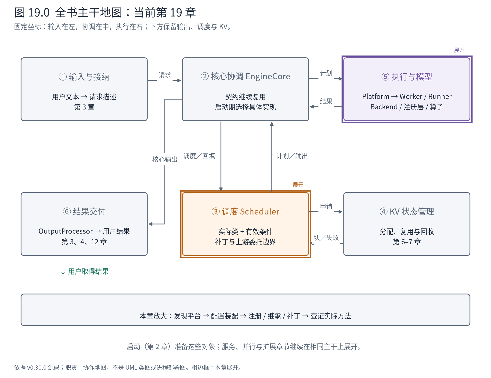
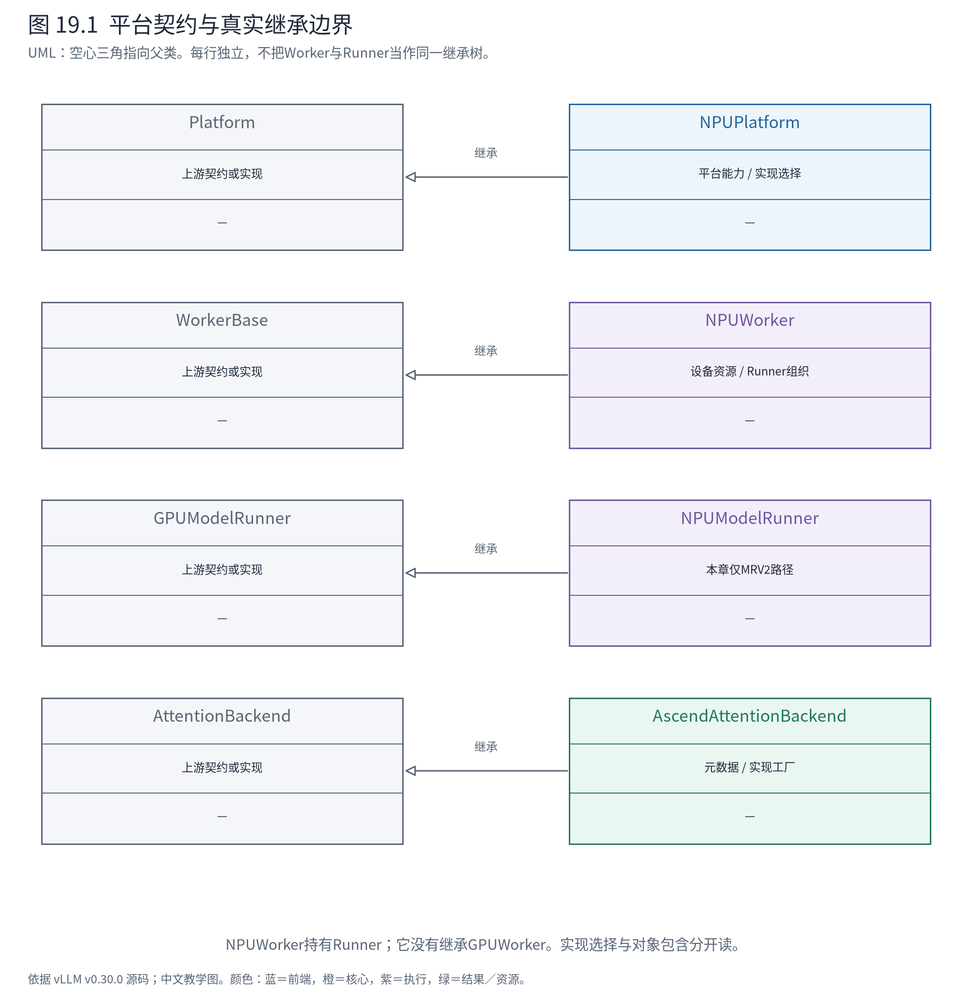
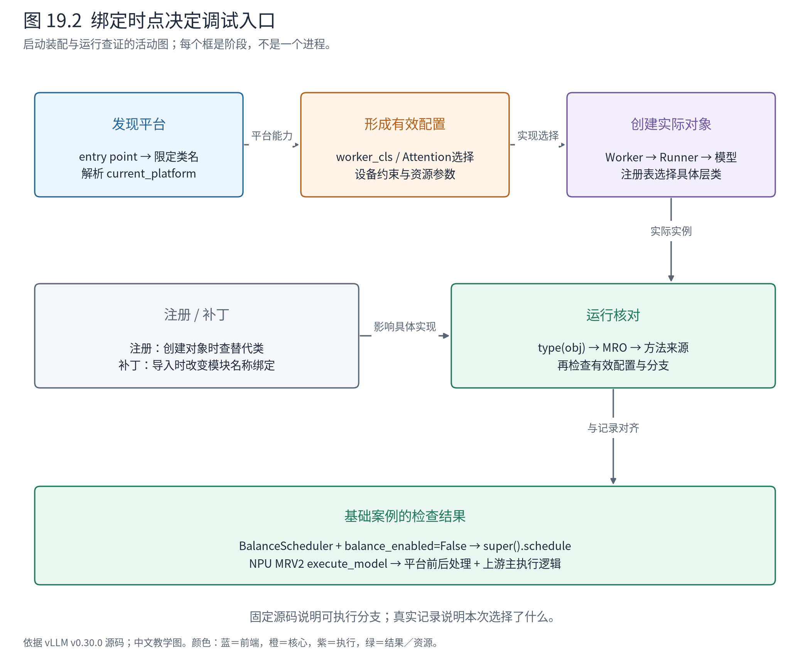

# 第 19 章 平台插件与 Ascend：同一契约怎样选中不同实现

从第 3 章开始，我们主要依据上游源码理解 vLLM，却一直在 Ascend NPU 上观察 A/B。为什么上游路径中的 Worker、Runner 或模型层，在日志里会出现 `vllm_ascend` 的类名？哪些逻辑仍来自上游，哪些已被替换？

本章把这些分支集中展开。目标是能沿一次装配与调用，判断当前执行的实现来自哪里，而不是把 Ascend 变成另一条与上游无关的主线。



**先在地图上定位。** 主变化在⑤及其设备资源边界，启动期通过配置和注册选择具体实现；某些补丁也触及③。输入、调度计划和结果这些跨模块契约继续存在。不能仅凭“平台插件”四个字，就假设它只替换一个矩阵乘法函数。

## 19.1 先问在哪个时刻替换了什么

平台适配有多种机制。本章将它们按绑定时点区分：

| 机制 | 绑定时点 | 替换或选择的对象 | 阅读证据 |
|---|---|---|---|
| 平台发现 | 首次解析 current_platform | Platform 实现类 | Python entry point 与返回的限定名 |
| 配置装配 | 有效配置形成、创建 Worker 前 | Worker、Attention 后端等 | 平台配置更新与工厂选择 |
| 类注册 | 层实例创建前 | 具体模型层或 CustomOp 类 | 树外注册表与 `__new__` |
| 继承覆写 | 调用实际实例的方法时 | 某个方法及其前后处理 | MRO、方法定义位置、super 调用 |
| 模块补丁 | 特定模块导入或初始化时 | 模块属性绑定、函数等 | 明确的赋值与导入顺序 |

限定名是“模块路径 + 类名”，例如 `vllm_ascend.worker.v2.model_runner.NPUModelRunner`。MRO 是 Python 查找继承方法的顺序。它们分别帮助回答“实例是哪一类”与“这个方法最终从哪里找到”。

这些机制可以同时出现。一个 NPU Worker 由配置选择，它持有的 Runner 又通过继承复用上游代码；模型层创建时再依据注册表换成平台实现。把一切统称为“重载”会掩盖不同的检查位置和失效方式。

## 19.2 平台从包元数据进入，而不是由模型代码猜硬件

vLLM 使用 Python 包的 entry points 发现插件。插件组指出用途，插件名标识条目，插件值给出可调用入口。Ascend 的安装元数据登记了 `vllm.platform_plugins` 中的 `ascend`，入口返回平台类的限定名：

<!-- book:ch19-register:start -->
源码教学注释版，vllm-ascend v0.30.0：[原文件 L72–L75](https://github.com/vllm-project/vllm-ascend/blob/c09d3e20b9c45c80b34ae3781440d90904a44023/vllm_ascend/__init__.py#L72-L75)。仅新增 `# 【解读】`，其他内容保留原文。

```python
# 【解读】entry point调用此函数发现平台；此处不创建Worker或模型。
def register():
    """Register the NPU platform."""

    # 【解读】返回限定类名，上游稍后解析并实例化平台对象。
    return "vllm_ascend.platform.NPUPlatform"
```
<!-- book:ch19-register:end -->

这个函数没有创建 NPUWorker，也没有加载权重。上游先收集候选，再决定平台：

<!-- book:ch19-select:start -->
源码教学注释版，vllm v0.30.0：[原文件 L263–L272](https://github.com/vllm-project/vllm/blob/ced6857afa0ea7b2e3f0846a62e1394e90f15607/vllm/platforms/__init__.py#L263-L272)。仅新增 `# 【解读】`，其他内容保留原文。

```python
    # 【解读】从已激活候选中取出树外平台插件。
    activated_oot_plugins = list(set(activated_plugins) & set(platform_plugins.keys()))

    # 【解读】多个树外平台同时激活时拒绝模糊选择。
    if len(activated_oot_plugins) >= 2:
        raise RuntimeError(
            "Only one platform plugin can be activated, but got: "
            f"{activated_oot_plugins}"
        )
    # 【解读】只有一个树外平台候选时使用其返回的限定名。
    elif len(activated_oot_plugins) == 1:
        platform_cls_qualname = platform_plugins[activated_oot_plugins[0]]()
        logger.info("Platform plugin %s is activated", activated_oot_plugins[0])
```
<!-- book:ch19-select:end -->

一个树外平台激活时采用该实现；多个树外平台同时激活则报错。之后 `current_platform` 的延迟解析把限定名变为实际 Platform 实例。延迟是为了让插件加载顺序先建立完整候选，而不是在模块导入到一半时就固定平台。

通用插件入口与平台入口承担不同职责。Ascend 还登记 connector、model loader、模型注册等 general plugins，它们扩展相应注册体系，不等于又选择一次平台。官方插件设计也要求注意重复调用以及多进程加载：父进程登记过的状态，不能自动等同于新 spawn 解释器已经登记。[官方插件设计](https://docs.vllm.ai/en/v0.30.0/design/plugin_system/)

配套自省脚本读取安装包的真实 entry points，并检查类定义文件与固定源码逐字相同：

<!-- book:ch19-platform:start -->
已安装包的entry point与类自省记录，来源文件逐字匹配固定源码；没有创建Worker实例或运行模型。来自[原始记录](evidence/platform/metadata.json)。

```json
{
  "entry_points": [
    {
      "name": "vllm-ascend",
      "group": "ms_service_metric.providers",
      "value": "vllm_ascend.observability:get_metric_provider"
    },
    {
      "name": "ascend_kv_connector",
      "group": "vllm.general_plugins",
      "value": "vllm_ascend:register_connector"
    },
    {
      "name": "ascend_model",
      "group": "vllm.general_plugins",
      "value": "vllm_ascend:register_model"
    },
    {
      "name": "ascend_model_loader",
      "group": "vllm.general_plugins",
      "value": "vllm_ascend:register_model_loader"
    },
    {
      "name": "ascend_service_profiling",
      "group": "vllm.general_plugins",
      "value": "vllm_ascend:register_service_profiling"
    },
    {
      "name": "ascend",
      "group": "vllm.platform_plugins",
      "value": "vllm_ascend:register"
    }
  ],
  "platform": {
    "class": "vllm_ascend.platform.NPUPlatform"
  },
  "worker": {
    "mro": [
      "vllm_ascend.worker.worker.NPUWorker",
      "vllm.v1.worker.worker_base.WorkerBase",
      "builtins.object"
    ]
  },
  "runner": {
    "mro": [
      "vllm_ascend.worker.v2.model_runner.NPUModelRunner",
      "vllm.v1.worker.gpu.model_runner.GPUModelRunner",
      "vllm.v1.worker.lora_model_runner_mixin.LoRAModelRunnerMixin",
      "builtins.object"
    ]
  }
}
```
<!-- book:ch19-platform:end -->

这是安装类与包元数据的观测，没有创建 Worker、没有加载模型。特别是 Attention 的具体选择依赖当前有效配置；脚本只检查候选类的来源，不能把一次无引擎的自省写成某条请求已选中该后端。

## 19.3 Worker 与 Runner 的继承关系并不对称

图 19.1 把四组关系并列，防止因为命名相似就画出不存在的继承线。



**图 19.1 怎样读。** NPUPlatform 继承 Platform；NPUWorker 继承 WorkerBase；MRV2 的 NPUModelRunner 继承上游 GPUModelRunner；AscendAttentionBackend 继承 AttentionBackend。空心三角只表示这些真实继承。NPUWorker 并没有因为负责设备工作就必然继承 GPU Worker。

平台形成有效配置时，根据硬件 profile 与相关设置选择 `worker_cls`。所以装配者按类名创建 Worker，并不需要为每种设备写一条独立的 EngineCore 主循环。Worker 负责设备、执行上下文和资源准备；它在设备可用后才创建 Runner：

<!-- book:ch19-runner:start -->
源码教学注释版，vllm-ascend v0.30.0：[原文件 L510–L516](https://github.com/vllm-project/vllm-ascend/blob/c09d3e20b9c45c80b34ae3781440d90904a44023/vllm_ascend/worker/worker.py#L510-L516)。仅新增 `# 【解读】`，其他内容保留原文。

```python
        # 【解读】读取有效MRV2开关；NPUWorker在设备准备后才创建Runner。
        if self.use_v2_model_runner:
            logger.warning("npu model runner v2 is in developing, some features doesn't work for now.")
            # 【解读】与MRV1同名的类位于不同模块，别只按短类名搜索。
            from vllm_ascend.worker.v2.model_runner import NPUModelRunner as NPUModelRunnerV2

            # 【解读】本书基础记录进入该分支。
            self.model_runner = NPUModelRunnerV2(self.vllm_config, self.device)
        else:
            # 【解读】未启用MRV2时走独立NPUModelRunner实现。
            self.model_runner = NPUModelRunner(self.vllm_config, self.device)
```
<!-- book:ch19-runner:end -->

两套 NPU Runner 的短类名相同，但模块路径不同。我们使用的是 `worker.v2.model_runner` 分支。阅读第 9 章的持久状态、InputBatch 时，真正重要的是它如何继承和覆写上游 MRV2，而不是看到“NPUModelRunner”就跳到旧 MRV1 文件。

MRV2 的执行方法在平台前后处理之间调用上游：

<!-- book:ch19-super:start -->
源码教学注释版，vllm-ascend v0.30.0：[原文件 L635–L645](https://github.com/vllm-project/vllm-ascend/blob/c09d3e20b9c45c80b34ae3781440d90904a44023/vllm_ascend/worker/v2/model_runner.py#L635-L645)。仅新增 `# 【解读】`，其他内容保留原文。

```python
        # 【解读】平台包装保留失败状态，供后续清理逻辑使用。
        forward_failed = True
        # 【解读】在平台决定的DP协调上下文中执行。
        with dp_coordination_context:
            try:
                # 【解读】调用上游MRV2主执行逻辑，说明平台实现没有把所有调度和批次逻辑重新写一遍。
                output = super().execute_model(
                    # 【解读】传递同一SchedulerOutput及中间张量契约。
                    scheduler_output,
                    intermediate_tensors=intermediate_tensors,
                    dummy_run=dummy_run,
                    skip_attn_for_dummy_run=skip_attn_for_dummy_run,
                    is_profile=is_profile,
                    context_len=context_len,
                    valid_dummy_state_slots=valid_dummy_state_slots,
```
<!-- book:ch19-super:end -->

这个 super 调用说明，请求状态更新、批次准备与模型执行的相当一部分组织仍可以沿上游主干理解。平台在调用前处理特定的 connector、调试和协调条件，调用后也有自己的收尾；复用主干不意味着整个函数行为与上游完全相同。

代价同样明显：上游方法参数、状态生命周期或调用顺序改变时，子类必须检查自己的前后条件是否仍成立。仅仅“Python 还能导入”不足以证明适配正确。固定版本的源码锚与真实调用记录，正是为了让这条兼容边界可以检查。

## 19.4 模型写 QKVParallelLinear，实例为何可能是 Ascend 类

第 16 章看到模型并行层类名，第 18 章看到装配函数。本节再打开模型层替换机制。上游 CustomOp 的创建逻辑会查树外注册表：

<!-- book:ch19-ops:start -->
源码教学注释版，vllm v0.30.0：[原文件 L119–L128](https://github.com/vllm-project/vllm/blob/ced6857afa0ea7b2e3f0846a62e1394e90f15607/vllm/model_executor/custom_op.py#L119-L128)。仅新增 `# 【解读】`，其他内容保留原文。

```python
        # 【解读】未登记树外实现时创建原类。
        if op_name not in op_registry_oot:
            op_cls_to_instantiate = cls
        else:
            # 【解读】有登记时选择替代类，选择发生在实例创建阶段。
            op_cls_to_instantiate = op_registry_oot[op_name]
            logger.debug(
                "Instantiating custom op: %s using %s",
                op_name,
                str(op_cls_to_instantiate),
            )
        # 【解读】返回选定类的实例；源码中的构造名字与type(obj)可能不同。
        return super().__new__(op_cls_to_instantiate)
```
<!-- book:ch19-ops:end -->

Ascend 的注册列表包含 QKVParallelLinear、RowParallelLinear、VocabParallelEmbedding、ParallelLMHead、RMSNorm 等名称，并通过 `CustomOp.register_oot` 登记对应实现。因此，模型定义可以保持上游的构造名字，而创建出的对象已经是平台类。

第 16 章的双卡记录中，embedding 与输出头实际显示为 AscendVocabParallelEmbedding 和 AscendParallelLMHead。PP 的非所属阶段又显示 PPMissingLayer。这两种变化含义不同：前者是实现替换，后者是本阶段没有该模块的职责。单凭“不是上游原类名”不能判定发生了哪一种变化。

PluggableLayer 也支持整层树外替换，但它不提供 CustomOp 那套逐平台 forward 分派。应先判断目标类采用哪种扩展契约，再看注册和实例，而不要把所有继承 torch.nn.Module 的类都当成同一种插件槽。

这些注册把平台差异集中到实现选择处，减少模型定义里的硬件条件分支；同时也让“读到的类名”与“运行的类名”可能不同。调试时至少记录 `type(obj)`、MRO 和目标方法定义位置，再回到注册入口解释原因。

## 19.5 Attention 适配必须保持元数据与 KV 的共同解释

第 11 章把 Attention 拆成 Backend、MetadataBuilder 与 Impl。Ascend 保留这个分工：平台选择 Backend，Backend 返回适用的构建器和实现类；它们共同约定 KV 布局、slot mapping、块表和有效长度。

NPUPlatform 的选择不是简单的“只要 NPU 就返回一个类”。它会检查 MLA、稀疏、压缩、上下文并行以及硬件族等条件。普通文本 GQA 是其中一个分支，其他模型不能照搬它的元数据字段解释。

例如普通 AscendAttentionBackend 的 KV shape 接口，在一种布局条件下返回 `[2, num_blocks, num_kv_heads, block_size, head_size]`，另一种返回 `[2, num_blocks, block_size, num_kv_heads, head_size]`。同样的五个数字，轴次序不同，Builder 与 Impl 必须共同承认。

回想 A 首轮的 slot 128–132 与 block 1：调度器给出物理块编号，Runner 根据位置准备 slot，平台实现再按选定布局访问设备缓存。块编号的逻辑意义没有改变，但张量实际怎样排列以及调用哪个 NPU 算子，不是 Scheduler 的职责。

这也解释了为什么不能把第 14 章 CUDA Graph 的源码描述直接改名为“NPU Graph 实测”。接口可以相似，底层捕获、内存和算子支持条件仍需独立验证。本书的 NPU eager 记录验证了指定配置的请求闭环；它没有替所有图模式或高级功能作能力担保。需要查具体支持时，使用[同版本 Ascend 官方文档](https://docs.vllm.ai/projects/ascend/en/v0.30.0/)及固定实现，而不是只查某个功能是否出现在目录里。

## 19.6 补丁改变名称绑定，配置决定是否采用新行为

还有一种机制超出了正常工厂选择：导入补丁模块后，直接修改另一个模块的属性。Ascend 的 `adapt_patch` 根据调用位置导入 platform 或 worker 补丁集合，具体改动由其中模块完成。

BalanceScheduler 是本书已经遇到的实例。补丁末尾执行：

<!-- book:ch19-patch:start -->
源码教学注释版，vllm-ascend v0.30.0：[原文件 L892–L897](https://github.com/vllm-project/vllm-ascend/blob/c09d3e20b9c45c80b34ae3781440d90904a44023/vllm_ascend/patch/platform/patch_balance_schedule.py#L892-L897)。仅新增 `# 【解读】`，其他内容保留原文。

```python
# The scheduler is constructed as ``Scheduler(...)`` from
# ``vllm.v1.core.sched.scheduler``. This takes effect when scheduler_cls is
# unset, covering ordinary synchronous, PD-prefill, and PD-mixed paths.
# vLLM-Ascend's recompute, dynamic-batch, and profiling schedulers set
# scheduler_cls and correctly bypass this name.
# 【解读】直接修改上游模块中的Scheduler名称绑定；这是运行期补丁，不是一个普通工厂参数。
_sched_mod.Scheduler = BalanceScheduler
```
<!-- book:ch19-patch:end -->

这使后续从该模块取得 Scheduler 时可能拿到 BalanceScheduler。它不是把磁盘里的上游源码文件改写了；变化发生在当前进程的 Python 名称绑定中。也不能假设此前已绑定到其他位置的每个旧引用都被这次赋值自动改变，所以加载时点与构造路径需要一起核对。

回到基础 A/B 的真实记录：

<!-- book:ch19-runtime:start -->
真实运行字段投影，保留字段名与值，省略无关项。来自[原始记录](evidence/baseline-inproc-traced/manifest.json)。

```json
{
  "effective": {
    "scheduler": "vllm_ascend.patch.platform.patch_balance_schedule.BalanceScheduler",
    "scheduler_mro": [
      "vllm_ascend.patch.platform.patch_balance_schedule.BalanceScheduler",
      "vllm.v1.core.sched.scheduler.Scheduler",
      "vllm.v1.core.sched.interface.SchedulerInterface",
      "abc.ABC",
      "builtins.object"
    ],
    "balance_enabled": false,
    "worker": "vllm_ascend.worker.worker.NPUWorker",
    "runner": "vllm_ascend.worker.v2.model_runner.NPUModelRunner",
    "runner_execute": {
      "symbol": "vllm_ascend.worker.v2.model_runner.NPUModelRunner.execute_model"
    }
  }
}
```
<!-- book:ch19-runtime:end -->

实际调度器类来自 Ascend，MRO 中仍包含上游 Scheduler；均衡开关是 false。实际 `schedule` 的入口进一步说明行为：

<!-- book:ch19-fallback:start -->
源码教学注释版，vllm-ascend v0.30.0：[原文件 L163–L165](https://github.com/vllm-project/vllm-ascend/blob/c09d3e20b9c45c80b34ae3781440d90904a44023/vllm_ascend/patch/platform/patch_balance_schedule.py#L163-L165)。仅新增 `# 【解读】`，其他内容保留原文。

```python
    # 【解读】实际对象虽是BalanceScheduler，具体行为仍取决于有效配置。
    def schedule(self, throttle_prefills: bool = False) -> SchedulerOutput:
        # 【解读】均衡未启用时，委托原Scheduler的schedule。
        if not self._balance_enabled:
            return super().schedule(throttle_prefills)
```
<!-- book:ch19-fallback:end -->

因此，第 5 章基础案例可以沿上游 schedule 解释，但必须同时披露平台子类与关闭条件。相反，如果之后启用了均衡分支，就不能拿这次基础实验的调度序列作为新设置的证据。



**图 19.2 怎样读。** 上半是启动时的发现、选择和装配；下半是运行时查证实际对象和分派的方法。注册和模块补丁位于不同绑定点，二者都可能影响最终实例，但不应混成一条泛泛的“插件调用”。

本章的导航树也按时间分开：

```text
准备 / 装配
├─ 安装包entry point → Ascend.register → NPUPlatform限定名
├─ current_platform解析 → 平台检查并更新有效配置
├─ 平台 / Worker初始化中的注册与补丁
└─ 执行器 → NPUWorker → 按开关创建NPU MRV2 Runner

运行核对
├─ type(scheduler) + _balance_enabled → 是否委托上游schedule
├─ type(runner) + execute_model定义 → 平台包装 / super主干
└─ type(模型层) + Backend / Builder / Impl → 具体算子与布局契约
```

这是绑定与查证路线，不是一次线程活动栈。它帮助读者把“固定源码读到什么”与“特定环境实际执行什么”对齐。平台抽象的价值是让主干契约可复用；它的成本是装配、注册、继承和补丁共同决定行为，排查必须穿过这些绑定层。

至此，我们拥有了入口、核心、执行、并行和平台这几组源码坐标。接下来回到跨组件扩展。第 20 章从投机解码开始：当一轮不再只确认一个 token 时，Scheduler 的进度、Runner 的验证批次和结果回填要如何共同改变？

**源码停点：** [平台配置选择](https://github.com/vllm-project/vllm-ascend/blob/c09d3e20b9c45c80b34ae3781440d90904a44023/vllm_ascend/platform.py#L1362-L1373)看 Worker 绑定；[算子注册表](https://github.com/vllm-project/vllm-ascend/blob/c09d3e20b9c45c80b34ae3781440d90904a44023/vllm_ascend/utils.py#L872-L890)对齐模型层名称；[Attention 后端](https://github.com/vllm-project/vllm-ascend/blob/c09d3e20b9c45c80b34ae3781440d90904a44023/vllm_ascend/attention/attention_v1.py#L77-L118)看工厂与布局。先辨明绑定机制，再进入某个具体 NPU 内核。
