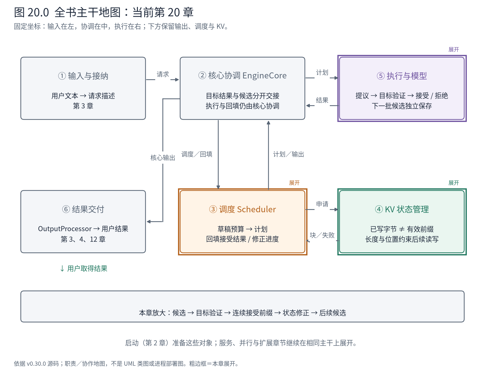
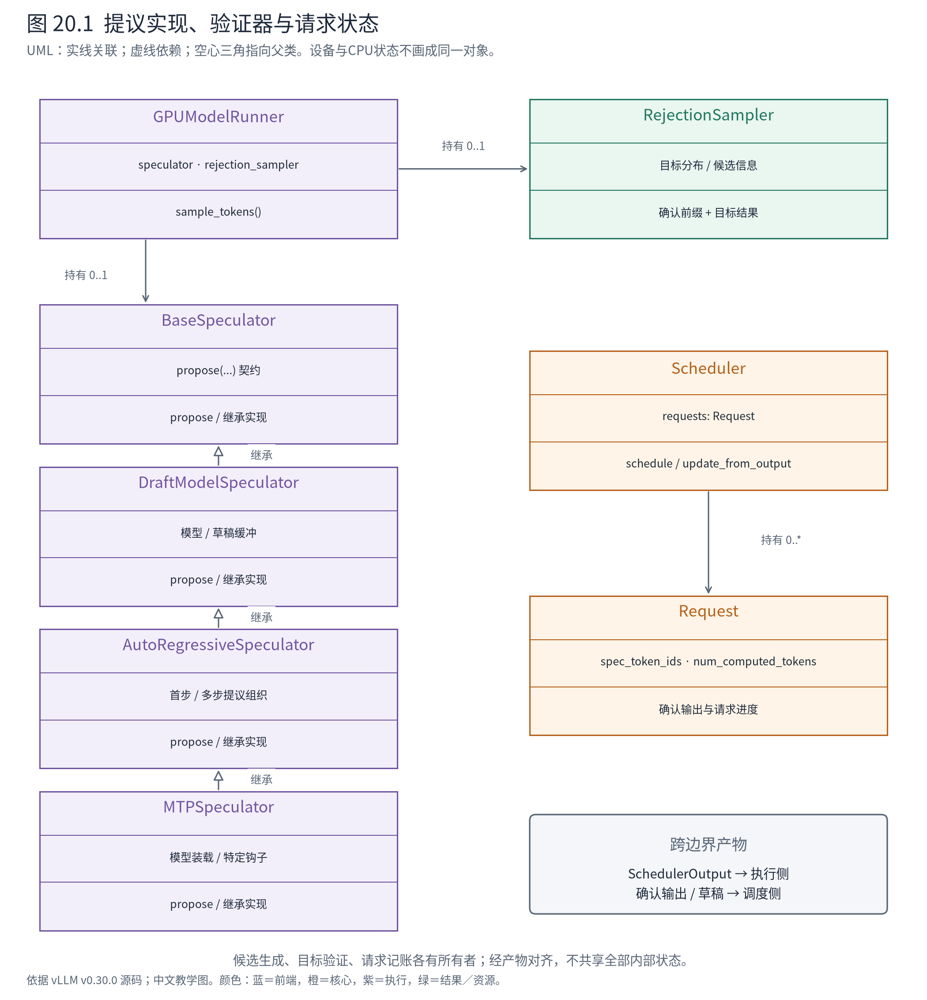
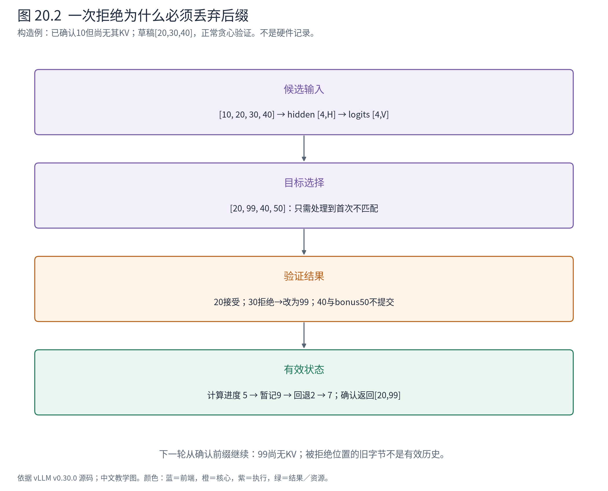

# 第 20 章 投机解码：候选怎样成为确认历史

第 19 章解释了实现可以怎样替换。本章开始检查另一类扩展：它不只替换一个计算方法，还改变了一轮执行的含义。此前一次 decode 通常为每条请求产生一个 token；现在让较便宜的提议过程先给出几个候选，再让目标模型一起检查，能否减少目标模型串行执行的次数？

Book6 已讲过投机解码的算法。本章进入源码，追问三个所有权问题：谁保存候选，谁有权确认它，谁负责撤销错误候选造成的进度？这三个问题不分清，`num_computed_tokens`、草稿长度和返回长度就会混成一个数字。



**怎样读地图。** ⑤增加提议和验证，③安排候选占用的 token 预算，并接收验证后的进度修正。④继续提供状态空间，但“写过 KV”不自动意味着这段历史已被确认。⑥只能交付确认结果。

## 20.1 把两条时间线分开：已经确认，与希望确认

沿用 B“地球上最大的海洋”这一请求语境，但为了讨论多候选，将输出长度上限放宽。以下用整数 token 的**构造例**说明验证；不是基础 B 的真实生成轨迹，也不声称 Qwen3-0.6B 配有 MTP 权重。

假定当前已有一个确认输出 `x=10`，其 KV 尚未进入有效前缀。提议器给出 `[20,30,40]`。目标模型这次输入可写成 `[10,20,30,40]`，形状为 `[4]`；前向得到隐藏状态 `[4,H]`，输出头得到 logits `[4,V]`。这里 H 是该目标模型隐藏宽度，V 是词表大小。

| 目标 logits 行 | 计算时看到的新增条件 | 这一行要决定什么 |
|---|---|---|
| 0 | 10 | 第一个候选20是否可接受 |
| 1 | 10,20 | 第二个候选30是否可接受 |
| 2 | 10,20,30 | 第三个候选40是否可接受 |
| 3 | 10,20,30,40 | 全部接受时，再产生一个目标模型token |

因果 Attention 允许这些位置在同次前向中计算；但它没有让未来 token 变成已知事实。若贪心目标选择是 `[20,99,40,50]`，第一个候选通过，第二个失败，本轮返回 `[20,99]`。第三个候选即使恰好等于第三行最大值，也不能越过失败点继续接受：第三行以错误的30为条件，并没有回答正确前缀 `[10,20,99]` 后该生成什么。

如果三项全通过，本轮才可以返回 `[20,30,40,50]`。最后的50是目标模型额外产生的 token，通常还没有自己的 KV。**批量验证的是一段假设历史；提交的是其中连续有效的前缀，加一个目标结果。**

## 20.2 谁提出，谁裁决，谁记账

MRV2 在 `GPUModelRunner` 内装配 `speculator` 与 `rejection_sampler`。前者封装如何便宜地产生候选，后者消费目标模型的验证结果。Scheduler 保存 CPU 侧请求进度及候选，负责把它们放入下一份 `SchedulerOutput`。



**怎样读图。** 实线是持有关系，虚线是调用／使用依赖，空心三角指向父类。`MTPSpeculator` 的继承链表达“某种提议实现”；Scheduler 与 Speculator 之间没有继承关系，也不直接共享同一个 Request 对象。

| 对象或产物 | 它封装什么 | 主要状态或交付物 |
|---|---|---|
| BaseSpeculator | 提议操作的抽象契约 | `propose(...)` 的输入输出约定 |
| DraftModelSpeculator | 由草稿模型支持的提议资源 | 模型、输入缓冲、候选矩阵，必要时草稿 logits |
| AutoRegressiveSpeculator | 首步与后续草稿步的执行组织 | 当前草稿步、位置、Attention／图执行状态 |
| MTPSpeculator | 特定 MTP 模型装配与钩子 | 加载方式及模型特有状态 |
| RejectionSampler | 将目标评估转换为可提交结果 | 接受长度、纠正 token、拒绝数量 |
| Request / Scheduler | 请求级进度与下一轮预算 | `spec_token_ids`、已计算进度、计划中的草稿 |

MTP 子类调用的装载工具名是 `load_eagle_model`；不能因此把本次配置说成 EAGLE。方法名的复用不改变工厂选择的算法。`init_speculator` 才是追查 MRV2 实现选择的入口。

这是一个明确的可替换边界：提议方法可以改变，目标验证与请求进度契约仍须一致。代价是多份状态需要对齐——设备侧的候选行、CPU 请求身份、调度裁剪后的长度和最终接受长度，一个也不能靠“它们应该一样”省掉。

## 20.3 从上一轮结果生成下一轮候选

将稳态闭环写成源码调用树更容易看清时序。以下是固定版本的**静态调用路径**，折叠了通信、图模式与模型内部层；不是实测活动栈：

```text
核心迭代（已有候选时）
├─ Scheduler.schedule
│  └─ 裁剪候选数量 → SchedulerOutput.scheduled_spec_decode_tokens
├─ Executor / Worker → MRV2
│  ├─ 组织目标输入 → 目标模型前向 → logits
│  ├─ sample_tokens → sample
│  │  └─ RejectionSampler：确认前缀 + 目标结果
│  └─ sample_tokens 中的后续处理
│     ├─ speculator.propose
│     │  ├─ prepare_prefill_inputs：使用本轮接受／拒绝数
│     │  ├─ _prefill：生成第一个候选
│     │  └─ _multi_step_decode 或融合版本：其余候选
│     └─ DraftTokensHandler：保存并交出新候选
├─ Scheduler.update_from_output：确认输出、修正进度
└─ update_draft_token_ids：登记候选，供后续调度
```

实际异步执行会把提交与回填错开；树里的“后续调度”不能机械等同于同一个 Python 栈帧的下一行。我们先抓逻辑依赖：新的候选必须依据本轮实际接受的前缀，而不是沿被拒绝的后缀继续猜。

<!-- book:ch20-propose:start -->
源码教学注释版，vllm v0.30.0：[原文件 L2142–L2158](https://github.com/vllm-project/vllm/blob/ced6857afa0ea7b2e3f0846a62e1394e90f15607/vllm/v1/worker/gpu/model_runner.py#L2142-L2158)。仅新增 `# 【解读】`，其他内容保留原文。

```python
            # 【解读】此处已经得到本轮验证结果，接下来为后续验证准备新草稿。
            with use_workspace_lane(self._draft_workspace_lane):
                draft_tokens = self.speculator.propose(
                    # 【解读】批次、Attention元数据和slot映射共同约束提议模型的输入位置。
                    input_batch,
                    attn_metadata,
                    slot_mappings_by_layer,
                    # 【解读】目标模型的隐藏状态可作为提议模型输入，具体模型负责适配。
                    spec_hidden_states,
                    aux_hidden_states,
                    # 【解读】接受与拒绝的数量决定有效前缀，避免继续沿被否定的历史提议。
                    num_sampled,
                    num_rejected,
                    self.req_states.last_sampled_tokens,
                    self.req_states.next_prefill_tokens,
                    self.sampler.sampling_states.temperature.gpu,
                    self.sampler.sampling_states.seeds.gpu,
                    dp_sync=dp_sync,
                    mm_inputs=mm_inputs,
                )
            # 【解读】按持久请求行保存候选；不是追加到用户已确认输出。
            self.req_states.draft_tokens[input_batch.idx_mapping] = draft_tokens
```
<!-- book:ch20-propose:end -->

这里传入的不只是 token。`spec_hidden_states` 是目标提供的隐藏特征；`num_sampled` 与 `num_rejected` 为每请求向量 `[R]`，告诉提议端真实有效的边界；`idx_mapping` 将当步 R 行映射回持久请求槽位。提议结果通常是 `[R,K]`，K 为草稿步数。目标与草稿隐藏宽度未必相同，适配责任在具体模型路径中，不能把所有方法都画成同宽张量直接复制。

AutoRegressiveSpeculator 先准备首步输入，再生成剩余候选：

<!-- book:ch20-decode:start -->
源码教学注释版，vllm v0.30.0：[原文件 L376–L392](https://github.com/vllm-project/vllm/blob/ced6857afa0ea7b2e3f0846a62e1394e90f15607/vllm/v1/worker/gpu/spec_decode/autoregressive/speculator.py#L376-L392)。仅新增 `# 【解读】`，其他内容保留原文。

```python
        # 【解读】进入多步草稿生成阶段；子类可实现相关钩子。
        self.on_multi_step_decode_begin(num_reqs)
        # Generate the remaining num_speculative_steps - 1 draft tokens.
        # 【解读】选择融合或普通多步执行方式，二者遵守同一个提议结果契约。
        decode_fn = (
            self._fused_multi_step_decode
            if self.use_fused_multi_step_decode
            else self._multi_step_decode
        )
        # 【解读】剩余步数的执行受本轮批次、图模式和DP协作约束。
        decode_fn(
            num_reqs,
            dummy_run and skip_attn_for_dummy_run,
            decode_batch_desc,
            num_tokens_across_dp,
            input_batch.seq_lens_cpu_upper_bound,
        )
        # 【解读】阶段结束后恢复子类临时状态。
        self.on_multi_step_decode_end(num_reqs)

        # 【解读】返回本批次请求的候选矩阵，每行对应一个请求。
        return self.draft_tokens[:num_reqs]
```
<!-- book:ch20-decode:end -->

首步之后，每条请求每个草稿步生成一个候选，因此可形成较稳定的执行形态；但额外模型、KV、图捕获和多次提议计算都会消耗资源。其源码还明确保留与目标输入相同的形状，把拒绝位置作为填充处理，以减少 CPU 为获知拒绝数而等待设备的需要。这是第 13、14 章“减少同步”与“维持稳定形态”在扩展算法中的再应用，不意味着填充位置也被提交。

## 20.4 验证器必须知道它在验证什么

MRV2 根据当步是否存在草稿选择采样路径：

<!-- book:ch20-sampler:start -->
源码教学注释版，vllm v0.30.0：[原文件 L1552–L1564](https://github.com/vllm-project/vllm/blob/ced6857afa0ea7b2e3f0846a62e1394e90f15607/vllm/v1/worker/gpu/model_runner.py#L1552-L1564)。仅新增 `# 【解读】`，其他内容保留原文。

```python
        # 【解读】当前批次没有草稿，或未装配拒绝采样器，沿普通采样路径。
        elif input_batch.num_draft_tokens == 0 or self.rejection_sampler is None:
            assert self.sampler is not None
            sampler_output = self.sampler(logits, input_batch)
        else:
            # 【解读】有草稿时由验证采样器决定哪些候选成为确认结果。
            # Rejection sampling for spec decoding.
            assert self.rejection_sampler is not None
            assert self.speculator is not None
            sampler_output = self.rejection_sampler(
                # 【解读】target logits来自本轮目标模型前向。
                logits,
                input_batch,
                # Draft logits are needed for probabilistic rejection sampling.
                # 【解读】概率验证还要知道提议分布，不能只比较两个模型的最大值。
                self.speculator.draft_logits,
            )
```
<!-- book:ch20-sampler:end -->

同一个请求可以在首轮 prefill 或没有有效草稿的轮次走普通采样，在有草稿时走验证。不要依据“引擎开启投机”就断言每次执行都必定有 K 个候选。

本章先沿基础案例的 `temperature=0` 理解正常贪心分支。目标全局 argmax 已在前面的内核代码算好，接下来的决定是：

<!-- book:ch20-accept:start -->
源码教学注释版，vllm v0.30.0：[原文件 L584–L595](https://github.com/vllm-project/vllm/blob/ced6857afa0ea7b2e3f0846a62e1394e90f15607/vllm/v1/worker/gpu/spec_decode/rejection_sampler_utils.py#L584-L595)。仅新增 `# 【解读】`，其他内容保留原文。

```python
                # 【解读】synthetic模式人为指定接受率，不能用它说明正常解码正确性。
                if SYNTHETIC_MODE:
                    rate = tl.load(synthetic_conditional_rates_ptr + i)
                    accepted = u < rate
                else:
                    # 【解读】正常贪心路径要求候选与目标argmax完全一致。
                    accepted = target_argmax == draft_sampled
                # 【解读】负数占位候选无效，必须拒绝。
                accepted &= is_valid_draft
                # 【解读】首次拒绝后停止验证后续候选，后缀依赖的条件已失效。
                verifying = accepted
                accepted_length += accepted
                # 【解读】接受时写候选；拒绝点写目标选择作为纠正token。
                tl.store(
                    sampled_ptr + req_idx * sampled_stride + i,
                    draft_sampled if accepted else target_argmax,
                )
```
<!-- book:ch20-accept:end -->

`verifying` 是本段算法的关键状态：一旦变成假，就不再把后缀当作可确认的候选。`accepted_length` 只累计通过的前缀。`SYNTHETIC_MODE` 是人为接受率分支，研究性能时可能有用，但不能拿它作为正常正确性依据。

随机采样还多一个约束：不能简单地“只要目标概率大就接受，否则直接按目标再抽一次”。设目标条件分布为 p、提议分布为 q，普通逐 token 算法以 $\min(1,p(x)/q(x))$ 的概率接受候选 x；拒绝时从归一化的 $\max(p-q,0)$ 残差分布重采样。用人话说，提议器已经让某些 token 出现得过多，纠正步骤必须补偿这种偏差。p、q 都是长度 V 的概率向量，接受率是标量。

例如词表只含两项，p=[0.8,0.2]、q=[0.5,0.5]。第一项总被接受，第二项以0.4接受；第二项被拒绝的概率质量0.3全部补给第一项，最终回到[0.8,0.2]。这一算法依据来自[原始论文](https://arxiv.org/abs/2211.17192)，源码的正常概率分支使用等价的 log 概率比判断。固定版本还存在 block verification 等分支，本章不把它们与逐 token 算法混讲。算法分布保证也不等于所有硬件浮点路径、随机数消费顺序下逐次输出字节一致。

## 20.5 拒绝之后，撤销的是哪一段状态



**怎样读图。** 从上到下看同一次构造验证。目标计算覆盖10及三个候选；确认只包含20和纠正99。底部进度是有效 KV 前缀，不是“本轮总共做过多少计算”。

继续前面的例子。假设本轮前 `num_computed_tokens=5`，调度10及三个候选共4个位置，暂记为9。只接受一个草稿后，拒绝数为2，进度退到7：有效 KV 对应原来的5个位置加10、20。新产生的99尚未计算 KV，将成为后续输入。设备上即使仍留着30、40的字节，也不能通过有效长度和元数据把它们当成确认历史读取。

Scheduler 的实际回填代码同时考虑异步占位和抢占旧结果：

<!-- book:ch20-rollback:start -->
源码教学注释版，vllm v0.30.0：[原文件 L1983–L1995](https://github.com/vllm-project/vllm/blob/ced6857afa0ea7b2e3f0846a62e1394e90f15607/vllm/v1/core/sched/scheduler.py#L1983-L1995)。仅新增 `# 【解读】`，其他内容保留原文。

```python
                # 【解读】以本轮实际调度的草稿数量为准，不用proposer最初想提议的上限。
                num_draft_tokens = len(scheduled_spec_token_ids)
                # 【解读】普通自回归路径每步额外有一个目标采样结果。
                num_sampled = self.num_sampled_tokens_per_step
                # 【解读】从返回长度扣除这个结果，得到被接受的草稿数量。
                num_accepted = max(len(generated_token_ids) - num_sampled, 0)
                # 【解读】未被接受的整个后缀都计入拒绝。
                num_rejected = num_draft_tokens - num_accepted
                # Rejections roll back num_computed_tokens (and, under async
                # scheduling, num_output_placeholders, which covers the spec
                # tokens). A stale rejection count predates the preemption
                # rollback and must not apply.
                # 【解读】抢占后的旧结果不再回退进度，避免重复记账。
                if not output_is_stale:
                    if request.num_computed_tokens > 0:
                        # 【解读】修正有效计算前缀；不要求擦除设备中所有旧字节。
                        request.num_computed_tokens -= num_rejected
                    if request.num_output_placeholders > 0:
                        # 【解读】异步路径还要同步修正占位计数。
                        request.num_output_placeholders -= num_rejected
```
<!-- book:ch20-rollback:end -->

这里 `len(generated_token_ids)=2`，普通路径 `num_sampled_tokens_per_step=1`，因此接受草稿1、拒绝2。代码没有写死“总是减1”，因为固定版本还支持不同的单步输出语义。`output_is_stale` 又把本章连接到第13章：抢占已经做过进度回退，旧验证结果不能再扣一遍。

物理块的生命周期与 token 的有效性也不是同一层。拒绝不要求立即逐字节擦除 KV；调度器、Runner 和提议器必须共同维护正确长度及写入位置，后续覆盖无效位置。它们承担一致性成本，换取少做目标模型串行轮次的机会。是否划算还取决于接受率、额外计算、内存压力和批次负载，本章没有投机硬件性能读数。

## 20.6 用一个真正执行的提议函数看清“候选”本身

MTP 依赖合适的模型权重，基础 Qwen3-0.6B 实验没有运行它。为了让读者看到一个可复现的候选产物，另开**MRV1 n-gram 辅助分支**：在历史中寻找与当前后缀相同的片段，把那个片段之后的 token 作为候选。上游 v0.30.0 的 MRV2 `init_speculator` 没有 n-gram 分支，下面不是同一执行器中的替代实测。

CPU 脚本直接执行固定源码的函数体，只去掉 Numba 装饰器，不重新实现匹配算法。输入整数只是教学 ID：

<!-- book:ch20-ngram-data:start -->
CPU执行固定源码函数体，去掉Numba装饰器；token ID为构造值。属于MRV1辅助路径，不是MRV2或NPU投机推理实测。来自[原始记录](evidence/ngram-contract/trace.json)。

```json
{
  "cases": [
    {
      "history": [
        10,
        20,
        30,
        40,
        10,
        20
      ],
      "max_model_len": 32,
      "min_ngram": 2,
      "max_ngram": 2,
      "k": 2,
      "draft": [
        30,
        40
      ]
    },
    {
      "history": [
        10,
        20,
        30
      ],
      "max_model_len": 32,
      "min_ngram": 2,
      "max_ngram": 2,
      "k": 2,
      "draft": []
    },
    {
      "history": [
        10,
        20,
        30,
        40,
        10,
        20
      ],
      "max_model_len": 6,
      "min_ngram": 2,
      "max_ngram": 2,
      "k": 2,
      "draft": []
    }
  ]
}
```
<!-- book:ch20-ngram-data:end -->

第一行的末尾 `[10,20]` 曾在开头出现过，其后是 `[30,40]`，所以候选为这两项；第二行没有历史匹配；第三行虽有匹配，但已到长度上限。这三个输出说明提议器可以交付较短候选或空候选，不具有保证生成 K 个有效结果的权力。

匹配完成后的真实返回部分是：

<!-- book:ch20-ngram:start -->
源码教学注释版，vllm v0.30.0：[原文件 L283–L293](https://github.com/vllm-project/vllm/blob/ced6857afa0ea7b2e3f0846a62e1394e90f15607/vllm/v1/spec_decode/ngram_proposer.py#L283-L293)。仅新增 `# 【解读】`，其他内容保留原文。

```python
    # 【解读】找不到足够长的历史匹配时，不勉强制造候选。
    if longest_ngram < min_ngram:
        # No valid ngram is found
        return np.empty((0,), dtype=origin_tokens.dtype)

    # Flip the position back, so in origin_tokens,
    # origin_tokens[total_token-1-position:total_token-1-position+longest_ngram]
    # is the matched ngram, so we should start drafting tokens from
    # total_token-1-position+longest_ngram
    # 【解读】把反向匹配位置变回原历史，候选从匹配片段之后开始。
    start_position = total_token - 1 - position + longest_ngram
    # 【解读】候选最多取现有历史中可用的后续部分。
    k = min(k, total_token - start_position)
    # 【解读】返回的是历史token片段；目标模型仍必须验证。
    return origin_tokens[start_position : start_position + k]
```
<!-- book:ch20-ngram:end -->

这个例子只验证候选如何形成，没有运行目标模型，也没有验证 MTP 或 NPU 拒绝采样内核。它帮助我们隔离一个重要契约：**候选可以来自不同算法，但只能被目标验证和状态提交过程认可。**

## 20.7 回到主干：扩展改变的是提交协议

现在可以重新解释投机一轮：Scheduler 给候选分配预算；Runner 让目标模型批量评价假设历史；验证器产生确认前缀和目标结果；CPU 与设备状态修正有效边界；提议器再基于确认结果准备后续候选。确认、提议与已经做过的计算，是三种不同事实。

下一章的结构化输出会再加一项资格检查：即使某个 token 的模型概率很高，它也可能不符合请求的语法。候选如何与语法状态共存，采样时的 mask 又是谁生成的，将沿同一条主干继续追查。

**源码导航。** 从 `v1/worker/gpu/spec_decode/__init__.py` 看实现选择，沿 `speculator.py` 与 `autoregressive/speculator.py` 到代表 MTP 的装配和提议；在 MRV2 的 `sample` 与 `sample_tokens` 对齐验证、候选保存；最后回到 Scheduler 的 `update_from_output` 与 `update_draft_token_ids`。能解释候选、接受长度、有效 KV 和下一轮输入后，即可停止，不必把每个 Triton 分块归约都读完。

来源与边界：[官方投机解码文档](https://docs.vllm.ai/en/v0.30.0/features/speculative_decoding/)、正文固定源码、[CPU 辅助记录](evidence/ngram-contract/trace.json)。概率算法见原始论文；图与整数例是据源码制作的教学视图，未运行 MTP／EAGLE 模型，也不报告投机加速。
