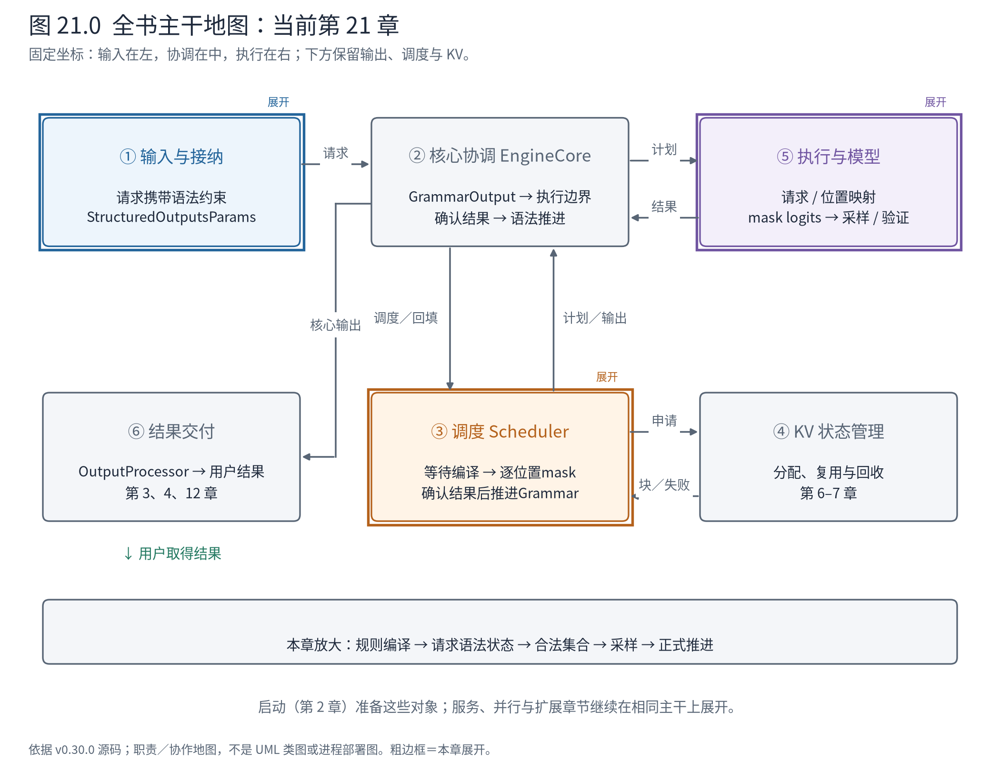
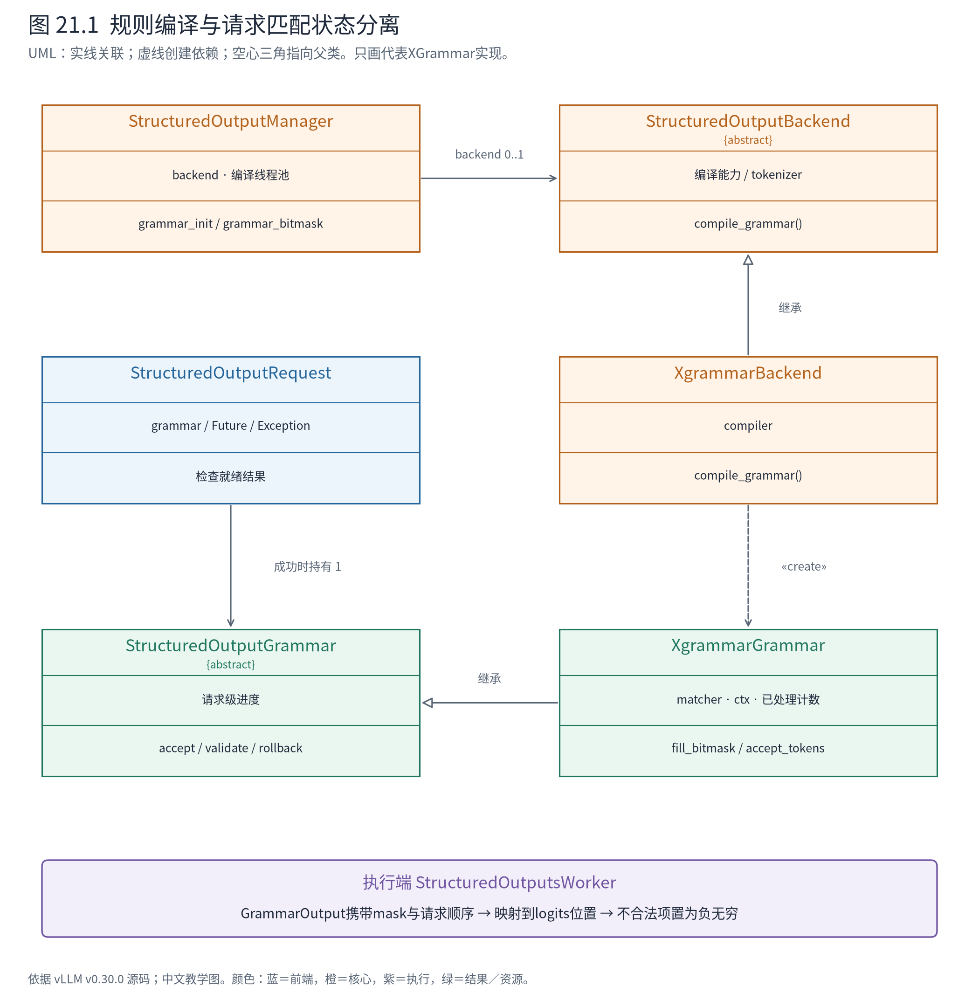
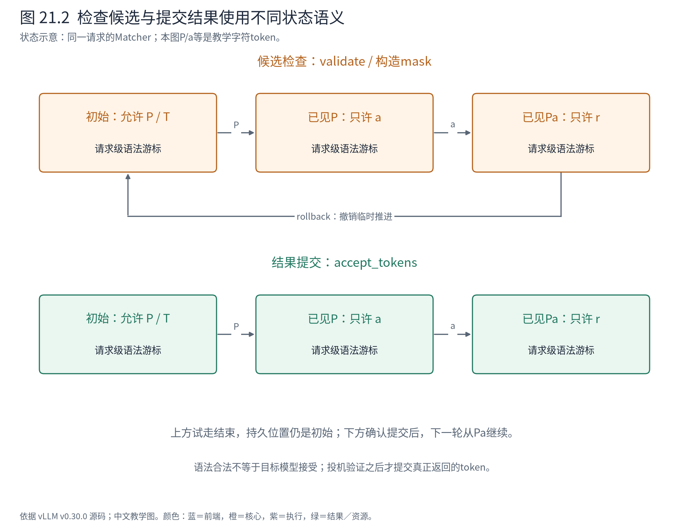

# 第 21 章 结构化输出：合法 token 由谁决定

第20章把模型候选与确认历史分开了。现在再给 A 增加一条要求：“答案只能是 Paris 或 Tokyo。”模型概率仍然负责在允许范围内选择，但选择范围不再是完整词表。把生成完的字符串交给正则检查，发现不合法再重试，并不能解释 vLLM 的结构化输出实现。

本章沿请求进入、语法就绪、mask 生成、采样和状态推进走一圈。我们继续讨论 A/C 的城市答案语境，实际演示采用小词表 CPU 语法实验，不把字符 ID 当成 Qwen 的真实分词。



**怎样读地图。** 输入侧携带约束；③维护请求级语法状态和就绪条件；⑤在采样前应用合法词表掩码；确认结果回到③推进语法。语法对象不需要替代模型，也不能由前端的文本消费速度驱动。

## 21.1 一份规则与一条请求走到哪，是两种对象

“只允许 Paris 或 Tokyo”是一份规则。A 已生成 P、C 已生成 T，则是两条请求不同的进度。即使两者使用同一份规则，下一步允许的字符也不同：A 只能接 a，C 只能接 o。

这正是源码将引擎级后端与请求级语法对象分开的理由。



**怎样读图。** Manager 持有后端；后端实现 `StructuredOutputBackend` 抽象契约，并创建请求级 `StructuredOutputGrammar` 实现。Request 经 StructuredOutputRequest 持有自己的语法或编译 Future。图中实线表示引用关系，不凭引用推断所有对象必须同时销毁。

| 抽象 | 生命周期与责任 | 不承担什么 |
|---|---|---|
| StructuredOutputBackend | 引擎级编译能力、词表信息、mask 分配 | 不保存所有请求共用的一份生成游标 |
| StructuredOutputGrammar | 请求级匹配状态，检查、推进、回退、填 mask | 不执行目标模型 |
| StructuredOutputManager | 装配后端、组织编译与批量 mask、处理约束生效区间 | 不负责模型 logits 计算 |
| StructuredOutputsWorker | 将语法行映射到执行行并应用 mask | 不重新解析原始 JSON Schema |

以 XGrammar 后端为例，编译结果 `ctx` 可以承载已经准备好的规则，而每次返回给请求的包装拥有一个 Matcher：

<!-- book:ch21-matcher:start -->
源码教学注释版，vllm v0.30.0：[原文件 L123–L131](https://github.com/vllm-project/vllm/blob/ced6857afa0ea7b2e3f0846a62e1394e90f15607/vllm/v1/structured_output/backend_xgrammar.py#L123-L131)。仅新增 `# 【解读】`，其他内容保留原文。

```python
        # 【解读】将编译产物包装成请求级Grammar。
        return XgrammarGrammar(
            # 【解读】为本请求创建独立Matcher游标，不共享可变解析进度。
            matcher=xgr.GrammarMatcher(
                ctx,
                # 【解读】停止token也进入契约，语法未完成时不能随意提前结束。
                override_stop_tokens=list(stop_token_ids) if stop_token_ids else None,
                # 【解读】投机检查需要回退能力，保留足够的历史窗口。
                max_rollback_tokens=self.num_speculative_tokens,
            ),
            vocab_size=self.vocab_size,
            ctx=ctx,
        )
```
<!-- book:ch21-matcher:end -->

这个边界很像“可复用程序”与“当前执行位置”的区别。复用编译工作可以减少启动成本，复用可变匹配游标却会让 A 的 P 改变 C 的合法下一步。源码阅读时，应分别追查编译器缓存和请求实例，而不是看到同一 schema 就认为整个对象都能共享。

语法也不保证事实正确。“Tokyo”符合这份规则，并不意味着它是法国首都。结构化约束限制表达集合，模型仍承担内容选择，应用仍需定义正确业务规则。

## 21.2 请求已到达，为什么还不能调度

Manager 第一次需要结构化输出时选择后端，调用编译工作。普通配置下，编译交给线程池，返回一个 Future；Request 已存在，但还没有可用的语法。于是产生 `WAITING_FOR_STRUCTURED_OUTPUT_GRAMMAR` 这个明确的等待原因。

Future 的读取逻辑没有把“未完成”和“编译失败”混为一谈：

<!-- book:ch21-future:start -->
源码教学注释版，vllm v0.30.0：[原文件 L44–L53](https://github.com/vllm-project/vllm/blob/ced6857afa0ea7b2e3f0846a62e1394e90f15607/vllm/v1/structured_output/request.py#L44-L53)。仅新增 `# 【解读】`，其他内容保留原文。

```python
    # 【解读】访问请求语法时，先检查编译Future是否已经完成。
    def _check_grammar_completion(self) -> bool:
        if isinstance(self._grammar, Future):
            try:
                # We will check whether the future is ready within 100 us
                # 【解读】短暂等待仍未完成，就把请求留在阻塞状态。
                self._grammar = self._grammar.result(timeout=0.0001)
            except TimeoutError:
                return False
            # 【解读】编译异常保存在该请求上，交由调度器定向处理。
            except Exception as e:
                self._grammar = e
        # 【解读】这里的完成包含成功和失败，不等于语法可用于采样。
        return True
```
<!-- book:ch21-future:end -->

随后调度器尝试将阻塞请求提升为可调度状态：

<!-- book:ch21-promote:start -->
源码教学注释版，vllm v0.30.0：[原文件 L2979–L2987](https://github.com/vllm-project/vllm/blob/ced6857afa0ea7b2e3f0846a62e1394e90f15607/vllm/v1/core/sched/scheduler.py#L2979-L2987)。仅新增 `# 【解读】`，其他内容保留原文。

```python
        # 【解读】这个等待原因与KV容量不足不同。
        if request.status == RequestStatus.WAITING_FOR_STRUCTURED_OUTPUT_GRAMMAR:
            structured_output_req = request.structured_output_request
            # 【解读】没有语法结果时继续等待。
            if not structured_output_req or structured_output_req.grammar is None:
                return False
            # 【解读】有结果但为异常时，登记请求级失败。
            if isinstance(structured_output_req.grammar, Exception):
                self.grammar_compile_error_reqs.add(request.request_id)
                return False
            # 【解读】只有得到可用结果，才回到普通等待队列语义。
            request.status = RequestStatus.WAITING
            return True
```
<!-- book:ch21-promote:end -->

注意 `is_grammar_ready=True` 的字面含义只是 Future 已有结果；结果也可能是 Exception。CPU 实验将同一个请求包装依次接到未完成、成功和失败的 Future，记录为：

<!-- book:ch21-future-data:start -->
CPU实际XGrammar与vLLM请求包装实验；小词表、语法和Future完成结果由脚本构造，没有运行模型或设备mask内核。来自[原始记录](evidence/grammar-cpu/trace.json)。

```json
{
  "future": {
    "pending": {
      "ready": false,
      "grammar_is_none": true
    },
    "ready": {
      "ready": true,
      "same_object": true
    },
    "failed": {
      "ready": true,
      "error_type": "ValueError"
    }
  }
}
```
<!-- book:ch21-future-data:end -->

失败请求进入 `grammar_compile_error_reqs` 后由调度器按请求处理，不需要把整个引擎当成损坏。另一个细节解释了配置与并发的关系：`external_launcher` 路径关闭异步语法编译，因为各 TP rank 都有调度器，若在不同时间把请求从语法等待转为普通等待，会破坏它们对一致调度的要求。异步不是无条件收益，它必须服从更外层的一致性契约。

## 21.3 mask 是当步产物，语法是跨步状态

下面这条调用树是固定源码整理，展示普通自回归的主要关系；CPU 与设备边界分开，非实测调用栈：

```text
核心接纳
└─ StructuredOutputManager.grammar_init → 编译Future

核心迭代
├─ Scheduler：检查语法就绪，形成SchedulerOutput
├─ Scheduler.get_grammar_bitmask
│  └─ StructuredOutputManager.grammar_bitmask
│     └─ Grammar.fill_bitmask → GrammarOutput
├─ 执行边界 → MRV2.sample_tokens → sample
│  ├─ 模型hidden → logits
│  ├─ StructuredOutputsWorker.apply_grammar_bitmask
│  └─ 普通Sampler / RejectionSampler
└─ Scheduler.update_from_output
   └─ StructuredOutputManager.accept_tokens → 请求Grammar推进
```

Grammar 保存的是“到目前为止已接受哪段语言”；mask 是对“当前这一位置允许哪些词表项”的回答。下一轮前缀变了，mask 就要重新获得。一个真实 tokenizer token 可能覆盖多个字符，因此后端必须结合 tokenizer 的词表信息判断，不能简单地为每个字符设置一位。

为了让位图可读，我们特意构造十项词表，每项恰好是一个字符或 EOS。CPU 实验使用真实的 XGrammar 编译器、Matcher，以及固定版本的 vLLM `XgrammarGrammar` 包装，规则为 `root ::= "Paris" | "Tokyo"`：

<!-- book:ch21-states:start -->
CPU实际XGrammar与vLLM请求包装实验；小词表、语法和Future完成结果由脚本构造，没有运行模型或设备mask内核。来自[原始记录](evidence/grammar-cpu/trace.json)。

```json
{
  "vocab": [
    "P",
    "a",
    "r",
    "i",
    "s",
    "T",
    "o",
    "k",
    "y",
    "<eos>"
  ],
  "states": {
    "before": {
      "mask_int32": [
        33
      ],
      "allowed_ids": [
        0,
        5
      ],
      "processed": 0,
      "terminated": false
    },
    "validated_prefix": [
      0,
      1,
      2,
      3,
      4
    ],
    "after_validate": {
      "mask_int32": [
        33
      ],
      "allowed_ids": [
        0,
        5
      ],
      "processed": 0,
      "terminated": false
    },
    "after_P": {
      "mask_int32": [
        2
      ],
      "allowed_ids": [
        1
      ],
      "processed": 1,
      "terminated": false
    },
    "after_Paris": {
      "mask_int32": [
        512
      ],
      "allowed_ids": [
        9
      ],
      "processed": 5,
      "terminated": false
    },
    "after_eos": {
      "mask_int32": null,
      "allowed_ids": null,
      "processed": 6,
      "terminated": true
    }
  }
}
```
<!-- book:ch21-states:end -->

读这份记录时，先看 `vocab` 再看状态。初始允许 ID0=P 与 ID5=T，压缩整数为33，因为第0位和第5位为1。`validate_tokens([0,1,2,3,4])` 确认 Paris 是合法候选，但前后 mask 相同，`processed` 仍为0。真正 `accept_tokens([0])` 后，只允许 ID1=a，整数变为2。接受完整 Paris 后只允许 EOS；接收 EOS 后才进入终结状态。

终结记录中的 mask 为 null：实验不再向已终结的 Matcher 请求下一步；直接请求会报错。Manager 的正常路径也会检查终结状态。这是生命周期约束，不是缺失了一份有效掩码。

每行压缩位图的形状是 `[ceil(V/32)]`、dtype 为 int32，R 行合起来是 `[R,ceil(V/32)]`；这个例子 V=10，一行只需一个整数。实际词表远大于10，但压缩与展开的契约相同。

## 21.4 从语法行到 logits 行，还要过一道映射

假设本轮执行顺序为 `[B,A,C]`，只有 A/C 使用语法。语法产物的顺序可能是 `[A,C]`，所以 mask 第0行不能直接作用到 logits 第0行，否则会约束 B。投机路径还给每条请求增加多个验证位置，单靠 request ID 也不够。

上游执行端显式建立“请求 + 位置”的映射：

<!-- book:ch21-map:start -->
源码教学注释版，vllm v0.30.0：[原文件 L74–L85](https://github.com/vllm-project/vllm/blob/ced6857afa0ea7b2e3f0846a62e1394e90f15607/vllm/v1/worker/gpu/structured_outputs.py#L74-L85)。仅新增 `# 【解读】`，其他内容保留原文。

```python
        # 【解读】语法行与目标logits行可能顺序不同，必须建立显式映射。
        # Construct bitmask -> logits mapping
        # Key by (request, position) rather than absolute logit index:
        # adaptive verification finalizes per-request logit offsets on
        # device, so the kernel resolves them from the GPU cu_num_logits.
        mapping = _build_grammar_mapping(
            # 【解读】当步请求顺序提供执行侧索引。
            input_batch.req_ids,
            # 【解读】mask列表自己的请求顺序可能只包含有约束的子集。
            grammar_req_ids,
            input_batch.cu_num_logits_np,
            # 【解读】投机路径还需逐候选位置的mask，不能每请求只取一行。
            input_batch.num_draft_tokens_per_req,
            self.num_bonus_tokens,
            self.mask_stride,
        )
```
<!-- book:ch21-map:end -->

普通路径中 logits 是 `[R,V]`；投机时它是所有待验证与目标额外采样位置拼起来的 `[L,V]`，L 不再等于请求数。mask 只覆盖有约束的那些位置。MRV2 的实现将 CPU mask 与映射异步复制到设备，计算流等待复制流后才进入内核。这里的 CUDA stream 源码用于说明上游契约，CPU 语法实验没有执行该设备路径。

压缩位图应用到 logits 的关键部分如下：

<!-- book:ch21-mask:start -->
源码教学注释版，vllm v0.30.0：[原文件 L152–L162](https://github.com/vllm-project/vllm/blob/ced6857afa0ea7b2e3f0846a62e1394e90f15607/vllm/v1/worker/gpu/structured_outputs.py#L152-L162)。仅新增 `# 【解读】`，其他内容保留原文。

```python
    # Unpack the bitmask.
    # 【解读】压缩位图中0代表禁止，先展开为每个词表位置的布尔条件。
    bitmask = ((packed_bitmask[:, None] >> (tl.arange(0, 32)[None, :])) & 1) == 0
    bitmask = bitmask.reshape(BLOCK_SIZE)

    # 【解读】保留允许项的原logit，只改被禁止且当前有效的位置。
    # Apply the bitmask to the logits.
    block_offset = block_id * BLOCK_SIZE + tl.arange(0, BLOCK_SIZE)
    tl.store(
        logits_ptr + logits_idx * logits_stride + block_offset,
        # 【解读】负无穷使该token在后续采样中不再有概率质量。
        -float("inf"),
        mask=position_is_active & bitmask & (block_offset < vocab_size),
    )
```
<!-- book:ch21-mask:end -->

允许项保留原值，禁止项变为负无穷。若玩具词表 `[P,T,X]` 的 logits 是 `[2,1,5]`，初始语法只允许 P/T，则应用后成为 `[2,1,-inf]`。原本最高的 X 被排除，剩下的概率仍按采样参数处理。结构化输出因此是**采样前的合法集合约束**，不是采样后把 X 改写成 P。

## 21.5 投机检查为什么需要回退

上一章的候选还没有提交，但为了生成第二个验证位置的语法 mask，必须暂时知道第一个候选对语法状态的影响。例如候选 `[P,a,X]`：检查第一项时允许 P/T，暂时接受 P 后才知道下一项只许 a，再接受 a 后才知道第三项应为 r；X 在此失败。

`validate_tokens` 的真实实现把“试走”与“提交”分开：

<!-- book:ch21-validate:start -->
源码教学注释版，vllm v0.30.0：[原文件 L187–L201](https://github.com/vllm-project/vllm/blob/ced6857afa0ea7b2e3f0846a62e1394e90f15607/vllm/v1/structured_output/backend_xgrammar.py#L187-L201)。仅新增 `# 【解读】`，其他内容保留原文。

```python
        # 【解读】语法已终结时，不再接受新的候选前缀。
        if self._is_terminated:
            return []

        accepted_tokens = []
        # 【解读】按候选顺序临时推进Matcher。
        for token in tokens:
            if self.matcher.accept_token(token):
                accepted_tokens.append(token)
                # 【解读】到达终结点便停止试走。
                if self.matcher.is_terminated():
                    break
            else:
                # 【解读】第一个不合法token截断整个后缀。
                break
        if len(accepted_tokens) > 0:
            # Rollback the FSM to the initial state
            # 【解读】撤销本次试走，不能把候选当成已经提交的输出。
            self.matcher.rollback(len(accepted_tokens))
        # 【解读】交出合法前缀，Grammar自身仍停在原确认位置。
        return accepted_tokens
```
<!-- book:ch21-validate:end -->



**怎样读图。** 上方从初始状态试走 P、a，再回到初始；下方在目标结果确认后正式推进。两个过程可能经过同一状态，但权限不同。前者为了检查候选、构造逐位置 mask，后者才改变下一轮持久语法位置。

Manager 的 `grammar_bitmask` 也遵守这个原则：按草稿位置填 mask，暂时调用 `accept_tokens`，记录推进次数，再用 `rollback` 撤销；返回的 mask 通过 NumPy 数组传给执行端。Sampler 确认结果后，Scheduler 才正式推进：

<!-- book:ch21-commit:start -->
源码教学注释版，vllm v0.30.0：[原文件 L2054–L2065](https://github.com/vllm-project/vllm/blob/ced6857afa0ea7b2e3f0846a62e1394e90f15607/vllm/v1/core/sched/scheduler.py#L2054-L2065)。仅新增 `# 【解读】`，其他内容保留原文。

```python
            # 【解读】验证后的确认token才正式推进请求语法。
            if new_token_ids and not self.structured_output_manager.accept_tokens(
                request, new_token_ids
            ):
                # 【解读】若语法拒绝这批结果，说明约束执行出现不一致。
                logger.error(
                    "Unexpected: grammar rejected tokens %s for request %s. "
                    "Terminating request.",
                    new_token_ids,
                    req_id,
                )
                # 【解读】将对应请求标为错误结束，不继续输出未经约束的后续内容。
                request.status = RequestStatus.FINISHED_ERROR
                request.resumable = False
                stopped = True
```
<!-- book:ch21-commit:end -->

这道检查失败会把请求标为 `FINISHED_ERROR`。它不是“用户提供的 schema 编译失败”——编译失败发生得更早；这里是已经运行后发现状态或约束不一致。区分两类失败，排查时才知道应检查输入规则，还是 mask 映射、投机回退与结果对齐。

推理模型还可能先输出思考段，再输出受约束答案。Manager 通过请求级 reasoner 和 `_get_constraint_start` 决定约束从哪里生效；不能笼统地说整个响应从第一个 token 起都受 JSON 规则限制。这个生效区间同样影响投机候选的逐位置检查。

## 21.6 留下的接口心智

一份规则经过编译成为可执行约束；每条请求有自己的匹配状态；每个采样位置由该状态产生合法集合；执行侧负责把集合映射到正确 logits 行；确认结果回来后才推进持久状态。编译、匹配、mask 和采样各自独立，靠请求身份与位置保持一致。

下一章会让输入也超出 token 字符串：图片先形成特征，再与语言模型输入对齐。结构化输出要求“语法状态对应正确生成位置”，多模态要求“媒体特征对应正确输入位置”，两者都把位置契约带进了全局主干。

**源码导航。** 先读 `v1/structured_output/backend_types.py` 的两个抽象；再读 `request.py` 与 Manager 的 `grammar_init`、`grammar_bitmask`、`accept_tokens`；代表后端读 `backend_xgrammar.py` 的 Matcher 创建、validate 与 rollback；执行端读 MRV2 `structured_outputs.py` 的映射和应用。能解释编译未完成、试走不提交以及 mask 对错行三种情景，即可停止，不必深入 XGrammar 的全部编译算法。

依据：[官方结构化输出文档](https://docs.vllm.ai/en/v0.30.0/features/structured_outputs/)、固定源码与[CPU 语法记录](evidence/grammar-cpu/trace.json)。图为中文教学视图；没有运行受约束模型生成，也未验证所有 JSON Schema 特性或所有后端。
