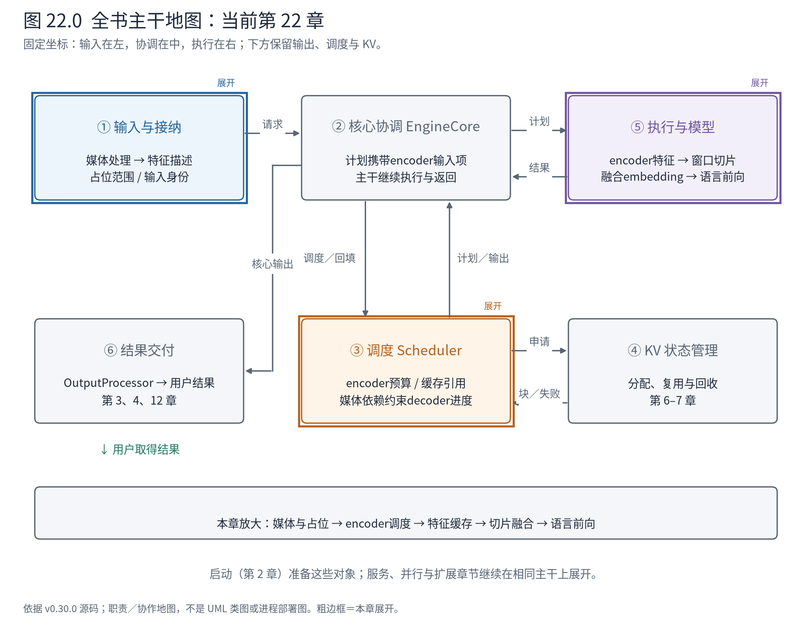
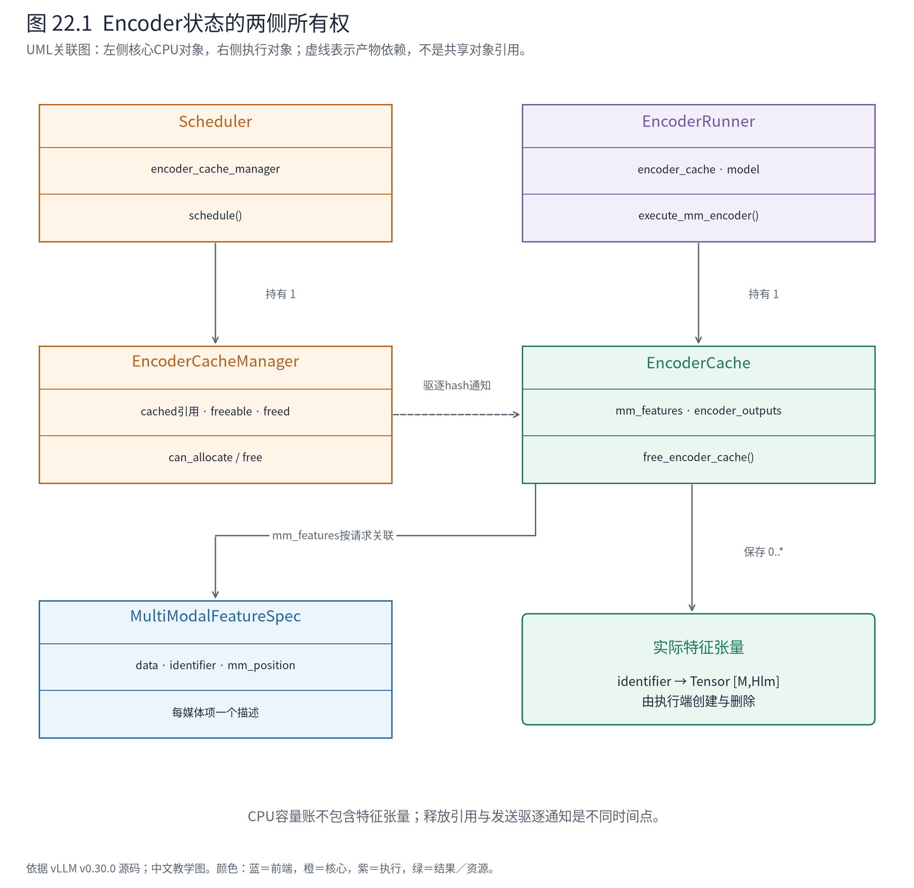
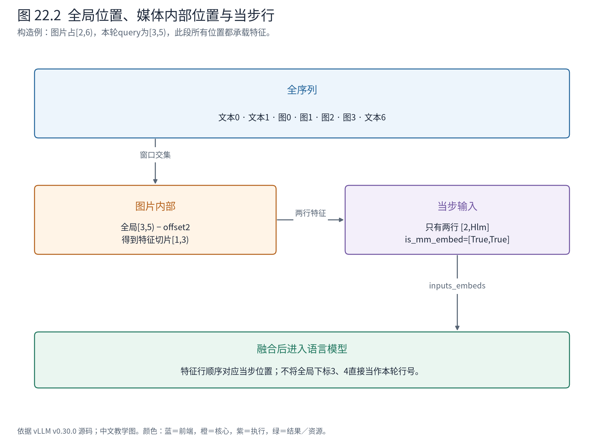

# 第 22 章 多模态：一张图片怎样进入同一条生成主干

前面的 A/C 只用文本询问城市。现在将 A 改成“看这张地标图片，回答它所在的城市”。如果仍把请求理解为一串 token ID，就少了至少三件事：图片如何预处理，视觉计算何时执行，得到的特征应填进语言序列的哪些位置。

本章以 Qwen2-VL 的上游实现为代表，沿多模态输入进入 MRV2 的路径走读。它是为了研究视觉接口而引入的模型分支；基础实验的 Qwen3-0.6B 仍是文本模型，没有因为请求携带图片就获得视觉能力。



**怎样读地图。** ①准备媒体及位置描述，③增加 encoder 计算与缓存约束，⑤先形成媒体特征，再与文本 embedding 合并，最后仍进入模型计算和采样。④的 decoder KV 继续保存语言模型状态，但它不是视觉特征缓存。

## 22.1 先分清三种容易都被叫作“缓存”的东西

| 资产 | 内容与位置 | 省掉什么工作 |
|---|---|---|
| 多模态处理产物 | 像素／网格等 processor 输出，及跨进程传递所需信息 | 重复预处理、部分重复传输 |
| Encoder 输出 | 图像等媒体编码后的 embedding，执行侧张量 | 重复视觉编码 |
| Decoder KV | 语言模型各层已经计算的上下文状态 | 重复语言前向的前缀计算 |

同一张图片再次出现，可能命中其中一层，也可能没有命中另一层。处理器已经认识这张图，不等于视觉张量已在当前 Worker；视觉张量还在，也不等于整段含图 prompt 的 decoder KV 可复用。

这个区分也决定调试时打印什么：先检查 `MultiModalFeatureSpec` 是否带对数据和位置，再检查 encoder 输出是否存在，最后才看语言模型的块表。直接从“图片缓存命中率”跳到“为什么还在 prefill”，中间会漏掉两道不同的工作。

## 22.2 媒体必须先获得序列坐标

Qwen2VLProcessor 适配底层处理器输出，并更新 prompt 的占位段。图片不是永远对应一个 token，也不是固定对应某个长度：

<!-- book:ch22-place:start -->
源码教学注释版，vllm v0.30.0：[原文件 L1150–L1158](https://github.com/vllm-project/vllm/blob/ced6857afa0ea7b2e3f0846a62e1394e90f15607/vllm/model_executor/models/qwen2_vl.py#L1150-L1158)。仅新增 `# 【解读】`，其他内容保留原文。

```python
        # 【解读】视觉特征经过空间合并，展开长度由合并粒度决定。
        merge_length = image_processor.merge_size**2

        def get_replacement_qwen2vl(item_idx: int, modality: str):
            # 【解读】取当前媒体项的处理产物，不用整批图片数量替代。
            out_item = out_mm_kwargs[modality][item_idx]
            # 【解读】grid_thw描述该项的时间与空间网格。
            grid_thw = out_item[f"{modality}_grid_thw"].data
            assert isinstance(grid_thw, torch.Tensor)

            # 【解读】把网格大小换算为语言序列需要的特征位置数。
            num_tokens = int(grid_thw.prod()) // merge_length
            # 【解读】占位token为后续embedding替换预留位置。
            return [placeholder[modality]] * num_tokens
```
<!-- book:ch22-place:end -->

构造一个最小网格 `grid_thw=[1,4,4]`，空间合并边长为2。网格共有16个位置，每4个合成一行语言侧特征，因此占位长度为4。这里是**公式代入的教学配置**，没有真的把一张图片预处理成该网格。真实图片尺寸、裁剪和处理器策略会影响结果。

InputProcessor 将不同模态的项按 prompt 位置排序，再形成 `MultiModalFeatureSpec`。每项至少要回答：

| 字段 | 消费者关心的问题 |
|---|---|
| `data` | 执行侧要用哪些处理产物；命中相关缓存时可省略传递 |
| `modality` | 用图像、视频还是其他模态的处理／执行契约 |
| `identifier` | encoder 输出应按哪个身份复用，必要时包括 LoRA 身份 |
| `mm_hash` | 原始处理产物的缓存身份，不能自动等同所有后端状态身份 |
| `mm_position` | 该项在整个输入序列中的占位范围 |

最简单的构造位置是 `offset=2,length=4`：在序列 `[文本0,文本1,图0,图1,图2,图3,文本6]` 中，图片占 `[2,6)`。方括号采用左闭右开约定，长度就是6减2。

有些模型在媒体段内还放分隔 token，因而 `length` 不等于实际 embedding 行数。源码的 PlaceholderRange 为此允许 `is_embed`，CPU 运行真实对象得到：

<!-- book:ch22-position-data:start -->
CPU实际位置对象与EncoderCacheManager实验，媒体hash和token为构造值；未处理图片、未分配视觉特征张量、未运行视觉模型。来自[原始记录](evidence/mm-contract/trace.json)。

```json
{
  "positions": {
    "offset": 2,
    "length": 5,
    "is_embed": [
      false,
      true,
      false,
      true,
      true
    ],
    "num_embeds": 3,
    "relative_range": [
      3,
      5
    ],
    "embedding_slice": [
      1,
      3
    ]
  }
}
```
<!-- book:ch22-position-data:end -->

这一记录占位长度5，只有3个位置要填视觉特征。相对区间 `[3,5)` 对应第2、3个特征，即 embedding 切片 `[1,3)`。offset 定位全局，is_embed 定位段内哪些位置属于特征；两级坐标不能互换。

## 22.3 调度器增加了一种资源，而没有变成视觉模型



**怎样读图。** 左边是核心的 EncoderCacheManager，管理引用、容量和待驱逐身份；右边是 MRV2 的 EncoderCache，实际持有特征张量。两者不是继承关系，靠调度产物同步决定。Request 持有的 FeatureSpec 又是输入描述，不是设备张量缓存本身。

一轮原本有 decoder token 预算与 KV 容量约束，多模态现在加入 encoder 计算预算和特征缓存容量。`_try_schedule_encoder_inputs` 先查本轮语言位置窗口是否碰到某个媒体项，再查其输出是否已有缓存，最后判断本轮能否计算和保存它。

如果语言 token 预算允许算到位置6，但图片特征还没有资源生成，继续计算后面的语言位置会使用错误输入。源码因此会缩短语言计划：

<!-- book:ch22-budget:start -->
源码教学注释版，vllm v0.30.0：[原文件 L1778–L1797](https://github.com/vllm-project/vllm/blob/ced6857afa0ea7b2e3f0846a62e1394e90f15607/vllm/v1/core/sched/scheduler.py#L1778-L1797)。仅新增 `# 【解读】`，其他内容保留原文。

```python
            # 【解读】decoder能算多少，还受encoder预算和特征缓存容量约束。
            if not self.encoder_cache_manager.can_allocate(
                request, i, encoder_compute_budget, num_embeds_to_schedule
            ):
                # The encoder cache is full or the encoder budget is exhausted.
                # NOTE(woosuk): We assume that the encoder input tokens should
                # be processed altogether, as the encoder usually uses
                # bidirectional attention.
                # 【解读】媒体项之前仍有文本时，本轮可以先推进这些文本。
                if num_computed_tokens + shift_computed_tokens < start_pos:
                    # We only schedule the decoder tokens just before the
                    # encoder input.
                    # 【解读】将decoder计划截在尚未准备好的媒体输入之前。
                    num_new_tokens = start_pos - (
                        num_computed_tokens + shift_computed_tokens
                    )
                else:
                    # 【解读】已处于该媒体范围而特征不可用时，不能越过它计算。
                    # Because of prefix caching, num_computed_tokens is greater
                    # than start_pos even though its encoder input is not
                    # available. In this case, we can't schedule any token for
                    # the request in this step.
                    num_new_tokens = 0
                break
```
<!-- book:ch22-budget:end -->

回到 `offset=2,length=4`：如果本轮从0开始，encoder 预算不足，则可先计算位置0、1，在图片前停止；如果已位于图片内部而需要的特征仍不可用，本轮可能一个 token 都不能推进。

这里要区分两种“分块”。语言模型可以分批消费一张图片对应的特征位置；视觉 encoder 通常有双向依赖，不能据此把图像编码也随意拆成独立小段。固定源码通常按媒体项准备完整 encoder 输出，再让 decoder 消费需要的切片。`disable_chunked_mm_input` 又能进一步限制语言端是否允许部分处理媒体项。这些条件解释了为什么 encoder 预算不是简单复用 decoder token 预算。

## 22.4 从调度计划走到视觉模型，再走回语言输入

以下是固定源码整理的代表路径，折叠了远端 encoder、图执行和多模态剪枝分支；不是硬件调用栈：

```text
输入准备
├─ Qwen2VLMultiModalProcessor：processor产物 + prompt占位更新
└─ InputProcessor：按位置组织MultiModalFeatureSpec

核心
└─ Scheduler._try_schedule_encoder_inputs
   └─ SchedulerOutput.scheduled_encoder_inputs[req_id] = 输入项下标列表

执行边界 → MRV2
├─ EncoderRunner.prepare_mm_inputs：排除已缓存项
├─ EncoderRunner.execute_mm_encoder
│  └─ 模型.embed_multimodal
│     └─ Qwen2VL._process_image_input → visual → 按媒体项拆输出
├─ EncoderCache.encoder_outputs[identifier]：保存特征
├─ EncoderRunner.gather_mm_embeddings：按本轮窗口取切片
└─ EncoderRunner.get_inputs_embeds
   └─ 模型.embed_input_ids → _merge_multimodal_embeddings
      └─ 语言模型forward → hidden → 后续采样
```

`scheduled_encoder_inputs` 的值是请求内媒体项的下标，不是图片 patch ID，也不是 KV 块编号。例如 `{"A-image":[0]}` 表示准备 A 的第一个媒体项；这份控制消息不承载完整像素矩阵。

代表模型中的视觉执行与按项拆分如下：

<!-- book:ch22-vision:start -->
源码教学注释版，vllm v0.30.0：[原文件 L1390–L1396](https://github.com/vllm-project/vllm/blob/ced6857afa0ea7b2e3f0846a62e1394e90f15607/vllm/model_executor/models/qwen2_vl.py#L1390-L1396)。仅新增 `# 【解读】`，其他内容保留原文。

```python
            else:
                # 【解读】普通本地视觉分支执行视觉模型，得到合并后的特征。
                image_embeds = self.visual(pixel_values, grid_thw=grid_thw)

        # Split concatenated embeddings for each image item.
        # 【解读】按同一空间合并规则计算每张图片的特征行数。
        merge_size = self.visual.spatial_merge_size
        sizes = (grid_thw.prod(-1) // merge_size // merge_size).tolist()
        # 【解读】将拼接输出分回媒体项；顺序必须对应输入项。
        return image_embeds.split(sizes)
```
<!-- book:ch22-vision:end -->

用形状检查这道接口：处理后的 patch 输入可写为 `[P,Dpatch]`，视觉主干与合并操作产生 `[M,Hlm]`，其中 M 是语言侧特征行数、Hlm 是语言 embedding 宽度；每张图片再取得自己的 `[Mi,Hlm]`，且所有 Mi 之和为 M。这里没有把视觉内部宽度误写成 Hlm：它可以先在视觉宽度上计算，再由模型内的合并／投影结构转到语言宽度。

MRV2 取当前窗口所需的部分时，再进行一次坐标转换：

<!-- book:ch22-window:start -->
源码教学注释版，vllm v0.30.0：[原文件 L245–L264](https://github.com/vllm-project/vllm/blob/ced6857afa0ea7b2e3f0846a62e1394e90f15607/vllm/v1/worker/gpu/mm/encoder_runner.py#L245-L264)。仅新增 `# 【解读】`，其他内容保留原文。

```python
            mm_features = self.encoder_cache.mm_features[req_id]
            # 【解读】先定位与当前query区间有交集的媒体项。
            lo, hi = get_mm_features_in_window(
                mm_features, start=cur_query_start, end=cur_query_end
            )
            for idx in range(lo, hi):
                mm_feature = mm_features[idx]
                pos_info = mm_feature.mm_position
                start_pos = pos_info.offset
                num_encoder_tokens = pos_info.length

                # 【解读】把全序列窗口转换成此媒体占位段内部的相对区间。
                start_idx = max(cur_query_start - start_pos, 0)
                end_idx = min(cur_query_end - start_pos, num_encoder_tokens)
                assert start_idx < end_idx
                # 【解读】包含文本分隔位时，占位相对位置还要再映射成真正的embedding行。
                curr_embeds_start, curr_embeds_end = (
                    pos_info.get_embeds_indices_in_range(start_idx, end_idx)
                )
                # If there are no embeddings in the current range, we skip
                # gathering the embeddings.
                # 【解读】本段没有特征行则跳过，避免把分隔token误当成encoder输出。
                if curr_embeds_start == curr_embeds_end:
                    continue
```
<!-- book:ch22-window:end -->



**怎样读图。** 上方图片占全局 `[2,6)`，本轮只处理全局 `[3,5)`；对应图片特征的 `[1,3)`。下方是当轮拼接输入中的位置，两行媒体特征要填到对应的多模态位置，而不是直接拿全局下标3、4去索引一个只有两行的当步张量。

最终融合不是把图片“转换成某几个词表 ID”再查表。文本位置先取得语言 embedding，媒体位置由实际特征覆盖：

<!-- book:ch22-merge:start -->
源码教学注释版，vllm v0.30.0：[原文件 L702–L710](https://github.com/vllm-project/vllm/blob/ced6857afa0ea7b2e3f0846a62e1394e90f15607/vllm/model_executor/models/utils.py#L702-L710)。仅新增 `# 【解读】`，其他内容保留原文。

```python
    # 【解读】纯文本或无媒体特征时保留原embedding。
    if len(multimodal_embeddings) == 0:
        return inputs_embeds

    # 【解读】将多个媒体项按既定顺序整理成特征行。
    mm_embeds_flat = _flatten_embeddings(multimodal_embeddings)
    # 【解读】融合后的dtype遵守语言输入embedding的契约。
    input_dtype = inputs_embeds.dtype

    try:
        # If is_multimodal is on CPU this avoids a D2H sync
        # 【解读】按明确的多模态位置覆盖，形状与顺序必须匹配；这是原地更新。
        inputs_embeds[is_multimodal] = mm_embeds_flat.to(dtype=input_dtype)
```
<!-- book:ch22-merge:end -->

例如当步只有两个媒体位置，特征为 `[2,Hlm]`，`is_multimodal=[True,True]`，那么 `[2,Hlm]` 的当步输入被这两行覆盖。若本轮还混有三个文本位置，则输入形状为 `[5,Hlm]`，mask 中恰好两个 True；覆盖前后形状保持 `[5,Hlm]`。真实代码还检查特征行数与占位数不匹配的错误。形状相同只是必要条件，媒体项顺序也必须与占位顺序一致。

## 22.5 请求结束后，特征为什么还可能存在

CPU 实验构造实际 Request 和 EncoderCacheManager，容量只容纳4行特征。A-image 与 C-image 共享 image-X，B-image 需要另一个 image-Y；两个媒体项各需4行。没有运行视觉模型，记录的是管理器真实记账结果：

<!-- book:ch22-cache-data:start -->
CPU实际位置对象与EncoderCacheManager实验，媒体hash和token为构造值；未处理图片、未分配视觉特征张量、未运行视觉模型。来自[原始记录](evidence/mm-contract/trace.json)。

```json
{
  "states": [
    {
      "event": "allocate A/X",
      "free": 0,
      "reclaimable": 0,
      "cached": {
        "image-X": [
          "A-image"
        ]
      },
      "freeable": {}
    },
    {
      "event": "C hits X",
      "free": 0,
      "reclaimable": 0,
      "cached": {
        "image-X": [
          "A-image",
          "C-image"
        ]
      },
      "freeable": {}
    },
    {
      "event": "free A",
      "free": 0,
      "reclaimable": 0,
      "cached": {
        "image-X": [
          "C-image"
        ]
      },
      "freeable": {}
    },
    {
      "event": "B/Y blocked while C holds X",
      "free": 0,
      "reclaimable": 0,
      "cached": {
        "image-X": [
          "C-image"
        ]
      },
      "freeable": {}
    },
    {
      "event": "free C, X retained",
      "free": 0,
      "reclaimable": 4,
      "cached": {
        "image-X": []
      },
      "freeable": {
        "image-X": 4
      }
    },
    {
      "event": "allocate B/Y, evict X",
      "free": 0,
      "reclaimable": 0,
      "cached": {
        "image-Y": [
          "B-image"
        ]
      },
      "freeable": {}
    }
  ],
  "freed_hashes": [
    "image-X"
  ]
}
```
<!-- book:ch22-cache-data:end -->

先看 A/C 都持有 X 时的引用集合。释放 A 后，C 仍要用它，B 无法分配 Y。释放 C 后，X 变成可回收，但 `free` 容量仍为0；等 B 申请容量时才驱逐 X，产生 `freed_hashes=["image-X"]`。这个身份将随调度输出通知执行端，后者才删除对应张量。

源码把“可回收”与“已经驱逐”明确分开：

<!-- book:ch22-evict:start -->
源码教学注释版，vllm v0.30.0：[原文件 L174–L190](https://github.com/vllm-project/vllm/blob/ced6857afa0ea7b2e3f0846a62e1394e90f15607/vllm/v1/core/encoder_cache_manager.py#L174-L190)。仅新增 `# 【解读】`，其他内容保留原文。

```python
        # 【解读】空闲容量足够即可；这里只检查和维护CPU账本。
        # Enough free slots
        if num_embeds <= self.num_free_slots:
            return True

        # Not enough reclaimable slots
        # 【解读】可回收容量也不足则失败，不能驱逐仍被请求引用的项。
        if num_embeds > self.num_freeable_slots:
            return False

        # Not enough free slots but enough reclaimable slots
        # NOTE: Eviction takes place here, but physical memory is not freed
        # until model runner is notified by the scheduler output.
        # 【解读】从最早成为可回收的项开始驱逐。
        while num_embeds > self.num_free_slots:
            mm_hash, num_free_embeds = self.freeable.popitem(last=False)
            del self.cached[mm_hash]
            # 【解读】记录hash，稍后通过调度产物通知执行端删除对应张量。
            self.freed.append(mm_hash)
            self.num_free_slots += num_free_embeds
        return True
```
<!-- book:ch22-evict:end -->

同一请求重复出现同一张图时还多一道保护：引用集合按请求计数，不能在第一个出现位置消费完后就认为整个请求不再需要它。

<!-- book:ch22-reference:start -->
源码教学注释版，vllm v0.30.0：[原文件 L251–L260](https://github.com/vllm-project/vllm/blob/ced6857afa0ea7b2e3f0846a62e1394e90f15607/vllm/v1/core/encoder_cache_manager.py#L251-L260)。仅新增 `# 【解读】`，其他内容保留原文。

```python
        # 【解读】同一请求可能多次引用同一图片，仍有其他位置需要时不能释放请求引用。
        if any(
            request.mm_features[other_id].identifier == mm_hash
            for other_id in self.request_cached_ids.get(req_id, ())
        ):
            return
        # 【解读】最后一个对应位置释放后，才移除该请求的引用。
        self.cached[mm_hash].discard(req_id)
        # 【解读】没有任何请求使用时变为可回收，而不是立即删除张量。
        if not self.cached[mm_hash]:
            num_encoder_embeds = request.get_num_encoder_embeds(input_id)
            self.freeable[mm_hash] = num_encoder_embeds
            self.num_freeable_slots += num_encoder_embeds
```
<!-- book:ch22-reference:end -->

这与第7章前缀缓存的思想相通：结束使用和淘汰存储是不同事件。差别在于这里的资产是一项 encoder 输出，容量按特征行计，不是语言模型的物理 KV 块；不能照搬块 ID 的数据结构。

## 22.6 回到整台机器：新增的是输入依赖链

多模态请求仍进入同一调度—执行—返回闭环，但语言输入之前多了一条必须满足的依赖：媒体处理产物 → encoder 特征 → 正确的序列位置。调度器知道“特征是否可供给、占多少容量”，模型知道“如何把媒体变成特征”，Runner 知道“本轮要取哪几行”。这个划分避免让调度器理解每种视觉网络，同时要求处理、缓存和位置描述严格一致。

视频、音频、预计算 embedding、encoder-decoder 模型与远端 encoder 都沿相关接口扩展，但并非都等价于本章 Qwen2-VL 的占位替换。尤其 encoder-decoder 的 encoder 输出不必作为 decoder prompt token 计入进度，不能把这里的长度公式无条件推广。先确认模型协议，再复用阅读方法。

下一章让不同请求使用不同 LoRA adapter。相同输入在不同参数下可能得到不同特征和 KV，刚才看到的 `identifier` 因而也必须考虑计算身份，而不只是文件内容。

**源码导航。** 先读 `multimodal/inputs.py` 的 FeatureSpec 与 PlaceholderRange，再到代表模型的 `_get_prompt_updates`；沿 Scheduler `_try_schedule_encoder_inputs` 看资源约束；执行端读 `gpu/mm/encoder_runner.py` 的准备、编码与窗口采集，最后读模型 `embed_multimodal` 和 `embed_input_ids`。能区分三种缓存、解释一个分块窗口、说明谁删除实际特征张量后即可停止。

依据：[官方多模态处理设计](https://docs.vllm.ai/en/v0.30.0/design/mm_processing/)、[输入说明](https://docs.vllm.ai/en/v0.30.0/features/multimodal_inputs/)、固定源码和[CPU 元数据记录](evidence/mm-contract/trace.json)。网格与张量形状例为教学构造，没有进行 Qwen2-VL 权重加载或图像推理。
