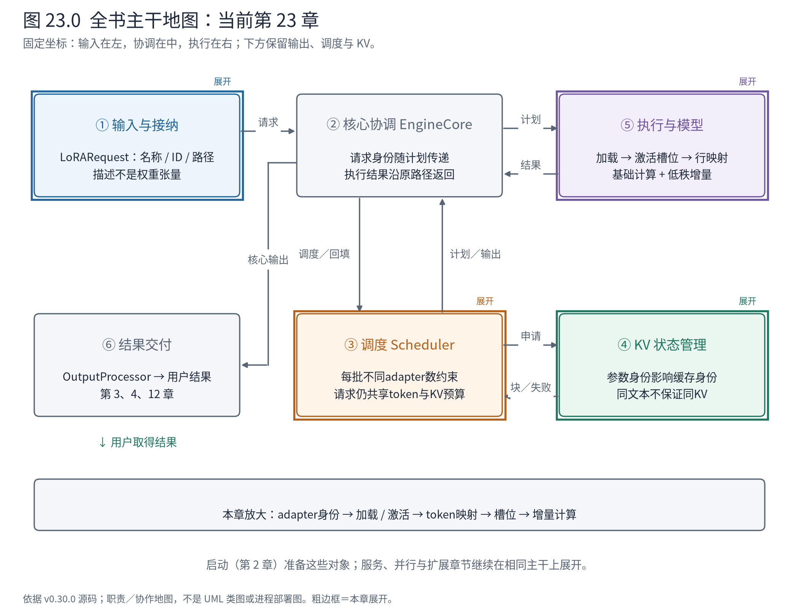
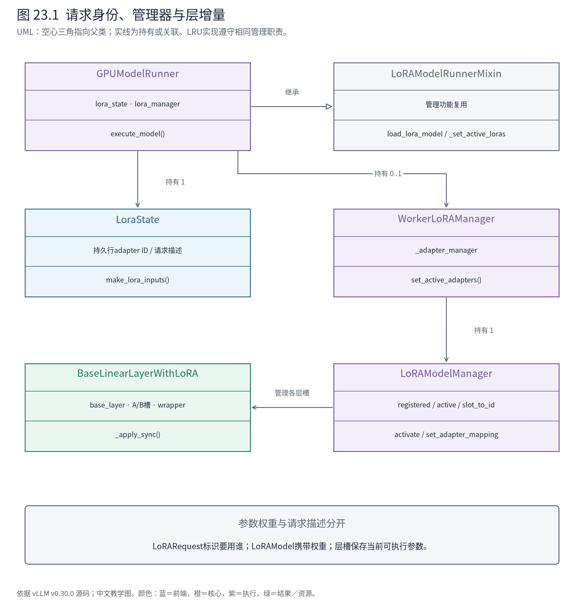
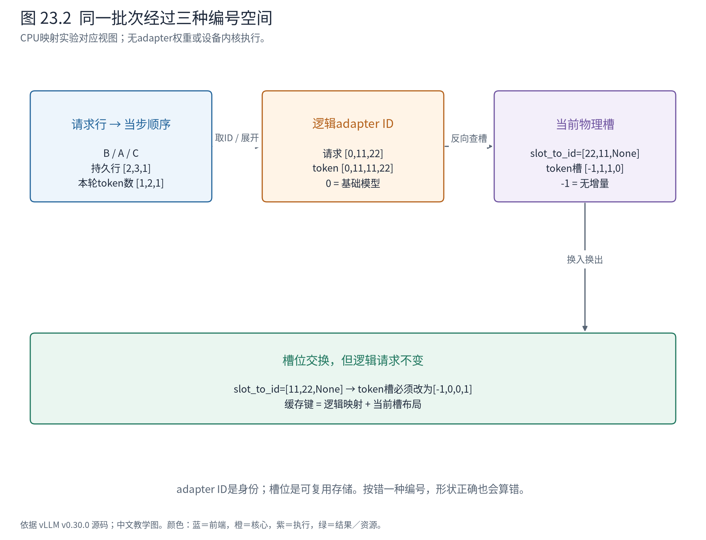

# 第 23 章 LoRA：同一批次怎样使用不同参数增量

第22章说明，同一张图片能否复用，不只取决于它的文件内容，还取决于产生特征的计算身份。本章把这一问题推进到参数层：A 使用城市问答 adapter，C 使用另一套 adapter，B 仍使用基础模型，三条请求能否一起执行？

能否混批的关键不只是“小权重装进内存”。系统还必须让每一行计算知道自己属于哪套增量参数，并在 adapter 换入换出后继续指向正确位置。本章不训练 LoRA，也不下载未知 adapter；沿上游 MRV2 源码和 CPU 映射实物理解这些契约。



**怎样读地图。** ①接收 adapter 身份，③限制本轮活跃 adapter 种类，⑤加载、激活并按计算行应用参数增量。④的缓存身份也受参数变化影响。主干仍然传递请求和执行计划，只是请求多了一项决定计算语义的属性。

## 23.1 共享基础计算，把差异留在低秩分支

对于输入 $X\in\mathbb{R}^{T\times d}$，基础权重 $W\in\mathbb{R}^{o\times d}$，某 adapter 的 $A\in\mathbb{R}^{r\times d}$、$B\in\mathbb{R}^{o\times r}$，线性输出可写成：

$$Y=XW^\top+s(XA^\top)B^\top.$$

用人话说，共享的大矩阵给出基础结果，低秩分支再提供这套 adapter 的修正。形状依次是 `[T,d]→[T,o]` 与 `[T,d]→[T,r]→[T,o]`，相加后仍为 `[T,o]`；s 是缩放标量，常见普通 LoRA 为 alpha/r，具体方法也可以使用其他规则。

如果 A/C 使用不同 adapter，不能给整个批次统一加同一个低秩结果。基础矩阵乘仍可共享组织，增量分支则必须按 token 行选择对应 A/B。B 没有 adapter 时，该行增量为零。

这就是本章的设计问题：**一份基础模型，多个参数身份，一份混合计算批次。** [S-LoRA 论文](https://arxiv.org/abs/2311.03285)讨论了多 adapter 服务的资源与批处理挑战；它是问题背景，不代表 vLLM 当前管理器照搬了论文中全部存储算法。以下实现事实仍以固定源码为准。

## 23.2 请求描述、权重对象、设备槽位分别归谁

`LoRARequest` 携带 `lora_name`、正整数 `lora_int_id` 和 `lora_path` 等字段。它是“这条请求需要哪个 adapter”的描述，不包含各层 A/B 张量。ID0 在批次映射中留给基础模型；真正 adapter 的 ID 必须大于0。



**怎样读图。** GPUModelRunner 通过继承 mixin 获得管理功能，实例仍持有自己的 LoraState 和 manager；WorkerLoRAManager 装配底层 ModelManager；具体 LoRA 层包装基础层并持有增量槽。持有不是继承，LoRARequest 也不是 LoRALayer 的父类。

| 对象 | 封装的边界 | 关键状态 |
|---|---|---|
| LoraState | MRV2 请求到 adapter 的长期对应 | 持久行上的 ID、请求描述字典 |
| WorkerLoRAManager及LRU实现 | 加载请求、权重有效性、缓存策略 | 加载路径及底层管理器引用 |
| LoRAModelManager及LRU实现 | 将 adapter 权重装到模型层可用槽 | 已登记／活跃集合、`lora_index_to_id` |
| 带 LoRA 的层 | 保留基础计算并叠加增量 | 基础层、各槽 A/B、Punica wrapper |
| LoRAMapping | 当步哪些行使用哪个身份 | token 映射、请求级映射、映射类型 |

启动时 mixin 检查模型支持 LoRA，再创建管理器，按支持的模块将模型层包装成相应实现。运行时不会为每条请求复制一套完整基础模型。装配成本前移，增量权重与批次选择继续动态变化，这是减少模型复制与增加管理复杂度之间的交换。

## 23.3 调度器约束的是 adapter 种类，不是请求数量

设本轮最多激活两套 adapter。A/C 使用同一套时，无论它们有几条请求，种类数只增加一；另一个不同 adapter 才消耗第二个名额。B 使用基础模型，不等于又装一套 adapter。

调度器在等待队列接纳时明确检查这一点：

<!-- book:ch23-limit:start -->
源码教学注释版，vllm v0.30.0：[原文件 L897–L910](https://github.com/vllm-project/vllm/blob/ced6857afa0ea7b2e3f0846a62e1394e90f15607/vllm/v1/core/sched/scheduler.py#L897-L910)。仅新增 `# 【解读】`，其他内容保留原文。

```python
                # Check that adding the request still respects the max_loras
                # constraint.
                # 【解读】本轮已达到不同adapter数量上限时，检查新请求是否引入新身份。
                if (
                    self.lora_config
                    and request.lora_request
                    and (
                        len(scheduled_loras) == self.lora_config.max_loras
                        # 【解读】使用已在本轮集合中的adapter不增加种类数。
                        and request.lora_request.lora_int_id not in scheduled_loras
                    )
                ):
                    # Scheduling would exceed max_loras, skip.
                    # 【解读】暂时跳过该请求，让其他可兼容请求仍有机会入批。
                    request_queue.pop_request()
                    step_skipped_waiting.prepend_request(request)
                    continue
```
<!-- book:ch23-limit:end -->

若第三套 adapter 暂时进不来，请求被放到本轮跳过队列，其他兼容请求仍可继续被考虑。于是“有 token 预算、有 KV 空间”仍不是充分条件，执行层可同时容纳的参数身份也进入调度约束。

这里还有两个不同容量：CPU 侧可以缓存多少套 adapter，与本轮设备上可活跃多少套，不是同一个参数。缓存容量大不保证一个批次能激活全部；设备槽够也不表示加载不会产生延迟。

静态调用路径如下，折叠了 adapter 文件解析与内核实现，非实测栈：

```text
启动：GPUModelRunner.load_lora_model（mixin）
└─ LRUCacheWorkerLoRAManager.create_lora_manager → 包装模型层

当步：GPUModelRunner.execute_model
├─ LoraState.make_lora_inputs：持久请求行 → 当步逻辑ID
└─ _set_active_loras（mixin）
   └─ WorkerLoRAManager.set_active_adapters
      ├─ _apply_adapters → 加载 / 激活所需adapter
      │  └─ LoRAModelManager.activate_adapter → 各层.set_lora
      └─ LoRAModelManager.set_adapter_mapping → Punica元数据

模型前向
└─ 带LoRA的线性层
   ├─ 基础层计算方法.apply
   └─ punica_wrapper.add_lora_linear → 按映射叠加增量
```

MRV2 使用独立的 LoraState，不应把另一路 InputBatch 同名辅助方法的实现拼进本章调用树。

## 23.4 一条请求经过三次编号转换

第9章已经见过“持久请求行不等于本轮 batch 行”。LoRA 在其后再增加两层：逻辑 adapter ID 与物理 adapter 槽位。

MRV2 首先按当轮请求顺序提取逻辑 ID，并按 token 数展开：

<!-- book:ch23-expand:start -->
源码教学注释版，vllm v0.30.0：[原文件 L95–L105](https://github.com/vllm-project/vllm/blob/ced6857afa0ea7b2e3f0846a62e1394e90f15607/vllm/v1/worker/gpu/lora_utils.py#L95-L105)。仅新增 `# 【解读】`，其他内容保留原文。

```python
    def make_lora_inputs(
        self,
        req_ids: list[str],
        idx_mapping: np.ndarray,
        num_scheduled_tokens: np.ndarray,
    ) -> tuple[tuple[int, ...], tuple[int, ...], set[LoRARequest]]:
        # 【解读】先按当步idx_mapping从持久行取出adapter ID，避免请求重排后串用。
        lora_ids = self.lora_ids[idx_mapping]
        # 【解读】请求级映射保持每个当步请求一项。
        prompt_lora_mapping = tuple(lora_ids)
        # 【解读】按各请求本轮token数量展开，为每个计算行指定adapter身份。
        token_lora_mapping = tuple(lora_ids.repeat(num_scheduled_tokens))
        # 【解读】去重得到当步需要激活的adapter集合。
        active_lora_requests: set[LoRARequest] = self.get_activate_loras(req_ids)
        return prompt_lora_mapping, token_lora_mapping, active_lora_requests
```
<!-- book:ch23-expand:end -->

CPU 实验让 A 在持久行3、使用 adapter11；B 在行2、使用基础模型；C 在行1、使用 adapter22。当轮顺序是 `[B,A,C]`，分别计算 `[1,2,1]` 个 token。真实 LoraState 与固定源码转换函数得到：

<!-- book:ch23-mapping-data:start -->
CPU实际LoraState与固定convert_mapping函数实验；异步传输helper替换为CPU张量创建，adapter路径为未访问的构造路径，没有加载权重或执行LoRA内核。来自[原始记录](evidence/lora-mapping/trace.json)。

```json
{
  "batch": {
    "req_ids": [
      "B",
      "A",
      "C"
    ],
    "persistent_rows": [
      2,
      3,
      1
    ],
    "num_scheduled_tokens": [
      1,
      2,
      1
    ],
    "request_adapter_ids": [
      0,
      11,
      22
    ],
    "token_adapter_ids": [
      0,
      11,
      11,
      22
    ],
    "active_adapter_ids": [
      11,
      22
    ]
  },
  "layouts": [
    {
      "slot_to_adapter": [
        22,
        11,
        null
      ],
      "token_slots": [
        -1,
        1,
        1,
        0
      ],
      "request_slots": [
        -1,
        1,
        0
      ]
    },
    {
      "slot_to_adapter": [
        11,
        22,
        null
      ],
      "token_slots": [
        -1,
        0,
        0,
        1
      ],
      "request_slots": [
        -1,
        0,
        1
      ]
    }
  ]
}
```
<!-- book:ch23-mapping-data:end -->

先读 `batch`：请求级映射 `[0,11,22]` 被展开成 token 级 `[0,11,11,22]`。A 有两行，必须两行都选11；不能只给第一个 token 设置 adapter。

再读 `layouts`：槽表 `[22,11,None]` 表示槽0存22、槽1存11、槽2为空。内核要使用的是 `[-1,1,1,0]`，而不是 `[0,11,11,22]`。基础模型的0在这里变为-1，含义为不叠加增量。



**怎样读图。** 从左到右依次经过当步请求顺序、token 展开和槽位翻译。编号3在左侧表示 A 的持久行，编号11在中间表示 adapter 身份，编号1在右侧表示当前设备槽；它们没有可直接比较的含义。

源码实际建立反向查找完成最后一步：

<!-- book:ch23-convert:start -->
源码教学注释版，vllm v0.30.0：[原文件 L94–L111](https://github.com/vllm-project/vllm/blob/ced6857afa0ea7b2e3f0846a62e1394e90f15607/vllm/lora/punica_wrapper/utils.py#L94-L111)。仅新增 `# 【解读】`，其他内容保留原文。

```python
    # 【解读】反转槽位表，建立逻辑adapter ID到本地槽的查找。
    lora_id_to_index = {
        lora_id: index
        for index, lora_id in enumerate(lora_index_to_id)
        if lora_id is not None
    }

    prompt_mapping: list[int] = [
        # 【解读】基础模型身份0转为-1，表示不应用LoRA增量。
        lora_id_to_index[x] if x > 0 else -1 for x in mapping.prompt_mapping
    ]
    lora_idx = None
    # 【解读】同样转换每个计算token的映射。
    for i in range(len(index_mapping_indices)):
        lora_idx = (
            lora_id_to_index[index_mapping_indices[i]]
            if index_mapping_indices[i] > 0
            else -1
        )
        embedding_indices[i] = lora_idx if index_mapping_indices[i] > 0 else 0
        # 【解读】得到内核实际使用的槽位索引，不能把逻辑ID直接用作数组下标。
        lora_indices[i] = lora_idx
```
<!-- book:ch23-convert:end -->

第二个布局把11和22的槽交换了。逻辑批次完全没变，token 槽必须变成 `[-1,0,0,1]`。如果只比较“本轮请求是否与上一轮相同”，就会复用错误元数据；固定版本因此同时比较映射与槽布局：

<!-- book:ch23-cachekey:start -->
源码教学注释版，vllm v0.30.0：[原文件 L1183–L1191](https://github.com/vllm-project/vllm/blob/ced6857afa0ea7b2e3f0846a62e1394e90f15607/vllm/lora/model_manager.py#L1183-L1191)。仅新增 `# 【解读】`，其他内容保留原文。

```python
    def set_adapter_mapping(self, mapping: LoRAMapping) -> None:
        # The punica metadata derives from the slot layout as well as the
        # mapping: an out-of-band add_lora() can LRU-evict and reassign slots
        # while the running batch, and thus the mapping, is unchanged.
        # 【解读】缓存键必须包含当前槽布局，adapter可能在批次外被换入换出。
        slot_layout = tuple(self.lora_index_to_id)
        # 【解读】逻辑批次不变但槽位改变，也必须重建内核元数据。
        if self._last_mapping != mapping or self._last_slot_layout != slot_layout:
            self._set_adapter_mapping(mapping)
            # 【解读】更新两份依赖快照，后续才可安全复用。
            self._last_mapping = mapping
            self._last_slot_layout = slot_layout
```
<!-- book:ch23-cachekey:end -->

这是一个具体的软件设计原则：缓存键必须覆盖产物的全部可变依赖。读者以后遇到“批次没变，结果却串了 adapter”，就知道不应只查请求排序，还要查槽位重分配与映射缓存失效。

## 23.5 加载与激活不是同一步

LRU Worker 管理器先加载新权重，成功后才考虑驱逐：

<!-- book:ch23-load:start -->
源码教学注释版，vllm v0.30.0：[原文件 L298–L314](https://github.com/vllm-project/vllm/blob/ced6857afa0ea7b2e3f0846a62e1394e90f15607/vllm/lora/worker_manager.py#L298-L314)。仅新增 `# 【解读】`，其他内容保留原文。

```python
                # Load the new adapter first to ensure it is actually valid, before
                # evicting any existing adapters.
                # This may cause the # of loaded lora adapters to very temporarily
                # exceed `--max-cpu-loras`.
                # 【解读】先完成加载与有效性检查，避免新adapter无效时先破坏已有缓存。
                lora = self._load_adapter(lora_request)

                # Remove the existing adapter if it exists
                # Use case for LoRA inplace
                # 【解读】处理同ID替换；只有上面加载成功才到这里。
                self._adapter_manager.remove_adapter(lora.id)

                # Loading succeeded, now check if we will exceed cache capacity and
                # evict if the oldest adapter if so
                # 【解读】新增将超CPU缓存容量时，驱逐旧项。
                if len(self._adapter_manager) + 1 > self._adapter_manager.capacity:
                    assert isinstance(self._adapter_manager, LRUCacheLoRAModelManager)
                    self._adapter_manager.remove_oldest_adapter()
                # Then add the new adapter to the cache
                # 【解读】将加载好的权重对象登记，设备激活是后续步骤。
                loaded = self._adapter_manager.add_adapter(lora)
```
<!-- book:ch23-load:end -->

这段顺序有直接的失败语义：若文件不合法或配置不兼容，已有缓存不会因为“尝试加载”而先被删掉；代价是加载期间 CPU 内存可短暂超过常规缓存容量。源码注释明确表达了这一取舍。

加载完成得到 LoRAModel，仍需要激活到可用设备槽。ModelManager 找到空槽后，遍历模型层放入各自 A/B：

<!-- book:ch23-slot:start -->
源码教学注释版，vllm v0.30.0：[原文件 L338–L353](https://github.com/vllm-project/vllm/blob/ced6857afa0ea7b2e3f0846a62e1394e90f15607/vllm/lora/model_manager.py#L338-L353)。仅新增 `# 【解读】`，其他内容保留原文。

```python
        # 【解读】index是设备槽位，lora_model.id是逻辑adapter ID，两者不相等也正常。
        self.lora_index_to_id[index] = lora_model.id
        num_lora_weights_applied = 0
        # 【解读】按模型层逐一安装此adapter的参数。
        for module_name, module in self.modules.items():
            module_lora = self._get_lora_layer_weights(lora_model, module_name)
            if not module_lora:
                # 【解读】adapter没有覆盖某层时清理该槽旧参数，避免上一个adapter残留。
                module.reset_lora(index)
                logger.debug(
                    "No LoRA weights found for module %s, skipping.", module_name
                )
                continue

            # 【解读】将该层A/B放进所选槽，供后续批次映射引用。
            module.set_lora(
                index,
                module_lora.lora_a,
                module_lora.lora_b,
            )
```
<!-- book:ch23-slot:end -->

某 adapter 没覆盖的层必须清理该槽；否则槽上一次属于另一套 adapter 时留下的增量可能泄漏进新计算。槽位是可复用存储，不是永远绑定某个模型身份的对象。

本章 CPU 实验只验证映射，构造路径没有被访问，未加载真实 adapter 文件，也没有执行这些权重复制或设备内核。加载和激活行为来自固定源码，不能把映射正确当作整套 adapter 数值验证。

## 23.6 真正落到层计算：基础结果加哪一个增量

同步代表路径先计算基础输出，再调用增量分支：

<!-- book:ch23-apply:start -->
源码教学注释版，vllm v0.30.0：[原文件 L208–L212](https://github.com/vllm-project/vllm/blob/ced6857afa0ea7b2e3f0846a62e1394e90f15607/vllm/lora/layers/base_linear.py#L208-L212)。仅新增 `# 【解读】`，其他内容保留原文。

```python
    def _apply_sync(
        self, x: torch.Tensor, bias: torch.Tensor | None = None
    ) -> torch.Tensor:
        # 【解读】先用基础层当前计算方法取得共享权重的结果，方法也可能是量化实现。
        output = self._get_quant_method().apply(self.base_layer, x, bias)
        # 【解读】再按行对应的adapter，将低秩增量加到结果上。
        return self._apply_lora_to_output(x, output)
```
<!-- book:ch23-apply:end -->

`_apply_lora_to_output` 把输入、基础输出、各槽 A/B 和切片信息交给 Punica wrapper，由它依据已准备的行映射组织增量计算。不同平台可以选择不同内核；高层契约仍是输入 `[T,d]`、输出 `[T,o]`，每行只使用自己对应的参数增量。多卡时还要遵守列／行并行层的分片方式，不能把单卡 A/B 形状原样套到每个 rank。

一个小算例：基础层为二维单位矩阵，输入行 x=[2,3]，某 adapter 的 A=[1,0]、B=[1,2]ᵀ、s=0.5。低秩中间值为2，增量为[1,2]，输出为[3,5]；基础模型那一行仍输出[2,3]。这只是公式构造例，用来说明混批中不同映射怎样改变结果。

读内核参数时还要注意缩放已经在哪里发生。这里经常传入1.0，不表示忘了 alpha/r：

<!-- book:ch23-scale:start -->
源码教学注释版，vllm v0.30.0：[原文件 L36–L42](https://github.com/vllm-project/vllm/blob/ced6857afa0ea7b2e3f0846a62e1394e90f15607/vllm/lora/lora_weights.py#L36-L42)。仅新增 `# 【解读】`，其他内容保留原文。

```python
    def optimize(self) -> "LoRALayerWeights":
        """Optimize the LoRA by merging the scaling into lora_b."""
        # 【解读】已折入缩放时不重复处理。
        if self.scaling == 1:
            return self
        # 【解读】把缩放吸收到B中，后续内核可用乘数1。
        self.lora_b *= self.scaling
        # 【解读】更新状态，防止下次optimize再次乘同一因子。
        self.scaling = 1
        return self
```
<!-- book:ch23-scale:end -->

这个实现把缩放折进 B，再把 scaling 标为1，后续不能再乘一遍。源码走读应从权重加载一路追到执行，而不是只看最靠近矩阵乘的那个常量。

## 23.7 参数身份也必须进入缓存身份

同样的 prompt 在不同 adapter 下会产生不同的中间状态。固定源码的 KV hash 附加键包含 `lora_name`；多模态 encoder 身份也可带 adapter 信息。由此可见，名称、ID 和路径不是随意的日志标签：它们参与识别、集合去重和复用边界。

`LoRARequest` 的注释要求 adapter 整数身份唯一，但并没有替调用方强制解决所有冲突；对象相等与哈希又基于名称。应用必须保持名称、整数ID与实际权重的一致对应。也不能从“支持 load_inplace”推断所有已缓存 KV 都能自动识别同名权重内容变化；原地换权重时，需要单独审查相关缓存失效契约。

活跃 LoRA 数还参与图执行选择，所以 adapter 切换影响的不只有权重缓存，也可能影响第14章的执行形态。理解这些跨组件依赖，才能解释“仅换了 adapter，为何调度或图执行路径也变了”。

下一章继续进入层计算方法，不过变化对象从请求级参数增量，变为权重表示与量化内核。刚才看到的基础层 `quant_method.apply` 将成为下一站的入口。

**源码导航。** 从 `lora/request.py` 与 MRV2 `lora_utils.LoraState` 开始；沿 mixin 到 Worker／ModelManager 的加载、激活和映射；最后看 `lora/layers/base_linear.py` 与 Punica wrapper。能解释四种编号、缓存命中不等于激活、同批次换槽必须重建映射后即可停止，不需穷举所有并行层和内核。

依据：[官方 LoRA 文档](https://docs.vllm.ai/en/v0.30.0/features/lora/)、固定源码与[CPU 映射记录](evidence/lora-mapping/trace.json)。图与数值算例为教学视图；未加载训练好的 adapter，也未给出 LoRA 服务吞吐读数。
