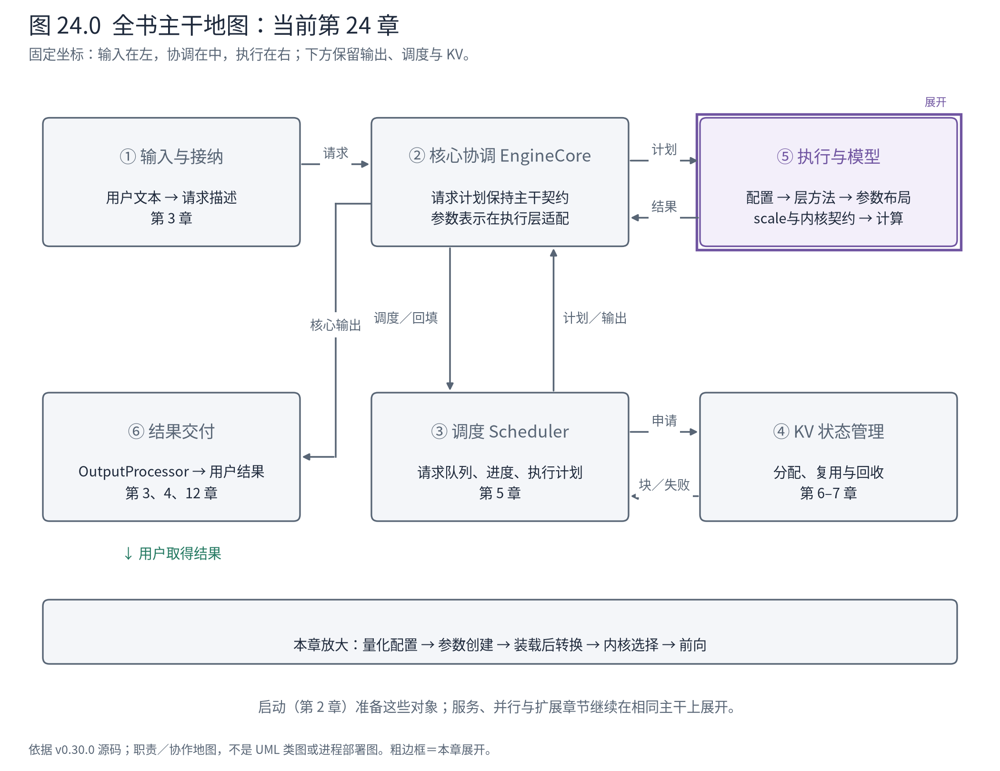
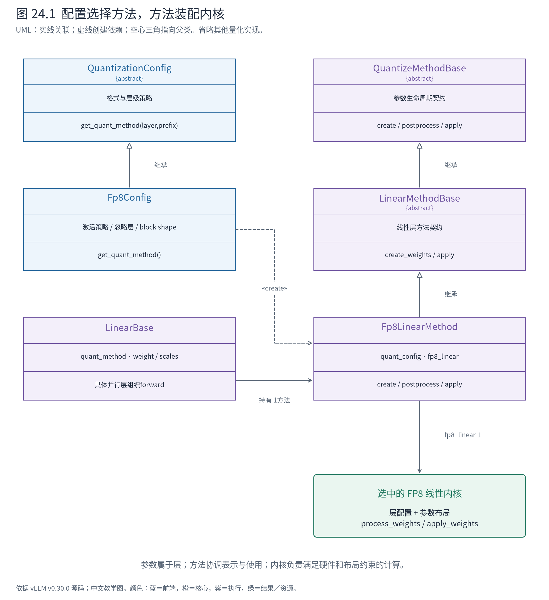
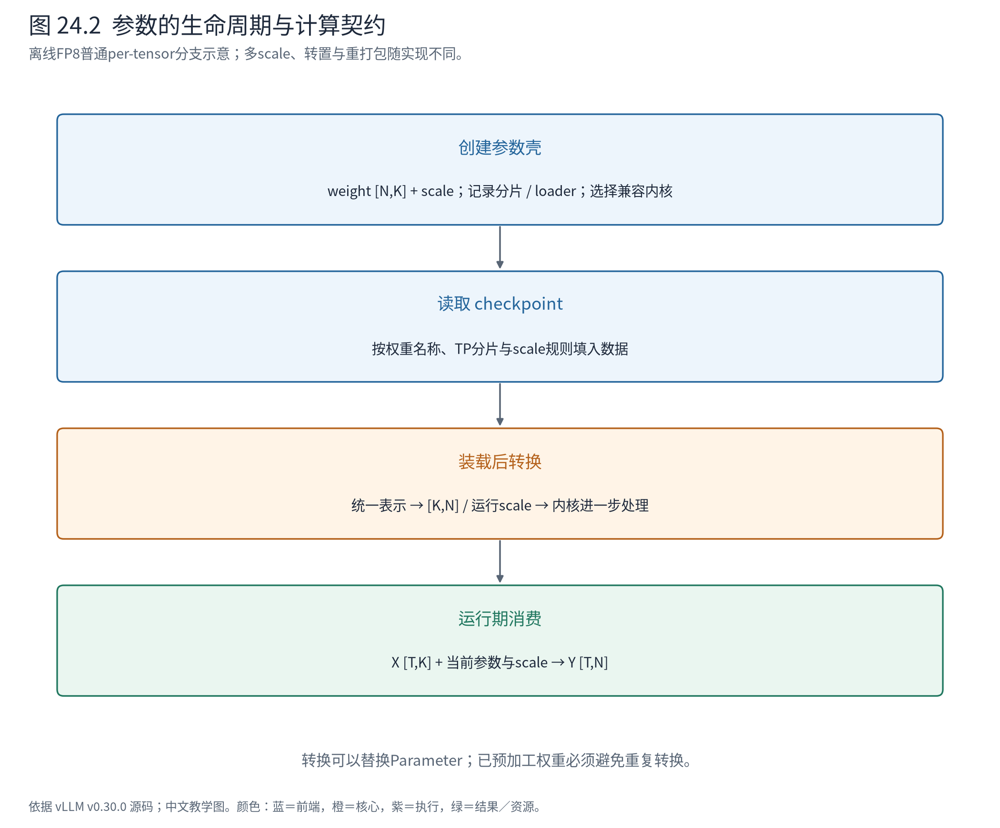

# 第 24 章 量化：参数表示怎样改变，模型主干为何还能复用

上一章的 LoRA 层先调用基础层的 `quant_method.apply`，再叠加参数增量。这个名字留下一个问题：同样一层 Linear，为什么基础计算还需要一个“方法对象”？本章打开这层抽象。

A/B 仍可提交原来的文本、获得相同种类的请求结果，但执行它们的权重可能不再是普通 BF16 矩阵。我们暂不改变基础实验的权重文件，选择上游离线 FP8 线性层作为源码分支：看清低精度编码、scale、装载后布局与实际内核如何组成一份完整契约。



**怎样读地图。** 放大⑤的模型层内部。输入、调度计划和输出类型保持熟悉的主干；变化集中在参数怎样创建、怎样从 checkpoint 变成运行布局，以及 `forward` 最终使用哪个内核。容量与速度可能间接改变调度表现，但量化配置不是 Scheduler 的另一种排队策略。

## 24.1 存下一个小数，还必须存下怎样解释它

Book4 已介绍低精度格式。这里需要补上源码中的表示契约。设某张权重用 FP8 编码 $Q$ 与反量化比例 $s$ 表示，近似恢复为 $\widehat W=sQ$。Q 与 W 形状相同；s 可以是整张量标量，也可以按通道或块组织。**只拿 Q 而丢失 s，就没有拿到原来那层的近似权重。**

对于输入 `[T,K]` 和逻辑权重 `[N,K]`，输出仍是 `[T,N]`。低精度改变的是数值表示与计算路径，不改变模型层对外承诺的输入输出意义。实际内核可能要求转置后的 `[K,N]`、分组 scale 或额外打包布局；磁盘文件的 shape 不能直接当作 GEMM 的运行契约。

还要分清两种“动态”：在线量化指装载原始权重时进行转换；动态激活量化指每次计算根据当前输入求比例。前者属于参数生命周期，后者属于运行期输入处理。它们可以组合，不能只看 dynamic 一词就推断发生时机。[官方在线量化文档](https://docs.vllm.ai/en/v0.30.0/features/quantization/online/)给出配置入口；下面以固定实现为准拆开这两个阶段。

## 24.2 方法对象封装了表示、准备与使用三个阶段

如果模型层到处写“若 FP8 则这样加载，若 INT4 则那样转置”，模型结构与格式细节就会交织。vLLM 将这些相关行为放到同一个方法对象里，让 Linear 持有它。



**怎样读图。** `Fp8Config` 是配置抽象的实现；`Fp8LinearMethod` 经 `LinearMethodBase` 实现量化方法契约。LinearBase 持有方法，方法再持有选中的计算内核。配置与内核不存在“一种配置必然对应一个固定内核”的一对一关系。

| 角色 | 负责什么 | 不应混入的职责 |
|---|---|---|
| QuantizationConfig | 解释格式与选项，针对具体层选择方法 | 不保存每条请求的进度 |
| QuantizeMethodBase及层方法 | 创建参数、装载后转换、调用计算 | 不决定A/B何时被调度 |
| LinearBase及具体并行层 | 模型拓扑、分片尺寸、对外层契约 | 不硬编码所有格式细节 |
| 选中的线性内核 | 在平台约束内消费参数与输入 | 不重新解释整份用户请求 |

这可理解为把可替换的计算策略放到对象中。但这里的策略比一个 `apply` 更完整：`create_weights` 与 `process_weights_after_loading` 必须为同一个 `apply` 准备正确表示。只替换计算函数而继续沿用不兼容的参数布局，会破坏契约。

`LinearBase` 构造时通过 `resolve_quant_method` 选择方法。代表配置的分支如下：

<!-- book:ch24-select:start -->
源码教学注释版，vllm v0.30.0：[原文件 L182–L201](https://github.com/vllm-project/vllm/blob/ced6857afa0ea7b2e3f0846a62e1394e90f15607/vllm/model_executor/layers/quantization/fp8.py#L182-L201)。仅新增 `# 【解读】`，其他内容保留原文。

```python
        # 【解读】按真实层类型与名称决定实现，不是全模型统一替换一个forward。
        if isinstance(layer, LinearBase):
            if is_layer_skipped(
                prefix=prefix,
                ignored_layers=self.ignored_layers,
                fused_mapping=self.packed_modules_mapping,
                match_mode=self.ignored_layers_match_mode,
            ):
                # 【解读】跳过列表中的层仍用未量化方法。
                return UnquantizedLinearMethod()
            # 【解读】checkpoint格式决定走在线转换还是已量化装载路径。
            if not self.is_checkpoint_fp8_serialized:
                from vllm.model_executor.layers.quantization.online.fp8 import (
                    Fp8PerTensorOnlineLinearMethod,
                )

                # 【解读】v0.30中，未预先量化的权重由独立在线方法处理。
                online_method = Fp8PerTensorOnlineLinearMethod()
                online_method.marlin_input_dtype = get_marlin_input_dtype(prefix)
                return online_method
            else:
                # 【解读】本章主线为已经序列化FP8的权重。
                offline_method = Fp8LinearMethod(self)
                offline_method.marlin_input_dtype = get_marlin_input_dtype(prefix)
                return offline_method
```
<!-- book:ch24-select:end -->

此处两个细节很值得停下。首先，忽略列表可以让同一个模型混合使用量化与未量化层。其次，v0.30 已将非预量化 checkpoint 的在线转换交给独立方法；不要根据某段历史注释，把所有 FP8 情况都归到 `Fp8LinearMethod`。额外在线配置也经过 `resolve_quant_method` 校验，已量化层与不兼容的重复转换会被拒绝。

## 24.3 权重加载完，还没有结束启动期

回到第10章的装载过程。模型先创建层与参数壳，loader 再按名称、分片和格式填充数据。以离线 FP8 的非 block 分支为例：

<!-- book:ch24-create:start -->
源码教学注释版，vllm v0.30.0：[原文件 L329–L343](https://github.com/vllm-project/vllm/blob/ced6857afa0ea7b2e3f0846a62e1394e90f15607/vllm/model_executor/layers/quantization/fp8.py#L329-L343)。仅新增 `# 【解读】`，其他内容保留原文。

```python
        # 【解读】创建该分片的权重参数壳，并保留装载器契约。
        weight = create_fp8_weight_parameter(
            output_size_per_partition, input_size_per_partition, weight_loader
        )
        # 【解读】参数属于层对象，计算方法负责其表示与使用。
        layer.register_parameter("weight", weight)

        # WEIGHT SCALE
        # 【解读】本片段只展开非block的scale；融合层可有多个逻辑分片。
        if not self.block_quant:
            scale = create_fp8_scale_parameter(
                PerTensorScaleParameter,
                output_partition_sizes,
                input_size_per_partition,
                None,
                weight_loader,
            )
            # 【解读】scale是权重语义的一部分，必须随正确分片一起装载。
            layer.register_parameter("weight_scale", scale)
```
<!-- book:ch24-create:end -->

`weight_loader` 随参数创建进入装载契约，因此“这个参数如何取 TP 分片”仍有落点。scale 也必须按自己的语义装载，不能简单把它当作另一个同形权重矩阵。融合 QKV 可能有多个逻辑输出分片，即使它们最终装入一个物理矩阵，也不能先忘掉分片的 scale 边界。

装载后处理负责把 checkpoint 表示转换成内核要用的表示。以下摘录属于普通非 block、非 Marlin 分支：

<!-- book:ch24-post:start -->
源码教学注释版，vllm v0.30.0：[原文件 L412–L427](https://github.com/vllm-project/vllm/blob/ced6857afa0ea7b2e3f0846a62e1394e90f15607/vllm/model_executor/layers/quantization/fp8.py#L412-L427)。仅新增 `# 【解读】`，其他内容保留原文。

```python
            # If using w8a8, torch._scaled_mm needs per tensor, so
            # requantize the logical shards as a single weight.
            # 【解读】将融合层多个逻辑分片的scale整理成执行策略要求的表示。
            weight, weight_scale, input_scale = process_fp8_weight_tensor_strategy(
                weight,
                weight_scale,
                # 【解读】logical_widths说明分片边界，不能只看整个矩阵shape。
                layer.logical_widths,
                getattr(layer, "input_scale", None),
            )
            # 【解读】静态激活缩放也要归一为内核所需形式。
            if self.act_q_static:
                assert input_scale is not None
                input_scale = input_scale.max()
            # 【解读】本分支转为运行期[K,N]布局。
            weight = weight.t()

            # Update layer with new values.
            # 【解读】替换参数对象；持有旧引用的代码不能假定它仍是当前权重。
            replace_parameter(layer, "weight", weight.data)
            replace_parameter(layer, "weight_scale", weight_scale.data)
```
<!-- book:ch24-post:end -->

假设一个教学融合层包含输出宽度 `[2,1,1]` 的三个逻辑矩阵，共同形成 `[4,K]` 权重，checkpoint 给了三个比例。某执行策略希望整个融合矩阵使用一个比例，就必须按各自比例解释原值、重新编码为统一策略，再转置成 `[K,4]`。不能只挑一个 scale 覆盖其余两个，否则张量 shape 虽然合法，数值已经错了。此处数值与尺寸是构造说明，具体重编码由工具函数完成。



**怎样读图。** 第一阶段约定将要接收什么，第二阶段填入磁盘表示，第三阶段变成执行表示。内核选择已可在参数创建阶段根据配置与 shape 发生；图中的最后一格强调运行时消费，不表示必须等权重装完才选择内核。

统一 loader 会遍历带 `quant_method` 的模块调用后处理。它允许方法声明是否需要将参数暂移到目标设备；后处理可能替换 Parameter，因此还会重新协调 TP 状态。预加工权重则有显式支持检查，避免再次转置或重编码。这里的设计思想是**让参数生命周期拥有明确阶段，而不是让第一次请求碰巧完成所有准备**。代价是开发一种新格式时，必须说明文件布局、运行布局、可重复装载与预加工状态之间的关系。

## 24.4 一段真实编码：看到 scale 和字节共同起作用

下面不运行量化模型，而在 CPU 执行固定源码的整张量 FP8 编码函数。显式指定 `float8_e4m3fn`，避免平台默认格式影响案例：

<!-- book:ch24-encoding:start -->
源码教学注释版，vllm v0.30.0：[原文件 L68–L79](https://github.com/vllm-project/vllm/blob/ced6857afa0ea7b2e3f0846a62e1394e90f15607/vllm/model_executor/layers/quantization/utils/fp8_utils.py#L68-L79)。仅新增 `# 【解读】`，其他内容保留原文。

```python
def input_to_float8(
    x: torch.Tensor, dtype: torch.dtype | None = None
) -> tuple[torch.Tensor, torch.Tensor]:
    """This function quantizes input values to float8 values "
    "with tensor-wise quantization."""
    # 【解读】CPU实验显式传入e4m3fn，不依赖当前平台默认格式。
    dtype = current_platform.fp8_dtype() if dtype is None else dtype
    finfo = torch.finfo(dtype)
    min_val, max_val = x.aminmax()
    # 【解读】用绝对最大值确定整张量范围；下界保护全零输入。
    amax = torch.maximum(min_val.abs(), max_val.abs()).clamp(min=1e-12)
    # 【解读】scale把最大值映射到目标格式的有限范围。
    scale = finfo.max / amax
    x_scl_sat = (x * scale).clamp(min=finfo.min, max=finfo.max)
    # 【解读】返回低精度编码及反向缩放因子，重建时二者相乘。
    return x_scl_sat.to(dtype).contiguous(), scale.float().reciprocal()
```
<!-- book:ch24-encoding:end -->

函数先找绝对最大值，用目标格式的最大有限值覆盖输入范围，再编码；返回的比例是缩放的倒数，供重建使用。名字同为 scale 的变量可能位于缩放或反缩放的一侧，读代码时要看乘法方向。

<!-- book:ch24-encoding-data:start -->
CPU执行固定input_to_float8函数体；显式e4m3fn、构造张量。未调用设备FP8矩阵乘、未运行量化模型。来自[原始记录](evidence/fp8-encoding/trace.json)。

```json
{
  "cases": [
    {
      "name": "mixed",
      "input": [
        [
          -2.0,
          -1.0,
          -0.30000001192092896,
          0.0
        ],
        [
          0.10000000149011612,
          0.5,
          1.0,
          2.0
        ]
      ],
      "dtype": "torch.float8_e4m3fn",
      "encoded_values": [
        [
          -448.0,
          -224.0,
          -64.0,
          0.0
        ],
        [
          22.0,
          112.0,
          224.0,
          448.0
        ]
      ],
      "encoded_bytes": [
        [
          254,
          246,
          232,
          0
        ],
        [
          91,
          110,
          118,
          126
        ]
      ],
      "dequant_scale": 0.004464285913854837,
      "restored": [
        [
          -2.0,
          -1.0,
          -0.2857142984867096,
          0.0
        ],
        [
          0.098214291036129,
          0.5,
          1.0,
          2.0
        ]
      ],
      "max_abs_error": 0.01428571343421936
    },
    {
      "name": "zero",
      "input": [
        [
          0.0,
          0.0,
          0.0,
          0.0
        ],
        [
          0.0,
          0.0,
          0.0,
          0.0
        ]
      ],
      "dtype": "torch.float8_e4m3fn",
      "encoded_values": [
        [
          0.0,
          0.0,
          0.0,
          0.0
        ],
        [
          0.0,
          0.0,
          0.0,
          0.0
        ]
      ],
      "encoded_bytes": [
        [
          0,
          0,
          0,
          0
        ],
        [
          0,
          0,
          0,
          0
        ]
      ],
      "dequant_scale": 2.2321429389771845e-15,
      "restored": [
        [
          0.0,
          0.0,
          0.0,
          0.0
        ],
        [
          0.0,
          0.0,
          0.0,
          0.0
        ]
      ],
      "max_abs_error": 0.0
    }
  ]
}
```
<!-- book:ch24-encoding-data:end -->

两组输入均为 `[2,4]`，编码仍为 `[2,4]`，比例为标量。mixed 的绝对最大值为2，e4m3fn 的最大有限值为448，因此编码缩放为224，重建比例约为 `1/224`。0.3 等数不能保证精确表示；打印的重建值和最大绝对误差让这种损失可以直接观察。全零输入通过 `clamp` 避免除零，编码与重建仍为零。

`encoded_bytes` 展示的是实际底层字节，而非把编码后的浮点值强转为整数。这个实验验证了函数的编码与比例关系，没有测量矩阵乘、模型质量或吞吐；将这几个数字推广成整模型精度结论是不成立的。

## 24.5 内核选择是能力匹配，不是按格式名跳转

`init_fp8_linear_kernel` 接收权重与激活的量化键、输入输出 dtype 和权重 shape，构造层配置，再选择合适候选。量化键还描述 scale 的分组方式；整张量、逐 token 或块尺度并非可任意互换。

<!-- book:ch24-kernel:start -->
源码教学注释版，vllm v0.30.0：[原文件 L678–L698](https://github.com/vllm-project/vllm/blob/ced6857afa0ea7b2e3f0846a62e1394e90f15607/vllm/model_executor/kernels/linear/__init__.py#L678-L698)。仅新增 `# 【解读】`，其他内容保留原文。

```python
    # 【解读】先取当前平台的候选集合。
    platform_kernels = possible_kernels.get(current_platform._enum, [])

    # 【解读】显式linear backend选项进一步约束候选。
    # Apply --linear-backend filtering when set.
    platform_kernels = _resolve_backend_kernels(
        platform_kernels,
        "scaled-mm",
        quantization=quantization,
    )
# 【解读】依次验证硬件支持及此层配置是否可实现。

    for kernel in platform_kernels:
        is_supported_and_can_implement, failure_reason = (
            is_supported_and_can_implement_kernel(kernel, config, compute_capability)
        )
        # 【解读】首个通过检查的候选成为本层内核。
        if is_supported_and_can_implement:
            return kernel
        failure_reason_list.append(failure_reason)

    # 【解读】没有可用实现时给出各候选失败原因，不凭量化名称强行执行。
    raise ValueError(
        "Failed to find a kernel that can implement the "
        "ScaledMM linear layer. Reasons: \n" + "\n".join(failure_reason_list)
    )
```
<!-- book:ch24-kernel:end -->

这里同时有平台候选、用户 backend 约束与层配置可实现性。一个内核支持 FP8，并不等于支持当前 group shape、尺寸、dtype 与并行分片；没有候选时应读失败原因，不能只检查模型配置里的字符串。

[官方 FP8 文档](https://docs.vllm.ai/en/v0.30.0/features/quantization/llm_compressor/fp8/)区分 W8A8 与部分设备上的权重型 W8A16 路径。源码中 batch-invariant 模式也存在解量化到 BF16 的分支。因此“权重文件是 FP8”不足以证明运行的是原生 FP8 GEMM。本章本机只做 CPU 编码实验；910B 上的量化格式和内核应沿第19章的平台注册分支逐项核对，不能直接照搬 CUDA 支持表。

## 24.6 用生命周期组织停点，比只盯 forward 更有效

下面是按源码整理的分阶段调用树，不是一次真实活动栈；省略模型构造器之间的包装层：

```text
启动：模型构造
└─ LinearBase.__init__
   └─ resolve_quant_method → Fp8Config.get_quant_method
      └─ Fp8LinearMethod（离线FP8分支）
具体线性层准备参数
└─ quant_method.create_weights
   ├─ 登记 weight / scale 参数与loader
   └─ init_fp8_linear_kernel → choose_scaled_mm_linear_kernel
装载：loader填充参数后
└─ process_weights_after_loading(model,...)
   └─ quant_method.process_weights_after_loading(layer)
      ├─ 统一scale / 转置 / 替换参数（按分支）
      └─ fp8_linear.process_weights_after_loading(layer)
运行：具体线性层forward
└─ quant_method.apply(layer,x,bias)
   └─ fp8_linear.apply_weights(...)（普通模式）
```

如果加载就报 shape 错，先停在参数创建与 loader，而不是检查 Scheduler。如果权重已加载、内核不支持，查看量化键、分片 shape、平台候选。若输出数值异常，检查 scale 是否与编码及转置后的布局一致，再看是否发生了重复后处理。每个停点都对应一个可打印的契约产物，而不是无限向下单步。

本章回到整机后留下的认识是：模型层可以维持稳定的数学接口，同时把参数表示和执行实现交给另一组对象协作。可替换性来自完整契约，也带来兼容性检查与生命周期管理的成本。下一章将遇到更深的变化：有些层保存的历史根本不是普通 KV，统一缓存管理如何容纳它们？

## 24.7 源码导航与停止边界

| 要回答的问题 | 入口 | 读到哪里即可停止 |
|---|---|---|
| 方法怎样随层类型选择 | `quantization/base_config.py::resolve_quant_method`、`fp8.py::Fp8Config` | 能区分离线、在线、忽略层 |
| 三阶段契约是什么 | `QuantizeMethodBase`、`Fp8LinearMethod` | 能解释创建、后处理、apply消费的同一组状态 |
| 谁在装载后调用转换 | `model_loader/utils.py::process_weights_after_loading` | 理解设备上下文、预加工检查和TP状态重建 |
| 为什么没选到预期内核 | `model_executor/kernels/linear/__init__.py` | 找到候选筛选与失败原因，暂不进入每个GEMM实现 |
| 数值和比例怎样配合 | `quantization/utils/fp8_utils.py::input_to_float8` | 用打印结果解释编码、反缩放与误差 |

正文源码链接固定到 ced6857；实验原始记录见上文。INT4、GPTQ、AWQ、compressed-tensors、量化MoE和KV量化各有格式与执行约束，不宜用本章FP8矩阵布局代替。阅读它们时复用“三阶段+内核能力”的检查顺序。
