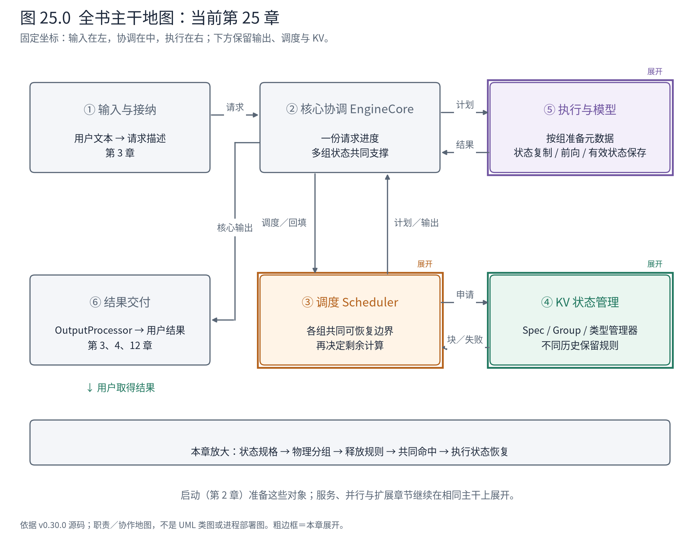
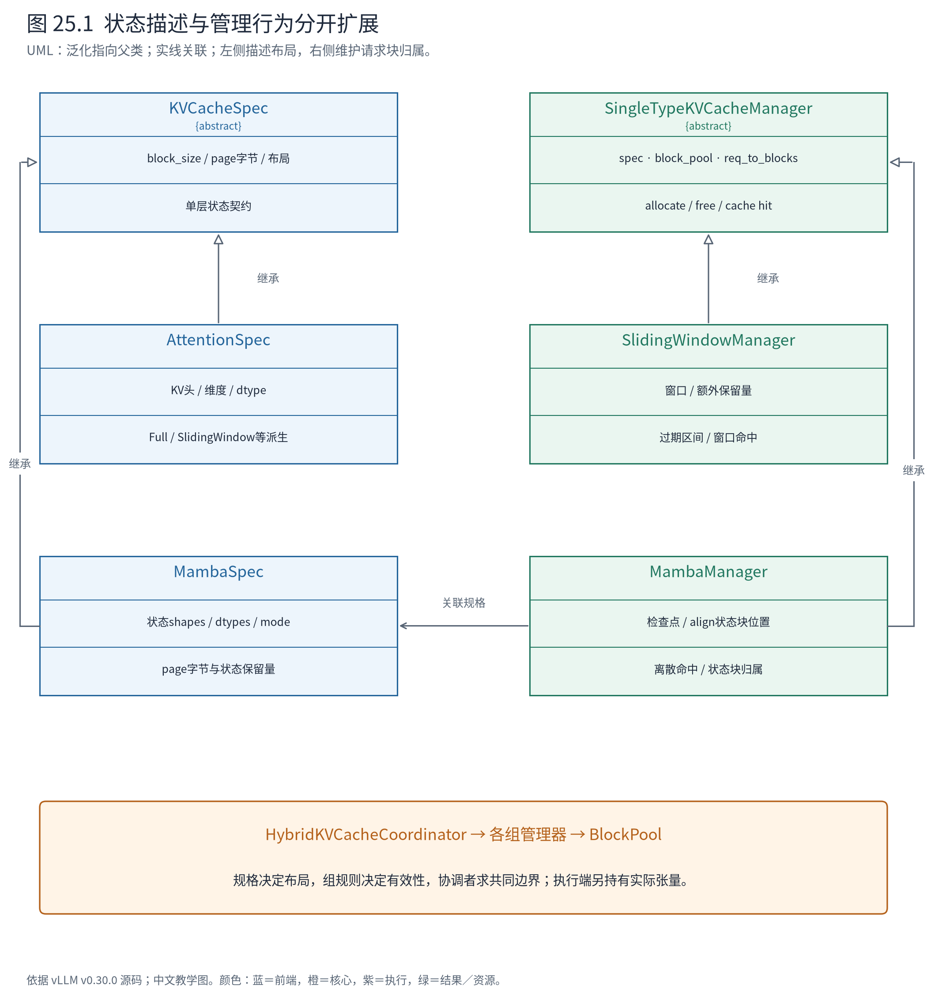
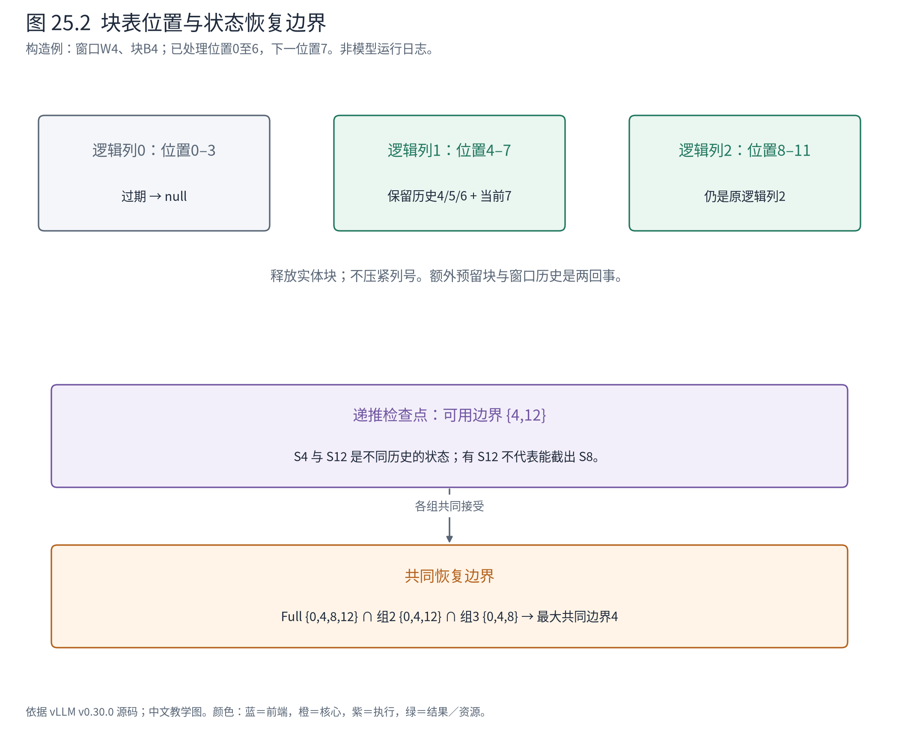

# 第 25 章 混合状态：同一个请求，不同层怎样保留历史

量化章改变了参数表示，本章改变的是请求运行时留下的历史。Book5 已介绍滑窗注意力与递推模型；现在把它们放进第6章的缓存管理框架，会出现一个具体问题：同一请求走过许多层，各层到底还需要保留哪些东西？

Qwen3-0.6B 基础案例不包含本章的混合状态。我们使用 C 的长序列教学变体，观察不同状态管理器；所有块和形状都是明确构造的 CPU 元数据，不把它们接到前面 NPU 日志上冒充同一次运行。



**怎样读地图。** ④从“为所有层保存同类KV”展开成多种状态规格与组管理器，⑤按相应元数据读取和更新状态，③只能从各组共同支持的位置继续。请求仍只有一个生成进度，但支持这个进度的状态有多种形态。

## 25.1 三类历史，三种保留理由

完整注意力保留前面各 token 的 K/V；滑窗注意力只需当前位置附近的 K/V；递推层则把历史折叠进状态，下一步用当前输入更新它。用模型无关的写法，递推是 $S_t=f(S_{t-1},x_t)$，输出由当前状态与输入产生。这里 S 的形状由模型决定，并不随 token 数每步增加一行。

一个简化递推层可能有卷积历史 `[C,Kconv-1]` 与递推状态 `[H,D,S]` 两部分。新增输入 `[C]` 更新卷积历史，映射后的输入参与 `[H,D,S]→[H,D,S]` 状态更新；具体 Mamba、GDN 等模型的运算与布局不同，本章不把这个示意当作统一模型公式。

| 状态类型 | 继续计算需要什么 | 过旧状态如何处理 |
|---|---|---|
| Full Attention | 所需完整前缀的K/V | 请求结束或其他合法管理动作后才能释放 |
| Sliding Window | 当前窗口覆盖的K/V | 窗口之外的整块可归还，保留逻辑位置 |
| 递推状态 | 对应恢复位置的完整状态 | 是否保留历史检查点由模式与复用需求决定 |

对递推层，“我有第12步状态”不自动等于“我有第8步状态”。通常无法只删掉后四个 token 的计数就恢复旧状态。这将成为前缀复用和投机拒绝的关键约束。

[官方 Hybrid KV Cache Manager 设计说明](https://docs.vllm.ai/en/v0.30.0/design/hybrid_kv_cache_manager/)介绍了按状态类型组织分配的动机，但文档注明基于早期提交。当前 v0.30 的分组、打包与回退分支更多；以下以固定源码核验后的契约为准。

## 25.2 Spec描述状态，Manager实现规则，执行侧持有张量

`KVCacheSpec` 名字里仍有 KV，但抽象已经承载多种单层状态。它说明块粒度、字节需求、布局等约束；它本身不包含请求 C 的实际 K/V 或递推值。



**怎样读图。** 左边是布局描述，右边是管理行为；具体 Manager 关联相应 Spec，并通过 BlockPool 管理实体块。HybridKVCacheCoordinator 协调多个组。执行侧依配置创建张量和视图，CPU管理器不直接修改那些张量。

`KVCacheGroupSpec` 把一组层名与规格联系起来，同组可以按统一规则共享块编号的组织方式；“共享编号”不意味着不同层写同一份 K/V 数值。`KVCacheConfig` 再描述分组、张量分配和容量。上一章的参数是模型级长期资源，这些状态则随请求增长、复用和释放。

块的 token 粒度与 page 的字节数也要分开。普通同头维的 K/V 页可按 $B\times H_{kv}\times(D_k+D_v)\times\mathrm{bytes\_per\_element}$ 计算。B 是每块 token 数，bytes_per_element 是每个元素的字节数；实际表示还可能有量化或 padding。MambaSpec 的 page 则由各状态 shape 与 dtype 求和，改变其 block_size 并不会自动把状态张量放大 B 倍。

这也是为何不能用同一个“每token字节数”公式估算所有混合状态。

## 25.3 统一分配单元，需要先协调物理布局

当前 `get_kv_cache_groups` 会先处理同规格、同类以及专用布局，也可能选择 packed 分组。只有进入普通 page 统一分支，才由 `unify_kv_cache_spec_page_size` 尝试协调各层 page。以下不是“所有模型只有一种等页池”的声明：

<!-- book:ch25-page:start -->
源码教学注释版，vllm v0.30.0：[原文件 L1399–L1426](https://github.com/vllm-project/vllm/blob/ced6857afa0ea7b2e3f0846a62e1394e90f15607/vllm/v1/core/kv_cache_utils.py#L1399-L1426)。仅新增 `# 【解读】`，其他内容保留原文。

```python
        # 【解读】Mamba状态尺寸来自shape，增大block_size不会增加状态字节。
        elif isinstance(layer_spec, MambaSpec):
            # MambaSpec's page size is determined by its state shapes and does
            # not scale with block_size, so pad the page instead. This is the
            # same padding mechanism the platform uses to align Mamba pages
            # with the main model's attention page size; it is needed here
            # when another layer (e.g. from a draft model) has a larger page
            # than the already-aligned Mamba page.
            # 【解读】为状态页补齐物理空间，语义shape保持不变。
            new_spec: KVCacheSpec = replace(layer_spec, page_size_padded=max_page_size)
            assert new_spec.page_size_bytes == max_page_size
            new_kv_cache_spec[layer_name] = new_spec
        else:
            layer_page_size = layer_spec.page_size_bytes
            # 【解读】attention页可整除时，扩大每块覆盖的token数量。
            if max_page_size % layer_page_size == 0:
                ratio = max_page_size // layer_page_size
                new_block_size = layer_spec.block_size * ratio
                new_spec = replace(layer_spec, block_size=new_block_size)
            # 【解读】部分非MLA不整除情况允许物理padding，MLA须保留自身行对齐约束。
            elif isinstance(layer_spec, AttentionSpec) and not isinstance(
                layer_spec, MLAAttentionSpec
            ):
                new_spec = replace(layer_spec, page_size_padded=max_page_size)
            else:
                # 【解读】无法满足布局契约时明确失败，调用方再决定是否有受支持的fallback。
                raise NotImplementedError(
                    f"Layer {layer_name}: page size is not divisible by the "
                    "maximum page size and cannot be padded. Padding is only "
                    "supported for non-MLA attention layers."
                )
            assert new_spec.page_size_bytes == max_page_size
            new_kv_cache_spec[layer_name] = new_spec
```
<!-- book:ch25-page:end -->

CPU 实验创建三种规格：完整KV为每块4 token、1个KV头、头维4、FP32；滑窗KV头维2；递推状态为FP32的 `[2,3]` 与 `[2,2]`。前两者分别需要128与64字节，递推状态需要40字节：

<!-- book:ch25-pages-data:start -->
CPU真实规格与管理器实验，手工构造shape、模式与块表；没有设备状态张量或混合模型前向。来自[原始记录](evidence/hybrid-state/trace.json)。

```json
{
  "pages": {
    "before": {
      "full": {
        "type": "FullAttentionSpec",
        "block_size": 4,
        "page_bytes": 128,
        "content_bytes": 128
      },
      "window": {
        "type": "SlidingWindowSpec",
        "block_size": 4,
        "page_bytes": 64,
        "content_bytes": 64
      },
      "mamba": {
        "type": "MambaSpec",
        "block_size": 4,
        "page_bytes": 40,
        "content_bytes": 40
      }
    },
    "after": {
      "full": {
        "type": "FullAttentionSpec",
        "block_size": 4,
        "page_bytes": 128,
        "content_bytes": 128
      },
      "window": {
        "type": "SlidingWindowSpec",
        "block_size": 8,
        "page_bytes": 128,
        "content_bytes": 128
      },
      "mamba": {
        "type": "MambaSpec",
        "block_size": 4,
        "page_bytes": 128,
        "content_bytes": 40
      }
    }
  }
}
```
<!-- book:ch25-pages-data:end -->

统一后，滑窗规格把每块 token 数从4增到8，使页达到128字节；递推规格保持状态内容40字节，物理页补齐到128字节。二者都满足同一分配尺度，但一个改变 token 粒度，一个只增加物理填充。真实模型还要满足 backend 对块大小、视图和对齐的要求；这段 CPU 规格变换不证明任意构造配置都能运行。

设计上的收益是减少分配体系的分裂，代价是 padding、粒度变化以及容量利用率损失。于是“可统一”与“最省内存”并不是同一条件，代码必须保留不同布局分支。

## 25.4 窗口滑走以后，块表留下空洞

为了单独观察释放规则，下一实验使用原始 `block_size=4`、`window=4` 的滑窗规格，**没有使用上一节统一后的8-token规格**。C 已确认处理7个 token，即位置0到6；下一步算位置7。窗口包含当前位置7，因此只需历史位置4、5、6：

<!-- book:ch25-window:start -->
源码教学注释版，vllm v0.30.0：[原文件 L1178–L1181](https://github.com/vllm-project/vllm/blob/ced6857afa0ea7b2e3f0846a62e1394e90f15607/vllm/v1/core/single_type_kv_cache_manager.py#L1178-L1181)。仅新增 `# 【解读】`，其他内容保留原文。

```python
        # 【解读】窗口包含将要计算的当前token，因此只需W-1个历史位置；额外保留用于特定投机分支。
        return max(
            0,
            num_computed_tokens - self.sliding_window + 1 - self.extra_retained_tokens,
        )
```
<!-- book:ch25-window:end -->

在无额外保留量时，跳过位置数为 `7-4+1=4`。位置0到3恰好构成一个完整块，可以释放；若跳过的只是不完整块，分配器不能因为其中一部分过期就归还整块。

下面是真实 SlidingWindowManager 与 BlockPool 的 CPU 实验。脚本先手工给 C 登记三块，模拟已分配的逻辑区间；再调用 `remove_skipped_blocks`：

<!-- book:ch25-window-data:start -->
CPU真实规格与管理器实验，手工构造shape、模式与块表；没有设备状态张量或混合模型前向。来自[原始记录](evidence/hybrid-state/trace.json)。

```json
{
  "window": {
    "window_size": 4,
    "block_size": 4,
    "computed": 7,
    "skipped_tokens": 4,
    "before": {
      "block_ids": [
        1,
        2,
        3
      ],
      "is_null": [
        false,
        false,
        false
      ],
      "free_blocks": 4
    },
    "after": {
      "block_ids": [
        0,
        2,
        3
      ],
      "is_null": [
        true,
        false,
        false
      ],
      "free_blocks": 5
    }
  }
}
```
<!-- book:ch25-window-data:end -->

你会看到块表第一列变成 null，后两列不向左移动，空闲块数增加一。为什么不直接删除数组第一项？因为列号表示逻辑 token 区间。如果把后一块压到第0列，执行侧按位置查表就会把位置4误认为位置0。

<!-- book:ch25-remove:start -->
源码教学注释版，vllm v0.30.0：[原文件 L670–L679](https://github.com/vllm-project/vllm/blob/ced6857afa0ea7b2e3f0846a62e1394e90f15607/vllm/v1/core/single_type_kv_cache_manager.py#L670-L679)。仅新增 `# 【解读】`，其他内容保留原文。

```python
        # 【解读】空洞仍保留在原逻辑列，不能把后面的块向左压紧。
        last_block = min(last_block, len(blocks))

        # 【解读】从后向前释放，已处理过的null前缀可停止。
        freed: list[KVCacheBlock] = []
        for i in range(last_block - 1, first_block - 1, -1):
            if blocks[i] == self._null_block:
                break
            # 【解读】先记录要归还的实体，再用null替代请求引用。
            freed.append(blocks[i])
            blocks[i] = self._null_block
        if freed:
            # 【解读】实际引用计数与空闲队列由BlockPool维护。
            self.block_pool.free_blocks(freed)
```
<!-- book:ch25-remove:end -->



**怎样读图。** 上半部把“过期的内容”与“仍需保留的位置索引”分开。下半部给出递推状态检查点：拥有边界12不代表拥有边界8，不能任意截断恢复。两部分共同说明，块表是状态解释的一部分，不只是空闲地址清单。

还有一个并发边界不能省略：释放判断使用已处理并提交的进度，而非异步调度乐观增加的进度。后者可能包含设备仍要读取的窗口；提前释放会使后续分配覆盖在途计算依赖的数据。额外投机保留量也会推迟释放，因为某些路径还需重新处理窗口尾部。

## 25.5 前缀命中必须落在所有组都能恢复的位置

对完整注意力而言，如果0到12的前缀都在，缩到8通常仍然有效；这称为向下封闭。滑窗则可能只保留边界12附近的窗口，往回缩到8时需要另一段已经不在的窗口。递推检查点也可能只有离散位置可用。

因此 HybridKVCacheCoordinator 不只是让每组各报最长值，取最小值就结束。它让各类型接受当前候选，或把候选缩短；发生缩短后，必要时重新检查其他组，直到边界稳定：

<!-- book:ch25-reconcile:start -->
源码教学注释版，vllm v0.30.0：[原文件 L937–L953](https://github.com/vllm-project/vllm/blob/ced6857afa0ea7b2e3f0846a62e1394e90f15607/vllm/v1/core/kv_cache_coordinator.py#L937-L953)。仅新增 `# 【解读】`，其他内容保留原文。

```python
                if drop_eagle_block:
                    eagle_verified.add(idx)
                # 【解读】候选边界缩短后，先前EAGLE验证状态不能直接沿用。
                elif _new_hit_length < curr_hit_length:
                    # length shrunk; invalidate previous eagle verifications
                    eagle_verified.clear()
                # 【解读】更新当前共同候选及本组实际命中产物。
                curr_hit_length = _new_hit_length
                for group_id, blocks in zip(group_ids, hit_blocks):
                    hit_blocks_by_group[group_id] = blocks
                    hit_length_by_group[group_id] = _new_hit_length

                longest_hit_length = max(longest_hit_length, curr_hit_length)

            # 【解读】所有组未再缩短，才到达可共同接受的边界。
            if curr_hit_length >= hit_length:
                break
            # 【解读】否则用更短候选重新检查各组。
            hit_length = curr_hit_length
            # 【解读】完整注意力+单一其他类型的简单组合有专门提前结束条件。
            if is_simple_hybrid:
                break
```
<!-- book:ch25-reconcile:end -->

用一个算法级构造例看这种必要性。三个状态组在本次缓存内容下的可恢复边界集合分别为 `{0,4,8,12}`、`{0,4,12}`、`{0,4,8}`。独立最长值是12、12、8，取最小值得8，但第二组在8不可恢复。再次约束后得到4，三个组才一致。这里的集合用于解释边界性质，不是某个实际模型的日志。

当前源码针对“一个完整注意力类型加一个其他类型”的简单组合有提前结束优化；完整注意力命中过一次后也可以裁剪，避免反复查哈希。优化建立在各类型的性质上，不能把它推广成所有混合组都只查一次。

统一请求进度与异构状态之间，需要的正是这样一个协调者。各组保留专业规则，协调者寻找共同起点，Scheduler 才能安全地把剩余 token 放进执行计划。

## 25.6 递推状态的保存模式与执行前后钩子

MambaSpec 的内存估算已经直接体现模式差异：

<!-- book:ch25-modes:start -->
源码教学注释版，vllm v0.30.0：[原文件 L1034–L1045](https://github.com/vllm-project/vllm/blob/ced6857afa0ea7b2e3f0846a62e1394e90f15607/vllm/v1/kv_cache_interface.py#L1034-L1045)。仅新增 `# 【解读】`，其他内容保留原文。

```python
    def max_memory_usage_bytes(self, vllm_config: VllmConfig) -> int:
        # 【解读】all模式按多个历史边界保存状态，不能概括成固定一个块。
        if vllm_config.cache_config.mamba_cache_mode == "all":
            max_model_len = vllm_config.model_config.max_model_len
            return (
                cdiv(max_model_len, self.block_size) + self.num_speculative_blocks
            ) * self.page_size_bytes
        # 【解读】align保留运行/对齐状态，并加上配置要求的额外检查点与投机空间。
        elif vllm_config.cache_config.mamba_cache_mode == "align":
            return self.page_size_bytes * (
                2 + self.num_speculative_blocks + self.num_prefill_checkpoint_blocks
            )
        else:
            # 【解读】none通常只需当前状态，加上必要投机块；状态字节由shapes决定。
            return self.page_size_bytes * (1 + self.num_speculative_blocks)
```
<!-- book:ch25-modes:end -->

我们继续使用40字节状态、block_size4、最大长度16，不加投机块或额外预填充检查点：

<!-- book:ch25-modes-data:start -->
CPU真实规格与管理器实验，手工构造shape、模式与块表；没有设备状态张量或混合模型前向。来自[原始记录](evidence/hybrid-state/trace.json)。

```json
{
  "mamba_modes": [
    {
      "mode": "none",
      "max_state_bytes": 40,
      "block_table_columns": 1
    },
    {
      "mode": "align",
      "max_state_bytes": 80,
      "block_table_columns": 4
    },
    {
      "mode": "all",
      "max_state_bytes": 160,
      "block_table_columns": 4
    }
  ]
}
```
<!-- book:ch25-modes-data:end -->

none、align、all 在这个构造配置下分别估算40、80、160字节。align 的物理常驻量为两份状态，但块表仍可能需要覆盖整段序列的四个逻辑列；早期位置可以是 null。**块表长度不能直接当作实际驻留状态数。** 开启投机或检查点保留后还要加上对应空间，不能把这三个数字当通用常数。

CPU 的 MambaManager 决定块的归属，执行侧的 `MambaHybridModelState` 则安排真正的状态迁移。它继承 `DefaultModelState`，通过执行前、Attention元数据准备、执行后三个钩子接入 MRV2。align 分支在跨块边界时把已有状态复制到下一运行位置；采样或验证结果回来后，再按接受数量保存有效状态。模型提供状态复制规则，以适应卷积与递推张量的不同布局。

源码整理的调用树如下，省略统一 Runner 的普通批次准备；这些阶段不是同时存在的活动栈：

```text
请求计划形成
└─ KVCacheManager.allocate_slots
   └─ Coordinator → 各 SingleTypeKVCacheManager
      ├─ remove_skipped_blocks（按已提交进度）
      └─ 容量与块归属更新
MRV2执行前
└─ model_state.preprocess_state
   └─ MambaHybridModelState：align状态索引推进 / 必要的precopy
Attention准备
└─ model_state.prepare_attn
   └─ build_attn_metadata：组块表 + 是否prefill + 接受数量
执行与采样/验证之后
└─ model_state.postprocess_state
   └─ 更新接受计数；align分支保存有效位置的状态
```

为什么不能只回退 `num_computed_tokens`？完整KV可能按位置保留各token结果，截断有效长度就能忽略拒绝后缀；递推计算可能已经覆盖了旧状态。执行端必须有对应恢复/复制机制，否则CPU计数正确也无法把张量变回确认前缀。

同样，MambaManager 会拒绝直接复用其他请求在当前轮刚产生的状态：

<!-- book:ch25-same-step:start -->
源码教学注释版，vllm v0.30.0：[原文件 L1724–L1732](https://github.com/vllm-project/vllm/blob/ced6857afa0ea7b2e3f0846a62e1394e90f15607/vllm/v1/core/single_type_kv_cache_manager.py#L1724-L1732)。仅新增 `# 【解读】`，其他内容保留原文。

```python
        # 【解读】同轮刚产生的状态尚不能作为另一请求的稳定起点。
        if (
            len(new_computed_blocks) > 0
            and new_computed_blocks[-1].block_hash in self.cached_blocks_this_step
        ):
            # Mamba can't rely on blocks generated by other requests in the current step
            # To put it in the next step, we return num_gpu_blocks + 1 so
            # that kv_cache_manager will think there is no enough blocks to allocate now
            # and don't schedule it in the current step.
            # 【解读】用超过池容量的需求阻止本轮接纳，等待后续安全时点。
            return self.block_pool.num_gpu_blocks + 1
```
<!-- book:ch25-same-step:end -->

哈希身份匹配与状态已安全可读是两种条件。这里用超过池容量的分配需求让本轮接纳失败，后续轮次再尝试。它体现的是时点约束，而不一定是真的没有物理内存。

本节是固定上游源码走读，没有运行混合模型或状态复制内核。具体Mamba/GDN、投机方式、图执行与平台组合仍需沿相应支持条件核对；“有共同基类”不代表所有组合自动支持。

## 25.7 回到调度器：它需要的是共同可恢复进度

忘掉某个具体 padding 分支，仍应记住三件事：规格描述状态怎样占空间；组管理器决定状态何时有效、何时可释放；协调者让所有组在同一请求边界重新汇合。执行端再依据这份契约操作张量。

这使 Scheduler 能继续围绕请求进度与预算工作，不必内嵌每种模型状态的细节。但复杂性没有消失，而是集中到规格、组规则、布局与执行钩子的协作中。下一章把边界再推远：状态不只跨迭代、跨层类型，还可能来自另一个引擎或另一层存储。

## 25.8 源码导航与停止边界

| 问题 | 源码入口 | 停止条件 |
|---|---|---|
| 模型保存的是什么状态 | `v1/kv_cache_interface.py` 的各 Spec | 说清shape、dtype、block_size与page字节的关系 |
| 同一模型怎样形成组 | `core/kv_cache_utils.py::get_kv_cache_groups` | 找到当前配置选中的分支，不穷举所有模型特例 |
| 过旧块怎样释放 | `single_type_kv_cache_manager.py::SlidingWindowManager`及基类 | 能从computed位置画出窗口、null列与释放块 |
| 多组如何共享命中边界 | `kv_cache_coordinator.py::HybridKVCacheCoordinator` | 能解释何时重新检查、何时可裁剪 |
| 递推张量由谁复制 | `worker/gpu/model_states/mamba_hybrid.py` | 连起preprocess、metadata、postprocess，不把CPU账本当张量操作 |

固定源码摘录与CPU原始记录见正文。窗口例与页统一例刻意分开，避免变换后的块粒度悄悄混入另一组数据。
