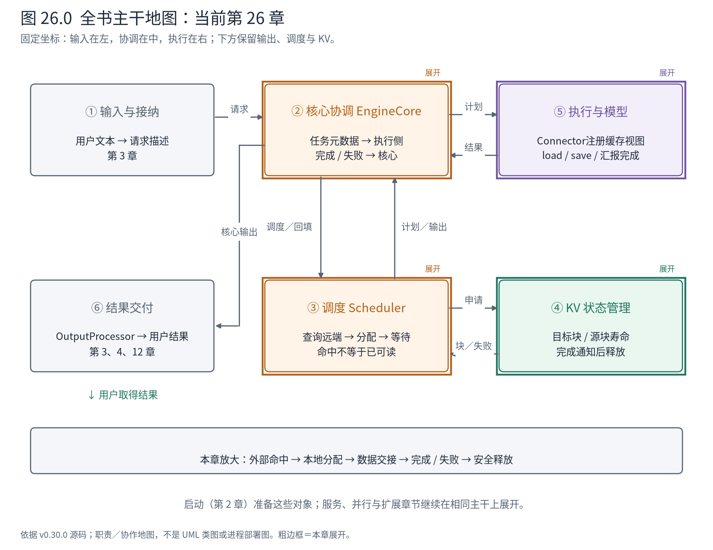
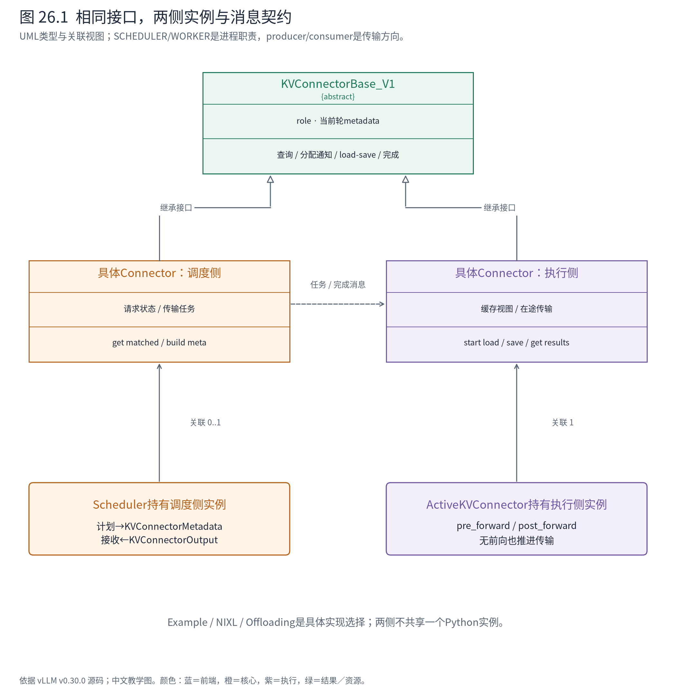
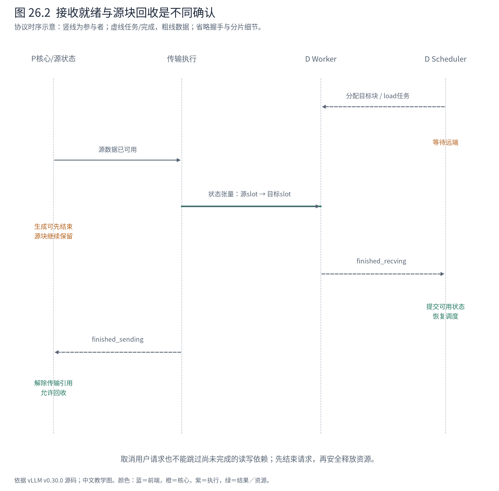

# 第 26 章 Connector：状态怎样跨越引擎与存储边界

第25章要求所有状态组在同一恢复位置汇合。本章再增加一个条件：这些状态可能还没有到达当前设备。调度器知道远端存在一段前缀，能否马上把它算进已完成进度？接收方分配了目标块，是否就能让模型读取？发送方已经结束生成，能否立即回收源块？

这些问题共同指向一个设计边界：**计算完成、数据可用和资源可回收，是三个需要分别确认的事实。** 本章先拆开 Connector 的两侧角色，再用实际CPU文件与槽位拷贝观察交接对象，最后进入异步传输与失败处理。



**怎样读地图。** ③向外部状态查询并规划目标块，⑤执行传输，④负责块在传输期间的有效性与寿命，②运送任务和完成结果。跨引擎的网络或存储位于本地图外部；它并不是又一个可以无条件接到调用栈末尾的普通函数。

## 26.1 PD分离改变的是计算部署，也增加了交接工作

同一引擎中，prefill 写出的 KV 可以继续被 decode 使用。PD分离把两段计算放到不同实例：P负责预填充，D负责后续生成。这样可以分别组织资源和控制两阶段相互干扰，但D必须取得与其模型和布局兼容的历史状态。

假设A的五个prompt token在P上处理过。D需要的不是字符串“已经算过五个”，而是正确的KV内容、对应的token位置，以及恢复下一步所需的结果信息。两端物理块号由各自分配器决定，P的块1完全可能落到D的块3。

[官方PD文档](https://docs.vllm.ai/en/v0.30.0/features/disagg_prefill/)把阶段独立调优与尾延迟控制作为动机。这里不据此推导必然提升吞吐；传输字节、网络等待、布局转换和实例间负载不均都可能成为代价。外部路由器怎样选择P/D、如何接续用户流式响应，与引擎内部Connector协议也属于不同职责。

## 26.2 两个“角色”维度不要混淆

`KVConnectorRole` 区分 SCHEDULER 与 WORKER：前者规划，后者操作数据。配置中的 producer、consumer、both 则说明一个实例在状态交接中的方向。**一个消费实例内部也有调度侧Connector和执行侧Connector。** 不能把Scheduler侧画成发送方、Worker侧画成接收方。



**怎样读图。** 两侧都遵守 `KVConnectorBase_V1`，但处在不同进程语境，持有不同状态。SchedulerOutput携带可序列化元数据，执行端返回KVConnectorOutput；它们不是指向同一个Python Connector对象的共享引用。MRV2还通过ActiveKVConnector包装执行前后钩子。

| 调度侧接口 | 交出的含义 | 对应约束 |
|---|---|---|
| `get_num_new_matched_tokens` | 本地进度之外还可取得多少token，是否异步 | `None`表示查询尚无结论，不等于0命中 |
| `update_state_after_alloc` | 当前请求的本地目标块及外部token数 | 有块不代表需要load，应看外部增量 |
| `build_connector_meta` | 本轮传输任务的描述 | 不擅自修改SchedulerOutput其他字段 |
| `request_finished` | 是否延迟释放，以及可交出的传输参数 | 生成结束时，数据可能仍在发送 |

Worker侧注册实际缓存视图，执行load/save，等待必要依赖，报告完成、失败或无效块。相同接口允许不同传输实现接入，代价是每个实现必须兑现时点与寿命契约，而不仅是“字节最终能复制过去”。

## 26.3 先看实物：不同块号怎样对应同一段内容

上游 `ExampleConnector` 是明确标为debug的文件保存/加载实现。本节不启动两台引擎；脚本手工设置该对象所需的最小字段，调用它真实的 `save_kv_layer` 与 `start_load_kv`，在工作区log目录完成CPU safetensors往返。它有真实张量拷贝，但没有NPU模型、网络握手或生产PD性能含义。

用于交接的 `ReqMeta` 包含 token、slot mapping、存取方向与媒体身份：

<!-- book:ch26-meta:start -->
源码教学注释版，vllm v0.30.0：[原文件 L50–L65](https://github.com/vllm-project/vllm/blob/ced6857afa0ea7b2e3f0846a62e1394e90f15607/vllm/distributed/kv_transfer/kv_connector/v1/example_connector.py#L50-L65)。仅新增 `# 【解读】`，其他内容保留原文。

```python
        # 【解读】本debug实现只传末token之前的完整块，具体对齐helper见正文。
        valid_num_tokens = align_to_block_size(len(token_ids), block_size)
        token_ids_tensor = torch.tensor(token_ids)[:valid_num_tokens]
        # 【解读】本地物理块号来自当前引擎分配器。
        block_ids_tensor = torch.tensor(block_ids)
        num_blocks = block_ids_tensor.shape[0]
        block_offsets = torch.arange(0, block_size)
        # 【解读】将每块展开成token槽地址；两端块号无需一致。
        slot_mapping = (
            block_offsets.reshape((1, block_size))
            + block_ids_tensor.reshape((num_blocks, 1)) * block_size
        )
        # 【解读】有效token长度裁剪掉多余预留槽。
        slot_mapping = slot_mapping.flatten()[:valid_num_tokens]
        return ReqMeta(
            token_ids=token_ids_tensor,
            slot_mapping=slot_mapping,
            # 【解读】方向是本次任务要存还是要读，不是Python对象的进程角色。
            is_store=is_store,
            mm_hashes=mm_hashes,
        )
```
<!-- book:ch26-meta:end -->

这个实现的 `align_to_block_size(n,B)` 实际是 `(n-1)//B*B`，不是通常的 `n//B*B`。它只取末token之前的完整块。A的5个token、教学块大小4，因此只传前4个；此规则属于这个debug实现，不是所有Connector的统一传输粒度。

构造缓存视图为 `[6,1,4,2]`，含6块、每块1个头、4个token槽，每槽2个状态数值。源取块1，目的写块3：

<!-- book:ch26-roundtrip:start -->
CPU真实ExampleConnector文件/槽拷贝与OffloadingWorkerMetadata聚合，手工初始化对象及构造张量；没有启动两引擎、网络传输或NPU模型。来自[原始记录](evidence/connector-cpu/trace.json)。

```json
{
  "roundtrip": {
    "shape": [
      6,
      1,
      4,
      2
    ],
    "store_meta": {
      "token_ids": [
        785,
        6722,
        315,
        9625
      ],
      "slot_mapping": [
        4,
        5,
        6,
        7
      ],
      "is_store": true,
      "mm_hashes": []
    },
    "load_meta": {
      "token_ids": [
        785,
        6722,
        315,
        9625
      ],
      "slot_mapping": [
        12,
        13,
        14,
        15
      ],
      "is_store": false,
      "mm_hashes": []
    },
    "source_block_1": [
      [
        [
          8.0,
          9.0
        ],
        [
          10.0,
          11.0
        ],
        [
          12.0,
          13.0
        ],
        [
          14.0,
          15.0
        ]
      ]
    ],
    "destination_block_3": [
      [
        [
          8.0,
          9.0
        ],
        [
          10.0,
          11.0
        ],
        [
          12.0,
          13.0
        ],
        [
          14.0,
          15.0
        ]
      ]
    ],
    "other_blocks_untouched": true
  }
}
```
<!-- book:ch26-roundtrip:end -->

源槽 `[4,5,6,7]` 与目的槽 `[12,13,14,15]` 指向不同物理位置，但抽出的张量均是 `[4,1,2]`，数值8到15逐项一致，其他目的块仍保持哨兵值-1。它直观说明：**传输共享逻辑身份和内容，不共享本地分配器的块号。**

保存端实际按元数据抽取张量并写文件：

<!-- book:ch26-save:start -->
源码教学注释版，vllm v0.30.0：[原文件 L243–L253](https://github.com/vllm-project/vllm/blob/ced6857afa0ea7b2e3f0846a62e1394e90f15607/vllm/distributed/kv_transfer/kv_connector/v1/example_connector.py#L243-L253)。仅新增 `# 【解读】`，其他内容保留原文。

```python
        # 【解读】从当前轮元数据中取要保存的请求。
        connector_metadata = self._get_connector_metadata()
        assert isinstance(connector_metadata, ExampleConnectorMetadata)
        for request in connector_metadata.requests:
            if request.is_store:
                # 【解读】以token身份与层名定位文件，这是debug实现的存储方式。
                filename = self._generate_filename_debug(
                    layer_name, request.token_ids, request.mm_hashes
                )
                # 【解读】按源引擎本地slot抽取有效内容。
                kv_cache = extract_kv_from_layer(kv_layer, request.slot_mapping)
                # 【解读】转为CPU张量后实际写safetensors；不是生产网络零拷贝。
                with gpu_sync_allowed():
                    tensors = {"kv_cache": kv_cache.detach().cpu()}
                safetensors.torch.save_file(tensors, filename)
```
<!-- book:ch26-save:end -->

加载端据目的slot计算块下标与块内偏移，将文件内容注入目的缓存。真实部署还需要校验模型身份、格式、层对应和并行布局。NIXL的元数据进一步携带远端engine/request身份、块集合、并行信息与有效期等；debug文件实现的简单键不能视为完整的多租户缓存协议。

## 26.4 从“外部命中”走到“当前前向可读”

现在进入异步语义。D侧调度器先查询远端可用前缀，再申请本地目标块，把任务交给Worker。若load异步，A进入 `WAITING_FOR_REMOTE_KVS`，不参与依赖这些数据的模型计算；同一个核心仍可处理B。

这里有一个很像debug陷阱的字段：等待传输时，源码可以先给 `num_computed_tokens` 填上计划接收的进度。此时必须结合状态一起解释，不能只看数值就宣布设备中已有这些KV。出错时该进度会按有效数据重置，完成时才允许请求恢复。



**怎样读图。** 实线为同侧调用，虚线为跨边界任务/完成消息，粗水平箭头表示状态数据传输。D先有目标块，后有可读状态；P可以先结束生成，后结束源块保留。图中省略网络握手与分片传输细节，不表示两端使用同一进程时钟。

MRV2 的 ActiveKVConnector 决定何时提交load：

<!-- book:ch26-pre:start -->
源码教学注释版，vllm v0.30.0：[原文件 L70–L80](https://github.com/vllm-project/vllm/blob/ced6857afa0ea7b2e3f0846a62e1394e90f15607/vllm/v1/worker/gpu/kv_connector.py#L70-L80)。仅新增 `# 【解读】`，其他内容保留原文。

```python
        # 【解读】调度侧只交接当前轮元数据，执行侧持有实际缓存视图。
        kv_connector_metadata = scheduler_output.kv_connector_metadata
        assert kv_connector_metadata is not None
        self.kv_connector.handle_preemptions(kv_connector_metadata)
        # 【解读】绑定当前轮产物，供层内钩子和load使用。
        self.kv_connector.bind_connector_metadata(kv_connector_metadata)
        self._pending_load_kwargs = kwargs

        # 【解读】同步命中必须先装好，当前前向才能读取它。
        if scheduler_output.has_sync_kv_loads:
            # Sync loads need to run before this step's forward.
            self._start_load_kv()
        # 【解读】异步请求尚未参与计算，可以把提交推迟到前向后。
        # Otherwise start the async load after forward to keep submission
        # off the critical path.
```
<!-- book:ch26-pre:end -->

同步load必须在当前前向读取前完成。异步load对应尚未入算的请求，可以推迟到前向之后提交，减少当前计算关键路径上的工作。这也意味着不能把所有Connector都概括成“forward前先搬KV”。

执行后收集到的结果如下：

<!-- book:ch26-output:start -->
源码教学注释版，vllm v0.30.0：[原文件 L110–L122](https://github.com/vllm-project/vllm/blob/ced6857afa0ea7b2e3f0846a62e1394e90f15607/vllm/v1/worker/gpu/kv_connector.py#L110-L122)。仅新增 `# 【解读】`，其他内容保留原文。

```python
        # 【解读】是否等待保存由本次调用语境决定。
        if wait_for_save:
            self.kv_connector.wait_for_save()
        # 【解读】统一收集完成结果，可能只是某些请求完成。
        transfer_results = self.kv_connector.get_transfer_results(finished_req_ids)
        output.finished_sending = transfer_results.finished_sending or None
        output.finished_recving = transfer_results.finished_recving or None
        # 【解读】接收失败与已完成接收不同，消费者必须分别处理。
        output.failed_recving = transfer_results.failed_recving
        # 【解读】出错块用于修正有效前缀，不能把未写入数据当命中。
        output.invalid_block_ids = self.kv_connector.get_block_ids_with_load_errors()
        output.kv_connector_stats = self.kv_connector.get_kv_connector_stats()
        output.kv_cache_events = self.kv_connector.get_kv_connector_kv_cache_events()
        output.kv_connector_worker_meta = (
            self.kv_connector.build_connector_worker_meta()
        )
        # 【解读】轮次结束清掉绑定，避免下一轮误用旧元数据。
        self.kv_connector.clear_connector_metadata()
```
<!-- book:ch26-output:end -->

即使这轮没有模型token要计算，`no_forward` 也会执行Connector前后钩子并返回仅含传输输出的ModelRunnerOutput。否则“等待远端→无可算请求→不轮询完成”会让协议停住。主循环不仅推进计算，也必须推进外部依赖。

调度器看到接收完成后，才能把有效块登记为可复用缓存，并将等待请求恢复。若整个prompt都命中，还需要生成下一token的logits：

<!-- book:ch26-full-hit:start -->
源码教学注释版，vllm v0.30.0：[原文件 L2950–L2958](https://github.com/vllm-project/vllm/blob/ced6857afa0ea7b2e3f0846a62e1394e90f15607/vllm/v1/core/sched/scheduler.py#L2950-L2958)。仅新增 `# 【解读】`，其他内容保留原文。

```python
        else:
            # 【解读】成功接收后才提交可用缓存身份。
            # Now that the blocks are ready, actually cache them.
            # This will cache the blocks iff caching is enabled.
            self.kv_cache_manager.cache_blocks(request, request.num_computed_tokens)

            # on a full prompt hit, we need to re-compute the last token
            # 【解读】完整prompt的KV存在，并不自带下一token的logits。
            # in order to be able to sample the next token
            if request.num_computed_tokens == request.num_tokens:
                # 【解读】回退一token重新执行末位置以采样；不是重新算完整prompt。
                request.num_computed_tokens = request.num_tokens - 1
```
<!-- book:ch26-full-hit:end -->

回退一个token是为了重新得到末位置的计算输出。KV命中解决历史注意力状态，不能凭空提供被省略的logits；具体端到端PD协议也可能传递首token等额外信息，不应混成所有Connector都有同一输出协议。

## 26.5 请求结束，并不自动解除所有块引用

发送方P可能已将A标记结束并交出响应，而传输还在读取它的源块。若此时把块归还给B，B写入新KV，接收方会得到混合内容。于是 `request_finished` 可返回延迟释放标志：

<!-- book:ch26-free:start -->
源码教学注释版，vllm v0.30.0：[原文件 L2580–L2588](https://github.com/vllm-project/vllm/blob/ced6857afa0ea7b2e3f0846a62e1394e90f15607/vllm/v1/core/sched/scheduler.py#L2580-L2588)。仅新增 `# 【解读】`，其他内容保留原文。

```python
        self.finished_req_ids.add(request_id)
        if self.finished_req_ids_dict is not None:
            # 【解读】请求生成结束的信息可以先对外报告。
            self.finished_req_ids_dict[request.client_index].add(request_id)

        # 【解读】connector仍需要源块时，延迟归还资源。
        delay_free_blocks |= connector_delay_free_blocks
        # 【解读】只有不存在延迟依赖时才立即释放。
        if not delay_free_blocks:
            self._free_blocks(request)

        return kv_xfer_params, ec_xfer_params
```
<!-- book:ch26-free:end -->

`finished_sending` 到来后，Scheduler 才释放这些已结束请求的块。接收方取消也有类似问题：用户不再要结果，不代表外部写操作已经停止。源码会结合完成通知与在途步骤的释放栅栏，避免把仍可能被写入的目标块交给下一请求。

这不是把整个取消过程全局阻塞。它是拆开“用户请求结束”和“资源引用解除”：前者可以先通知，后者依据真正使用资源的组件确认。第6章引用计数、第13章在途状态和这里的传输完成，处理的是同一类寿命问题。

失败也需要回到有效性边界。无效块上报后，Scheduler 查哪些请求依赖这些块，并将其进度退回可重算的前缀；混合模型的组粒度不同，当前错误处理采取更保守的完整重算，而不是假设某个块列对应所有组相同的token边界。是否重算或按配置失败结束，要继续看具体策略，不能读到“允许失败上报”就推断永远透明恢复。

## 26.6 卸载复用了交接协议，但目标不同

PD希望另一实例接续计算；KV卸载希望较慢、较大的存储层扩展复用容量。`OffloadingConnector` 是后者的代表：调度侧建立 `TransferJob`，带请求、源/目的存储描述，按job ID交给Worker；Worker完成后把同一个ID返回。

它还必须处理多Worker完成汇合。CPU实验实际调用 `OffloadingWorkerMetadata.mark_completed/aggregate`：

<!-- book:ch26-counts:start -->
CPU真实ExampleConnector文件/槽拷贝与OffloadingWorkerMetadata聚合，手工初始化对象及构造张量；没有启动两引擎、网络传输或NPU模型。来自[原始记录](evidence/connector-cpu/trace.json)。

```json
{
  "completion_counts": {
    "worker0": {
      "7": 1
    },
    "worker1": {
      "7": 1
    },
    "aggregate": {
      "7": 2
    }
  }
}
```
<!-- book:ch26-counts:end -->

两个Worker各报告job7完成一次，聚合计数为2。调度侧使用它减少pending_count：

<!-- book:ch26-job:start -->
源码教学注释版，vllm v0.30.0：[原文件 L1857–L1867](https://github.com/vllm-project/vllm/blob/ced6857afa0ea7b2e3f0846a62e1394e90f15607/vllm/distributed/kv_transfer/kv_connector/v1/offloading/scheduler.py#L1857-L1867)。仅新增 `# 【解读】`，其他内容保留原文。

```python
            # 【解读】job ID关联此前的传输计划，不靠日志出现顺序猜归属。
            job_status = self._jobs[job_id]
            # 【解读】扣除本次汇报完成的worker数量。
            job_status.pending_count -= count
            # 【解读】仍有worker未完成，就不能宣布整个状态可用。
            if job_status.pending_count > 0:
                continue
            # 【解读】计数不能超额，重复完成上报会破坏协议。
            assert job_status.pending_count == 0

            req_status = self._req_status[job_status.req_id]
            # 【解读】全部完成后再提交存储或加载完成状态。
            if job_status.is_store:
                self.manager.complete_store(job_status.keys, req_status.req_context)
            else:
                self.manager.complete_load(job_status.keys, req_status.req_context)
```
<!-- book:ch26-job:end -->

第一份完成不代表整个TP模型的状态都已保存；只有全部参与者结束才能提交load/store状态。这里验证的是聚合对象与源码协议，没有执行DMA、CPU缓存提升或多级存储。

卸载缓存可以是best-effort：某次保存未成功，未来只是少一次命中；PD接续依赖的数据交付则可能具有更强要求。当前OffloadingConnector显式不要求强制KV交付。两者共享Connector接口，并不意味着失败语义、布局支持或收益相同。[官方卸载指南](https://docs.vllm.ai/en/v0.30.0/features/kv_offloading_usage/)提供配置入口；是否适用于某平台与混合状态组合，仍须查实际实现。

## 26.7 沿协议边界设置停点

下面是静态调用/消息路径，跨进程处明确断开。同步ExampleConnector实验只覆盖保存与加载的CPU方法，未观测这整条异步链：

```text
D核心：Scheduler.schedule
├─ connector.get_num_new_matched_tokens
├─ KVCacheManager.allocate_slots
├─ connector.update_state_after_alloc
└─ build_connector_meta → SchedulerOutput
         ── 执行任务消息 ──>
D Worker / MRV2
├─ ActiveKVConnector.pre_forward
│  └─ bind metadata；同步load先执行
├─ 模型前向（若本轮有计算）
└─ ActiveKVConnector.post_forward
   ├─ 提交待发异步load；必要时等待save
   └─ 收集完成/失败 → KVConnectorOutput
         ── 结果消息 ──>
D核心：更新传输状态
├─ 无效块 → 修正进度/重算或失败策略
└─ 完成接收 → cache / 恢复等待请求
P核心：请求生成完成 → connector.request_finished
└─ 必要时保留源块 ── 收到finished_sending ──> 释放
```

如果D一直等待，先检查远端查询是否有结论，再看任务是否发出、完成是否返回、请求ID是否匹配。若传输完成但数值错误，先核对slot、组、层、dtype和布局，再看数据内容。若结束请求仍占块，检查是否有尚未解除的发送或写入引用。每种症状都落到可检查的协议阶段。

本章留下的设计认识是：Connector封装了跨边界的数据可用性协议。它使调度器保留统一主干，也把正确性要求带到了任务身份、状态可读性、完成汇合与延迟释放上。下一章将用这些职责边界组织诊断，回答“请求到底停在哪里”。

## 26.8 源码导航与停止边界

| 问题 | 入口 | 停止条件 |
|---|---|---|
| 两侧各承诺什么 | `kv_connector/v1/base.py::KVConnectorBase_V1` | 能解释None/0、异步标志、完成与延迟释放 |
| 具体消息是什么样 | `example_connector.py::ReqMeta`、NIXL metadata | 区分本地块与远端身份，不套用debug格式 |
| 何时load、何时收完成 | `worker/gpu/kv_connector.py::ActiveKVConnector` | 能解释同步/异步/no_forward |
| 失败与取消怎样释放 | `core/sched/scheduler.py`的传输更新与free方法 | 找到有效前缀和仍持有资源的依赖 |
| 多Worker卸载何时提交 | `offloading/common.py`、`offloading/scheduler.py` | 追一个job到pending_count归零 |

源码、文件往返与聚合实物已在正文给出；本章没有提供NPU PD或真实网络吞吐结果。Ascend的具体传输实现作为第19章的平台分支继续核对。
