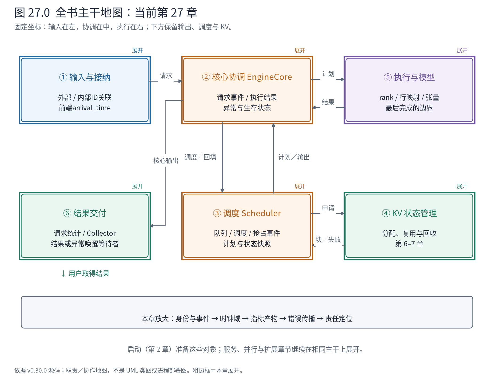
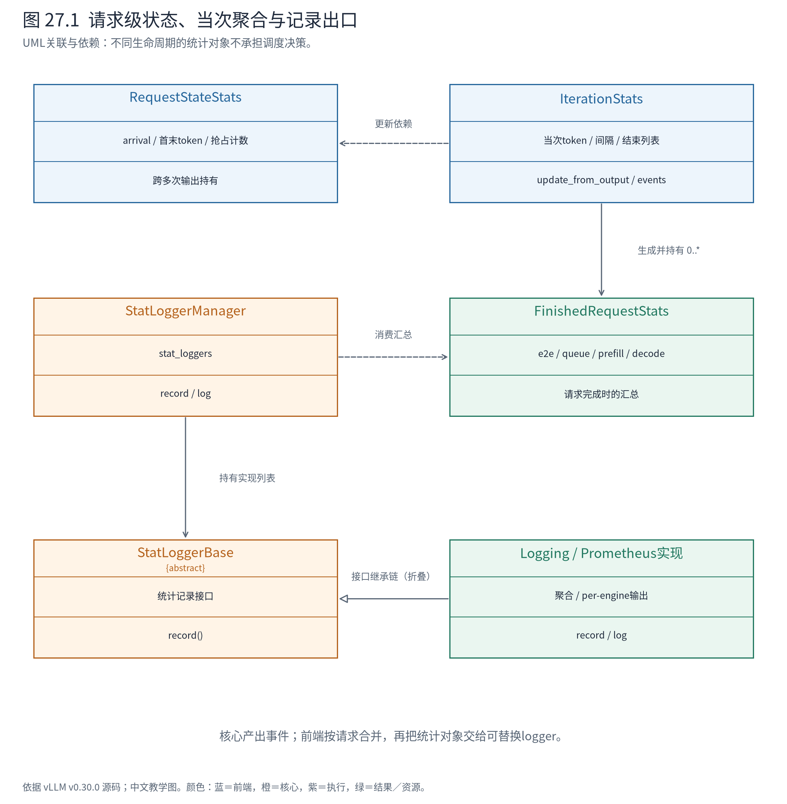
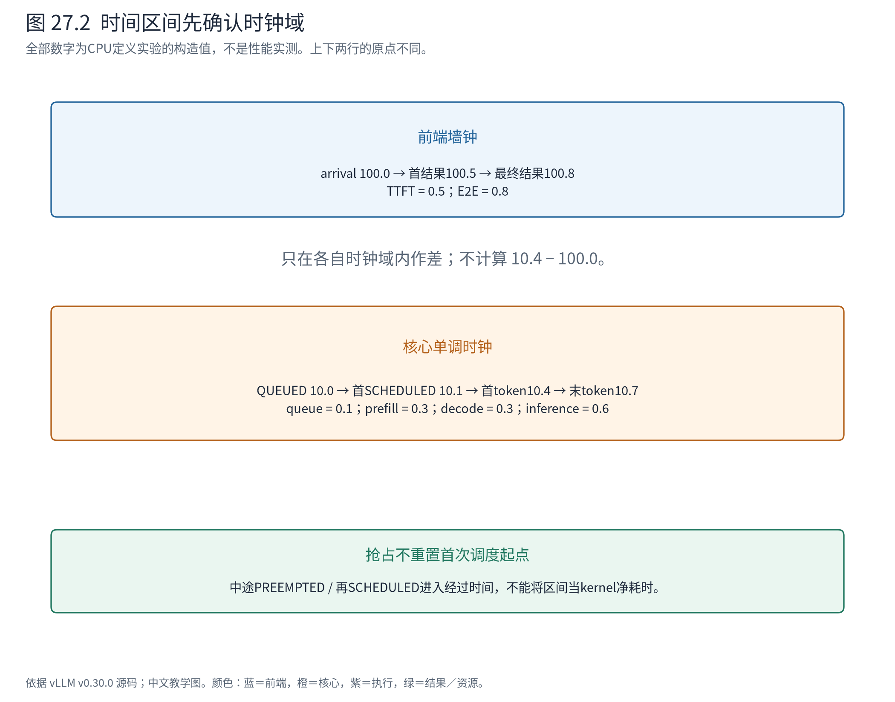

# 第 27 章 可观测与诊断：请求到底停在哪里

前一章的远端等待说明，“请求还没返回”可能有许多原因：未被接纳、等待预算、等待状态、正在计算、结果已到前端却未被消费。只看到一个延迟数字，无法区分它们；把整条调用链全部打印，也容易淹没真正的边界。

本章把前面的源码地图用作诊断工具。我们先看事件和指标怎样形成，再追一条异常如何唤醒请求，最后用具体症状选择最小观测点。目标是知道下一步应该检查谁，而不是背诵一张调参表。



**怎样读地图。** 每个边界都有可核验的交接物：请求描述、执行计划、计算输入、模型结果、用户输出。诊断从最后一个已确认的交接物向后推进；如果一个环节没有日志，先确认探针是否覆盖该进程，不能立即判断系统没走到那里。

## 27.1 日志、指标、追踪和对象快照回答不同问题

日志保存离散事件与异常详情；指标将许多请求聚合成计数、占用或分布；追踪把同一请求跨阶段的活动关联起来；对象快照则告诉我们某个停点的字段到底是什么。它们都可以服务诊断，但不能互相替代。

例如等待请求数高，说明压力出现在等待集合，却没有告诉你A是等KV、等语法编译还是等远端传输。单条A日志能给出状态，但不能代表整个服务的延迟分布。设备利用率高也不能证明A一直在运行，因为设备可能在处理B。

贯穿案例已经提供了一套关联键：外部与内部请求ID、轮次、进程、rank、持久请求行和当步批次行。它们各自有作用域。第9章里B从批次第二行变成唯一一行，持久行却仍是2；若只按“第0行”关联不同轮次，就可能把A的输入和B的输出拼在一起。

观测代码也有成本。设备张量复制回CPU可能同步执行、改变重叠行为；逐token打印会增加CPU与I/O开销。本书带探针的运行用于核对对象与机制，不能顺手把探针时间当作正常服务的性能。

## 27.2 从核心事件到前端统计对象

核心产生按请求关联的QUEUED、SCHEDULED、PREEMPTED事件；核心输出携带事件与结果到前端。前端将跨多次输出的请求状态保存在 `RequestStateStats`，当次输出批次的统计保存在 `IterationStats`，请求结束后形成 `FinishedRequestStats`。



**怎样读图。** 请求统计是长期关联状态，迭代统计是一次输出处理的聚合，结束统计是汇总产物。StatLoggerManager再把产物交给不同logger；PrometheusStatLogger和LoggingStatLogger属于出口实现，不能反过来当作Scheduler的决策对象。

这个分工让核心不必在调度热路径里完成所有展示与指标导出。代价是事件运输与前端聚合会带来延后，必须精确定义指标的观测边界。DP还需要保留engine身份：一个前端可能服务多个核心，聚合日志与按engine指标不是同一视图。

最容易忽略的定义就在状态字段旁边：

<!-- book:ch27-clocks:start -->
源码教学注释版，vllm v0.30.0：[原文件 L224–L234](https://github.com/vllm-project/vllm/blob/ced6857afa0ea7b2e3f0846a62e1394e90f15607/vllm/v1/metrics/stats.py#L224-L234)。仅新增 `# 【解读】`，其他内容保留原文。

```python
    # 【解读】前端接收起点使用墙钟；同域结束点才能与它相减。
    # This is an engine frontend timestamp (wall-clock)
    arrival_time: float = 0.0

    # 【解读】核心事件使用单调时钟，计核心内部阶段间隔。
    # These are engine core timestamps (monotonic)
    queued_ts: float = 0.0
    scheduled_ts: float = 0.0
    first_token_ts: float = 0.0
    last_token_ts: float = 0.0

    # first token latency
    # 【解读】首token延迟另存，不能用核心时间直接减arrival_time。
    first_token_latency: float = 0.0
```
<!-- book:ch27-clocks:end -->

前端 arrival_time 用墙钟；核心排队、调度、首末token时间用单调时钟。单调时钟用于测间隔，不是日期。源码还明确提醒，不应直接把不同进程的事件时间当同一时间轴比较；即使某台机器恰好共享时钟基准，诊断也应遵守明确的来源与契约。

## 27.3 时间区间如何从事件长出来

事件处理保留首次调度位置，并记录抢占：

<!-- book:ch27-events:start -->
源码教学注释版，vllm v0.30.0：[原文件 L518–L529](https://github.com/vllm-project/vllm/blob/ced6857afa0ea7b2e3f0846a62e1394e90f15607/vllm/v1/metrics/stats.py#L518-L529)。仅新增 `# 【解读】`，其他内容保留原文。

```python
        # 【解读】事件按请求关联，不按整个批次只记一份状态。
        for event in events:
            if event.type == EngineCoreEventType.QUEUED:
                req_stats.queued_ts = event.timestamp
                lora_states.request_waiting(req_id, lora_name)
            # 【解读】首次进入调度的时间用于请求级阶段划分。
            elif event.type == EngineCoreEventType.SCHEDULED:
                # 【解读】抢占后重新调度不覆盖最初scheduled时间。
                if req_stats.scheduled_ts == 0.0:  # ignore preemptions
                    req_stats.scheduled_ts = event.timestamp
                lora_states.request_running(req_id, lora_name)
            # 【解读】抢占同时累计本轮和该请求的计数。
            elif event.type == EngineCoreEventType.PREEMPTED:
                self.num_preempted_reqs += 1
                req_stats.num_preemptions += 1
                lora_states.request_waiting(req_id, lora_name)
```
<!-- book:ch27-events:end -->

抢占后再次调度，不覆盖首次scheduled_ts。因此请求的运行阶段可以包含重算、等待与恢复。一个“长prefill区间”并不必然是单次长prefill kernel，它可能在首结果到来前被抢占过。

结束统计的区间计算如下：

<!-- book:ch27-intervals:start -->
源码教学注释版，vllm v0.30.0：[原文件 L540–L562](https://github.com/vllm-project/vllm/blob/ced6857afa0ea7b2e3f0846a62e1394e90f15607/vllm/v1/metrics/stats.py#L540-L562)。仅新增 `# 【解读】`，其他内容保留原文。

```python
        # 【解读】E2E从前端到前端计算，包含前端观察到的完整等待。
        e2e_latency = self._time_since(req_stats.arrival_time)

        # Queued interval is from first QUEUED event to first SCHEDULED
        # 【解读】队列区间使用两个核心时间。
        queued_time = req_stats.scheduled_ts - req_stats.queued_ts

        # Prefill interval is from first SCHEDULED to first NEW_TOKEN
        # Any preemptions during prefill is included in the interval
        # 【解读】这里是首调度到首token事件的经过时间，不是设备kernel净执行时间。
        prefill_time = req_stats.first_token_ts - req_stats.scheduled_ts

        # Decode interval is from first NEW_TOKEN to last NEW_TOKEN
        # Any preemptions during decode are included
        # 【解读】decode包含首token之后直到末token的停顿与抢占。
        decode_time = req_stats.last_token_ts - req_stats.first_token_ts

        # Inference interval is from first SCHEDULED to last NEW_TOKEN
        # Any preemptions during prefill or decode are included
        inference_time = req_stats.last_token_ts - req_stats.scheduled_ts

        # Do not count the token generated by the prefill phase
        # 【解读】平均每输出token时间排除prefill产出的第一个token。
        mean_time_per_output_token = (
            decode_time / (req_stats.num_generation_tokens - 1)
            if req_stats.num_generation_tokens - 1 > 0
            # 【解读】只有一个生成token时没有后续间隔，返回0。
            else 0
        )
```
<!-- book:ch27-intervals:end -->

用人话说，先在各自时钟域内求差，再比较区间含义。TTFT与E2E是前端观察；queue、prefill、decode和inference由核心事件定义。这里的TTFT也不自动等于客户端从发HTTP到收到第一个字节的时间，后者还包含客户端、网络和协议交付。



**怎样读图。** 上方前端从100.0到100.5、100.8；下方核心从10.0到10.1、10.4、10.7。这些数是构造时间，故意使用不同原点。只读同一行的区间，不把上下两行刻度直接相减。

CPU实验驱动真实统计方法，使用B的三个生成token，并在中途构造一次抢占与重新调度：

<!-- book:ch27-metrics-data:start -->
CPU执行真实指标/错误交付方法；时间、事件与异常均由探针构造，不是性能实测或真实故障注入到运行引擎。来自[原始记录](evidence/metrics-contract/trace.json)。

```json
{
  "updates": [
    {
      "frontend_time": 100.5,
      "core_time": 10.4,
      "ttft_samples": [
        0.5
      ],
      "itl_samples": [],
      "scheduled_ts": 10.1,
      "preemptions": 0
    },
    {
      "frontend_time": 100.65,
      "core_time": 10.55,
      "ttft_samples": [],
      "itl_samples": [
        0.15000000000000036
      ],
      "scheduled_ts": 10.1,
      "preemptions": 1
    },
    {
      "frontend_time": 100.8,
      "core_time": 10.7,
      "ttft_samples": [],
      "itl_samples": [
        0.14999999999999858
      ],
      "scheduled_ts": 10.1,
      "preemptions": 1
    }
  ],
  "finished": {
    "finish_reason": 1,
    "request_id": "B-metrics",
    "e2e_latency": 0.7999999999999972,
    "num_prompt_tokens": 6,
    "num_preemptions": 1,
    "num_generation_tokens": 3,
    "max_tokens_param": 3,
    "queued_time": 0.09999999999999964,
    "prefill_time": 0.3000000000000007,
    "inference_time": 0.5999999999999996,
    "decode_time": 0.29999999999999893,
    "mean_time_per_output_token": 0.14999999999999947,
    "is_corrupted": false,
    "num_cached_tokens": 0
  }
}
```
<!-- book:ch27-metrics-data:end -->

结果对应TTFT0.5秒、E2E0.8秒、排队0.1秒、prefill0.3秒、decode0.3秒、inference0.6秒，平均后续token时间为0.15秒。JSON中的长小数来自浮点表示。首次scheduled仍为10.1，抢占计数为1。这是**定义的可执行验证**，不是本机B请求实测耗时。

还有两条解释边界。第一，一次核心输出可以含多个token，例如投机验证；相邻输出事件间隔不等于每个token独立执行时间。第二，只有一个生成token时，没有后续decode间隔，源码将平均值设为0。判断数据前先问统计对象到底计数什么，比先画平均线更重要。[官方指标设计文档](https://docs.vllm.ai/en/v0.30.0/design/metrics/)给出了这些阶段定义的背景。

## 27.4 异常必须跨过等待边界，才能被用户看见

一个异步请求正在 `await` 输出。如果后台接收协程失败，只在后台打印traceback而不通知等待者，用户可能一直等下去。错误传播因此也是接口契约的一部分。

AsyncMPClient的接收循环把异常放进输出队列：

<!-- book:ch27-socket-error:start -->
源码教学注释版，vllm v0.30.0：[原文件 L1158–L1161](https://github.com/vllm-project/vllm/blob/ced6857afa0ea7b2e3f0846a62e1394e90f15607/vllm/v1/engine/core_client.py#L1158-L1161)。仅新增 `# 【解读】`，其他内容保留原文。

```python
            # 【解读】后台接收协程失败，必须把异常交给等待输出的消费者。
            except Exception as e:
                outputs_queue.put_nowait(e)
            # 【解读】接收任务被取消也通知engine不可用，避免消费者永久等待。
            except asyncio.CancelledError:
                outputs_queue.put_nowait(EngineDeadError())
```
<!-- book:ch27-socket-error:end -->

`get_output_async` 取出后重新抛出；AsyncLLM的输出处理器捕获共享输出通道异常，将它交给OutputProcessor：

<!-- book:ch27-propagate:start -->
源码教学注释版，vllm v0.30.0：[原文件 L493–L498](https://github.com/vllm-project/vllm/blob/ced6857afa0ea7b2e3f0846a62e1394e90f15607/vllm/v1/engine/output_processor.py#L493-L498)。仅新增 `# 【解读】`，其他内容保留原文。

```python
    # 【解读】共享输出处理失败时，通知所有尚存请求的收集器。
    def propagate_error(self, e: Exception):
        """Propagate error to all generate() tasks."""

        # 【解读】每条generate任务等待自己的queue，必须逐一唤醒。
        for _, state in self.request_states.items():
            assert state.queue is not None
            # 【解读】异常作为队列载荷交付；get时会重新抛出。
            state.queue.put(e)
```
<!-- book:ch27-propagate:end -->

每个收集器的get又在对应请求任务里抛出该异常：

<!-- book:ch27-get:start -->
源码教学注释版，vllm v0.30.0：[原文件 L84–L92](https://github.com/vllm-project/vllm/blob/ced6857afa0ea7b2e3f0846a62e1394e90f15607/vllm/v1/engine/output_processor.py#L84-L92)。仅新增 `# 【解读】`，其他内容保留原文。

```python
    async def get(self) -> RequestOutput | PoolingRequestOutput:
        """Get operation blocks on put event."""
        # 【解读】无数据时等待事件；put(error)也会设置此事件。
        while (output := self.output) is None:
            await self.ready.wait()
        # 【解读】取走当前载荷后清空槽与事件，为后续更新准备。
        self.output = None
        self.ready.clear()
        # 【解读】把异常重新抛给原请求任务，不把它伪装成空输出。
        if isinstance(output, Exception):
            raise output
        return output
```
<!-- book:ch27-get:end -->

这条静态路径含异步任务与消息交接，不能画成一根同步活动栈：

```text
后台任务：AsyncMPClient.process_outputs_socket
└─ except → outputs_queue.put_nowait(exception)
          ── 队列交付 / 唤醒 ──>
共享输出任务：AsyncLLM.output_handler
└─ get_output_async → 重新raise
   └─ except → OutputProcessor.propagate_error
      ├─ A.collector.put(exception)
      └─ B.collector.put(exception)
          ── 请求级事件唤醒 ──>
A/B各自generate任务
└─ RequestOutputCollector.get → raise exception
```

CPU实验实际建立两个Collector，让两个协程进入等待，再调用真实 `propagate_error`，注入构造的RuntimeError：

<!-- book:ch27-error-data:start -->
CPU执行真实指标/错误交付方法；时间、事件与异常均由探针构造，不是性能实测或真实故障注入到运行引擎。来自[原始记录](evidence/metrics-contract/trace.json)。

```json
{
  "error_delivery": {
    "A": {
      "type": "RuntimeError",
      "message": "synthetic core failure",
      "ready_after_get": false
    },
    "B": {
      "type": "RuntimeError",
      "message": "synthetic core failure",
      "ready_after_get": false
    }
  }
}
```
<!-- book:ch27-error-data:end -->

两条请求都被唤醒并收到错误，取走载荷后事件已清除。没有杀掉真实EngineCore，也没有把这次构造异常当作硬件故障。

还要区别影响范围。某请求的参数校验失败通常只拒绝该请求；共享引擎死亡则影响依赖它的所有请求。`EngineDeadError` 告诉前端引擎不可用，根因可能在更早的核心或Worker日志中。只修复最后一层抛出位置，往往修不到真正原因。

## 27.5 用最后一个已确认产物缩小范围

设A没有按预期返回。先确认它是否已经得到内部ID，再沿边界检查；不要一上来钻进Attention内核。下面每行给出能区分下一步的证据：

| 症状 | 先看什么 | 能缩小到的责任边界 |
|---|---|---|
| 调用后没有核心请求 | 输入转换结果、内部ID、发送结果、core接收日志 | Renderer/InputProcessor、client消息与core登记 |
| 请求已登记但不入批 | RequestStatus、队列、预算、分配返回值 | 普通等待、语法等待、远端等待或容量约束 |
| SchedulerOutput已有A但执行侧看不到 | 计划ID/轮次、Executor分发与对应rank接收 | 消息、Worker生存性、执行入口 |
| Runner收到计划但模型输入错 | idx_mapping、query_start_loc、positions、slot_mapping | 持久行到当步行的转换，而非模型参数 |
| token正确但用户文本不对 | 采样ID、核心停止原因、detokenizer、输出kind | 输出处理、停止字符串与流式聚合 |
| 同文本前缀没命中 | 参数/媒体身份、完整块边界、各状态组命中 | 缓存身份、粒度、混合状态恢复条件 |
| 结束后内存未立即归还 | 引用数、缓存身份、在途步骤、传输任务 | 可复用缓存与真实泄漏的区别 |
| 多卡挂住 | 各rank最后阶段、组成员、collective参与条件 | 是否有rank先失败或走到不同分支 |

例如第15章中C取消后，前端未完成请求数归零，只证明前端追踪完成；没有设备块探针，就不能从这一条读数直接证明所有KV字节已回收。第26章又说明，合法的在途传输本来就可能延迟释放。诊断要先说清证据能证明什么，再决定增加哪个停点。

第16章的TP探针也经历过两次启动失败：一次触及自定义RPC序列化限制，一次涉及探针模块的pickle定位，之后才取得成功记录。这两次失败发生在控制与进程装配边界，不能据此宣布模型TP计算错误。成功记录保留了退出阶段警告；退出码、结果一致性与退出清理是否平静，也是不同事实。

## 27.6 让观测可证伪，而不是制造更多文字

一个有用的停点至少应记录：关联ID，所属进程/rank，阶段名，必要字段的即时拷贝，以及有效配置。记录对象引用而不做快照，等对象后来变化后再打印，会把多个时间点混成一个现场。

如果只在前端打补丁，多进程Worker内部没有记录是预期的观测边界；不能把“没观测到”当成“没执行”。如果怀疑某个内部阶段，就在拥有该状态的进程增加最小探针，并用一次小请求确认探针确实触发。确认后再扩大输入，避免一开始就引入多卡、长prompt、异步和图执行的全部变量。

同样，不要通过开启大量同步打印来测异步重叠，再拿下降后的吞吐否定异步设计。机制验证可以选择同步、eager与固定小批次；性能验证应移除重探针，控制预热、请求分布和计时边界，另行开展。两种实验都有效，但回答的问题不同。

回到整机，本章给出的不是一套万能日志开关，而是一种定位方法：**找最后一个可信交接物，检查下一边界的契约，再决定需要哪个对象的现场。** 最后一章将重走A/B完整请求，把这些契约重新合成一张可以继续阅读新源码的地图。

## 27.7 源码导航与停止边界

| 问题 | 入口 | 读到哪里停止 |
|---|---|---|
| 指标何时开始与结束 | `v1/metrics/stats.py` | 明确时钟域、事件端点、token计数含义 |
| 谁对外记录指标 | `v1/metrics/loggers.py` | 找到Manager装配、per-engine/aggregate与具体logger |
| 核心失败如何到前端 | `engine/core_client.py`、`engine/async_llm.py` | 区分生存监控、接收队列与输出任务 |
| 为何所有请求一起失败 | `output_processor.py::propagate_error` | 看到共享失败向请求级Collector的分发 |
| 性能数字是否可信 | 本章观测边界与各实验manifest | 能说清配置、探针成本、计时起止；未知项保留未知 |

原始NPU日志、失败日志与CPU定义实验均随书保留。未做生产压测、远程链路追踪部署或真实故障注入，不将教学记录称为生产可靠性验证。
