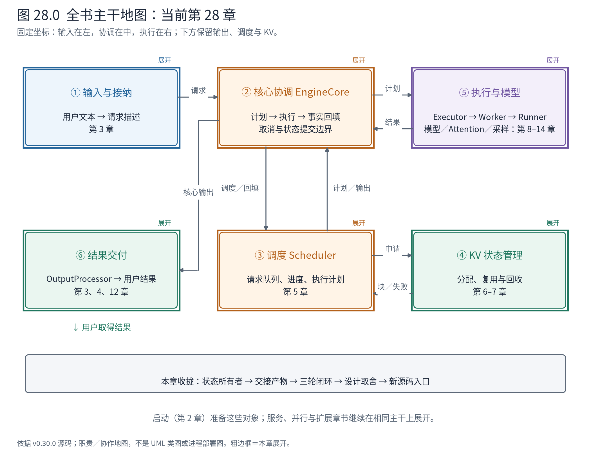
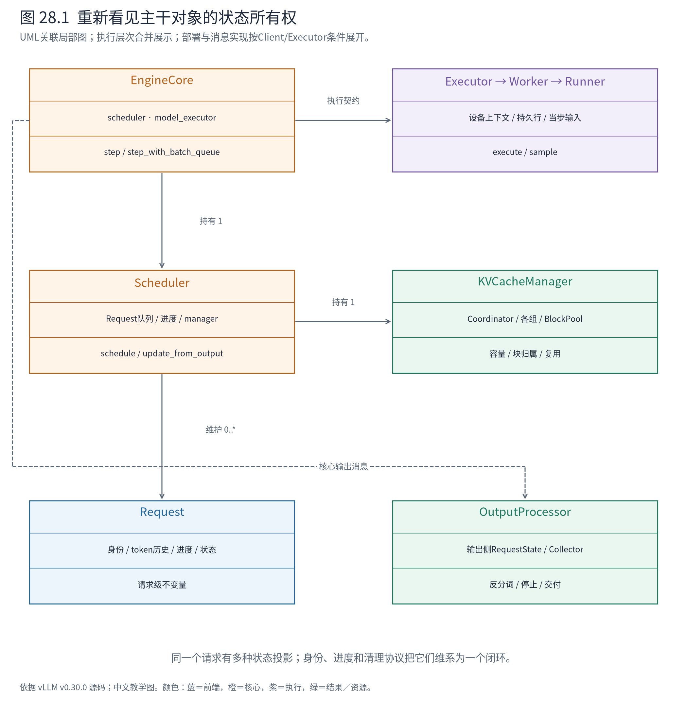

# 第 28 章 回到整机：从一次请求带走可迁移的源码心智

第27章用边界定位问题，最后一章把这些边界重新连起来。现在再看 `Request`、`SchedulerOutput`、Worker、Runner和KVCacheManager，它们应当不再是一串需要背下来的名字，而是各自拥有状态、兑现契约、协作推进请求的对象。

本章回到最初A/B那一次基础NPU运行。不开新实验，不把后面的CPU构造例或另一次Runner观测拼进来；用同一次记录闭合全书，再总结怎样带着这套坐标读一个尚未见过的实现。



**怎样读地图。** ①定义请求，②协调迭代，③决定本轮工作，④维持跨轮状态，⑤执行计算，⑥交付结果。每个箭头都应能说出具体产物；每个框都应能说出它没有代替相邻框管理什么。

## 28.1 再读一遍核心循环，注意它没有承担哪些状态

第一次看到 `EngineCore.step`，读者可能把它理解为“先调用这个，再调用那个”。现在可以从设计职责重新读：

<!-- book:ch28-loop:start -->
源码教学注释版，vllm v0.30.0：[原文件 L598–L619](https://github.com/vllm-project/vllm/blob/ced6857afa0ea7b2e3f0846a62e1394e90f15607/vllm/v1/engine/core.py#L598-L619)。仅新增 `# 【解读】`，其他内容保留原文。

```python
        # 【解读】是否仍有需要推进的状态由调度器判断，核心不重新维护一套请求队列。
        if not self.scheduler.has_requests():
            return {}, False
        # 【解读】产物描述本轮允许做的工作，不携带整个引擎的所有内部状态。
        scheduler_output = self.scheduler.schedule(self._should_throttle_prefills())
        # 【解读】执行器封装单设备或多Worker组织；核心只依赖执行契约。
        future = self.model_executor.execute_model(scheduler_output, non_block=True)
        # 【解读】约束准备与设备任务可以在职责分离后安排重叠。
        grammar_output = self.scheduler.get_grammar_bitmask(scheduler_output)
        with (
            self.capture_iteration_details(scheduler_output) as iteration_details,
            self.log_error_detail(scheduler_output),
        ):
            # 【解读】取得实际执行结果；Future本身不等于结果已就绪。
            model_output = future.result()
            # 【解读】是否另行采样取决于执行返回协议，不能无条件多采一次。
            if model_output is None:
                model_output = self.model_executor.sample_tokens(grammar_output)

        # Before processing the model output, process any aborts that happened
        # during the model execution.
        # 【解读】模型在算时可能收到取消，提交结果前处理它。
        self._process_aborts_queue()
        # 【解读】把执行事实交回拥有请求状态的调度器。
        engine_core_outputs = self.scheduler.update_from_output(
            scheduler_output, model_output
        )
        self._attach_iteration_details(engine_core_outputs, iteration_details)

        # 【解读】对外返回核心输出与是否执行模型；外层继续负责交付和循环。
        return engine_core_outputs, scheduler_output.total_num_scheduled_tokens > 0
```
<!-- book:ch28-loop:end -->

核心接收计划，提交执行，取得结果，再把事实交回调度器。它不直接挑选每条请求、不把block_ids翻译成设备输入、不按模型层实现Attention，也不自行拼接用户文本。这些职责各有状态所有者。

这里的源码主线是普通step；异步排队路径另有 `step_with_batch_queue`，不能用这个片段证明所有配置都逐轮同步等待。但是两条路径都必须让“什么已经计划”“什么已经完成”“什么可以提交”最终对齐。

取消处理的位置也很有意义。模型执行期间前端仍可能提出取消；结果回来后，核心先处理取消队列，再提交模型输出。异步协作不只追求并发，还要求在明确时点重新核对请求是否仍有资格消费结果。

## 28.2 把A/B的三轮实物重新连起来

本次运行采用第1章记录的教学条件：单设备、eager、同步调度、InprocClient、关闭前缀复用，A最多生成2个token，B最多3个，忽略EOS。真实实现仍含Ascend平台分支；有效类与配置见实验manifest。

A与B分别得到内部ID `A-93858a1e` 和 `B-9078dc24`。后面的投影保留这些完整ID，便于回到原始JSONL按seq核对：

<!-- book:ch28-rounds:start -->
同一次既有NPU基础运行的字段投影，保留原事件seq与pid；没有拼入其他运行的张量或时间。来自[原始记录](evidence/closing/trace.json)。

```json
{
  "rounds": [
    {
      "front_step": 1,
      "plan_event_seq": 21,
      "sample_event_seq": 25,
      "pid": 2136405,
      "num_scheduled_tokens": {
        "A-93858a1e": 5,
        "B-9078dc24": 6
      },
      "finished_req_ids_in_plan": [],
      "sampled": {
        "A-93858a1e": [
          12095
        ],
        "B-9078dc24": [
          279
        ]
      }
    },
    {
      "front_step": 2,
      "plan_event_seq": 37,
      "sample_event_seq": 41,
      "pid": 2136405,
      "num_scheduled_tokens": {
        "A-93858a1e": 1,
        "B-9078dc24": 1
      },
      "finished_req_ids_in_plan": [],
      "sampled": {
        "A-93858a1e": [
          13
        ],
        "B-9078dc24": [
          16462
        ]
      }
    },
    {
      "front_step": 3,
      "plan_event_seq": 53,
      "sample_event_seq": 57,
      "pid": 2136405,
      "num_scheduled_tokens": {
        "B-9078dc24": 1
      },
      "finished_req_ids_in_plan": [
        "A-93858a1e"
      ],
      "sampled": {
        "B-9078dc24": [
          21575
        ]
      }
    }
  ]
}
```
<!-- book:ch28-rounds:end -->

第一轮计划为A安排5个prompt token，为B安排6个，目标模型各产生一个新token：12095与279。第二轮各算1个输入token，生成13与16462。A到达长度上限，B继续。第三轮计划只给B一个token，同时把A的结束ID交给执行侧清理，B产生21575。

这里有三个容易混淆的量。首轮计算了11个输入token，却只新增两个生成token；第二轮生成出的token还没有因为“已经采样”就自动获得下一步KV；第三轮的结束ID说明执行侧还需要收尾，不能把“请求已向用户结束”理解为所有组件都在同一瞬间完成清理。

同一次运行的最终产物是：

<!-- book:ch28-final:start -->
同一次既有NPU基础运行的字段投影，保留原事件seq与pid；没有拼入其他运行的张量或时间。来自[原始记录](evidence/closing/trace.json)。

```json
{
  "final": {
    "A": {
      "token_ids": [
        12095,
        13
      ],
      "text": " Paris.",
      "finish_reason": "length"
    },
    "B": {
      "token_ids": [
        279,
        16462,
        21575
      ],
      "text": " the Pacific Ocean",
      "finish_reason": "length"
    }
  }
}
```
<!-- book:ch28-final:end -->

A得到` Paris.`，B得到` the Pacific Ocean`，结束原因都是length。这不是EOS语义演示，更不是回答质量评测。它验证了在这组明确配置下，请求身份、计划、采样和长度结束能闭合。

第9–11章另有Runner内部张量观测，展示持久行、slot和hidden/logits形状。它们帮助理解这个闭环中的执行边界，但来自另一轮运行，因此本章没有混用那次进程号与时间。保持这种证据边界，本身就是源码阅读能力的一部分。

## 28.3 对象图与执行路径应当互相解释



**怎样读图。** 关联线表示谁持有什么对象或通过契约协作，虚线表示结果交接。图不把模块、进程和设备放在同一级；Executor的具体部署在第8、16、17章展开。一个框里出现Worker/Runner表示执行职责层次，不能据此推断它们总在同一个进程。

把它投影为静态路径，仍能看到那条熟悉的闭环：

```text
前端接纳
├─ Renderer / InputProcessor → EngineCoreRequest
└─ OutputProcessor登记请求输出状态
核心接纳
└─ Request → Scheduler队列
每轮推进
├─ Scheduler.schedule
│  └─ KVCacheManager / Coordinator / 组管理器：状态容量与归属
├─ Executor → Worker → Model Runner
│  ├─ 长期请求状态 → 当步InputBatch
│  ├─ 模型 / Attention / 参数方法 → hidden / logits
│  └─ 采样或验证 → ModelRunnerOutput
└─ Scheduler.update_from_output → EngineCoreOutputs
前端交付
└─ OutputProcessor → RequestOutput / 请求Collector → 用户
```

这是职责调用树，省略适配包装层；进程消息边界要按实际Client和Executor另行展开。它不能替代部署图，也不声称所有列出的函数同时位于某次Python活动栈。

静态对象图回答“谁有权改状态”，动态路径回答“何时、凭什么产物改”。例如调度器持有Request，因此执行侧返回token事实而不直接修改这份核心对象；Runner持有设备输入与长期批次状态，因此收到计划后还需重建当步行映射。流程与对象结合，才不会退回逐函数翻译。

## 28.4 全书反复出现的设计原则，都有具体成本

**把状态放在能够维护其不变量的对象中。** Scheduler维护请求进度与队列，BlockPool维护引用与空闲候选，Runner维护设备执行所需状态，OutputProcessor维护文本与交付状态。收益是每个组件可以局部推理；代价是同一请求被投影到多份状态，身份、时点和清理协议必须一致。

**用明确产物跨越边界。** EngineCoreRequest、SchedulerOutput、ModelRunnerOutput和ConnectorMetadata不是随意包装的字典，它们定义了接收方需要知道什么。收益是进程拆分、平台替换和测试有了接口；代价是序列化、拷贝、字段演化与兼容性管理。消息越小并不总越好：删掉必要身份或位置，就会让另一侧依赖隐含全局状态。

**分开逻辑身份与物理位置。** 请求ID不等于批次行，adapter ID不等于设备槽，token位置不等于物理块号。间接映射让重排、复用、缓存和迁移成为可能；代价是每次转换都要有明确作用域，映射过期就可能读错数据。LoRA槽位重排和跨引擎slot拷贝已经给出可执行反例。

**区分计划、完成和提交。** 调度进度可以提前记账，设备任务可以在途，远端状态可以只确认存在；只有条件兑现后，结果才能成为后续计算的依据。异步重叠因此能减少等待，但也需要占位、回退、序列栅栏与错误恢复。把所有东西改成同步能简化时序，却可能重新暴露CPU或通信开销。

**准备阶段为热路径建立约束。** 模型装配、量化后处理、图捕获和元数据缓冲准备，把可提前完成的工作移出每步计算。收益是运行期开销下降；代价是启动更复杂，形状、地址、格式或模式受到限制，动态变化需要明确回退。

**按变化压力选择扩展点。** 平台改变执行实现，量化改变参数表示，结构化输出改变合法token集合，Connector改变状态来源。它们不需要把整个引擎复制一份，但也不是任意插件自由组合；一个功能同时影响调度、状态和执行时，必须维护跨组件契约。继承关系只能表达一部分代码复用，不能代替能力与一致性检查。

这些是从本书源码与观测总结出的架构解释，不是声称维护者在某一份文档中逐条写下了相同措辞。

## 28.5 新功能接在哪里，用“改变了什么”来判断

| 变化 | 首先改变的契约 | 必须一起检查的另一侧 |
|---|---|---|
| 在线流式服务 | 接纳与逐请求交付 | 取消、背压与核心资源清理 |
| TP/PP/DP/EP | 参数/层/副本/专家的部署与归属 | rank映射、通信条件与输出归属 |
| 投机解码 | 每请求本轮候选与确认数量 | KV有效前缀、接受计数、拒绝后的状态恢复 |
| 结构化输出 | 每位置允许的token集合 | 异步编译等待、logits行映射、确认后语法推进 |
| 多模态 | 输入包含媒体与占位区间 | encoder预算、特征缓存、embedding切片融合 |
| LoRA | 请求对应的参数身份 | 每批adapter限制、槽位映射、缓存身份 |
| 量化 | 参数编码、scale和计算方法 | loader、TP分片、内核能力与后处理布局 |
| 混合状态 | 各层保留历史的规则 | 共同命中边界、状态复制与模型专用元数据 |
| PD/卸载 | 历史状态来自引擎之外 | 目标块、完成消息、源块保留与失败策略 |

这张表不是功能支持矩阵。它回答的是源码阅读方向：先找契约变化，再找谁生产、谁消费、谁持有状态；支持某个具体模型/平台组合还要查对应实现与配置检查。

## 28.6 三个不用背代码也能回答的阅读练习

**练习一：新请求C加入时，B为什么不需要重新登记所有prompt？** 看执行端是否已有B的持久状态，再看计划中NewRequestData与CachedRequestData的分工。预期判断是：C补齐首次建立状态所需信息，B传本轮增量；若B曾被抢占或执行侧需要恢复，则沿恢复标记检查，不机械套用普通增量路径。读到Runner如何识别新、旧、恢复请求即可停止。

**练习二：某层换成滑窗，能否只改模型forward？** 预期判断是：至少还要核对Spec、组分配、旧块释放、前缀命中与Attention metadata。模型只限制读取窗口，却仍为所有历史分配状态，可能正确但未获得预期容量收益；若释放规则错误，则可能直接破坏正确性。读到窗口粒度、已提交进度和块表null语义即可建立主干认识。

**练习三：某Connector说“远端命中8个token”，为何A仍等待？** 预期判断是：查询命中只说明外部可取得范围，还需本地分配、传输、完成与合法状态提交。检查返回的异步标志、WAITING_FOR_REMOTE_KVS、完成ID和错误块；不能先把等待归咎于模型慢。读到共同协议闭环，再决定是否深入具体网络实现。

每道题都能画成一个对象关系局部图、一条带消息边界的调用路径和一组最小字段。能做到这三件事，就已经掌握了继续阅读的入口。

## 28.7 本书结束，源码阅读继续

这本书拆解的是vLLM V1的主架构、关键协作和代表实现，不逐行枚举全部模型、算子与插件。正文中“源码确认”“CPU构造执行”“NPU实际运行”各有边界，附录继续保留入口与未覆盖范围。不要因为某个分支没有本机实测就把它写成已验证，也不要因为没有逐个读完内核就放弃系统理解。

以后打开一个陌生文件，先问它属于全局哪一块；再找到主要对象拥有的状态、对外契约和装配位置；选一条最小请求看输入与输出；最后检查结束、失败、重排或恢复时契约是否仍成立。细节可以回查，判断方向应当留下。

从A的一段文本到最后的` Paris.`，重要的并不是经过了多少函数，而是每个边界都有人负责，并且有可以检查的产物。带着这种认识再进入源码，目录中的名字就会重新成为一张有方向的地图。
